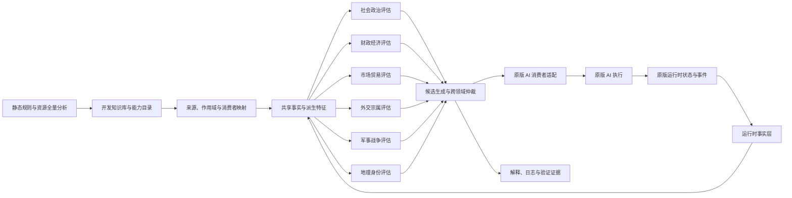

# 03 · 处境决策设计

> **状态**：2026-10-19，上一批 `2.0.0.dev0` 已冻结；本批将全域规则深化为生成期共享信号与战略意图图，候选升级 `2.0.0.dev1`，重验受影响 F0 后执行 F1。全量发现不等于全部运行时可读，引擎语义、行为质量、本地化实际显示和 F2 性能分别验收。实现边界、未新增能力与指纹见结果页。
> **适用范围**：Mod 行为、产品形式、信息覆盖、原版适配和机制验收。本设计落实 [Mod 开发原则](../principles/Mod开发原则.md)，并共同遵守 [工程原则](../principles/工程原则.md)；工具契约使用 [工程基线 1.0](exec/工程基线-1.0.md)。
> **实施入口**：[Mod 全目标实现优先与集中验证计划 6.0](exec/mod重设计-实施计划.md) 统一管理 F0–F2、C0–C9、M1–M4、回退、可玩候选和发布；实验和进度更新到结果页，未完成项见 [backlog](backlog.md) 的“mod 重设计”节。

## 1. 目标与产品形式

让 Victoria 3 的 AI 国家尽可能利用游戏中可观察、可表达、可验证的内部和外部因素，在政治、人口、财政、行政、经济、产业、资源、科技、市场、贸易、外交、军事、战争、宗属、殖民、地理和国家身份等方面作出更合理的选择，并随世界状态变化重新评估。

“更合理”指在当前游戏版本公开可读取的信息、原版允许的候选和明确约束内改善选择。产品不承诺读取不可见的 C++ 内部状态、不承诺全局最优、完整长期预测或永远正确。有限理性保留信息不足、政治摩擦、风险、资源限制和路线惯性。

产品保持后台自治和原版 AI 执行系统。玩家不需要安装 Python、运行外部服务或逐国下达大量命令。Python 只用于开发期分析、配置、生成、测试和证据处理；游戏运行时加载标准脚本和本地化。Mod 不使用免费收入、部队、资源、资格、强制行动或固定国家剧本伪造决策改善。

### 1.1 全域处境驱动国家决策扩展 2.0

2.0 由全量信息目录、运行时事实层、领域评估器、跨领域仲裁、原版消费者适配、解释和交付层组成。F0 先写出完整目标候选，F1 集中验证和修正，F2 完成性能、兼容和正式交付；任务顺序和阶段出口只在主计划维护。

| 决策面 | 需要综合的处境 | 可影响的原版决策 |
|---|---|---|
| 社会与政治 | 人口、文化、宗教、阶层、生活水平、合法性、利益集团、政治运动和法律 | 改革资格、法律倾向、稳定和政府路线 |
| 财政与行政 | 收入、支出、债务、利息、信用、税收、行政力和机构成本 | 发展、军费、改革、外交承诺和危机响应 |
| 经济与产业 | 建筑、生产方式、投入/产出、工资、利润、就业、资源和科技 | 建设、产业、研发、商品生产和支出平衡 |
| 市场与贸易 | 价格、供需、短缺、路线、关税、护航、封锁、依赖和替代 | 生产、贸易、军需、外交和市场路线 |
| 外交与宗属 | 关系、条约、博弈、威胁、盟友、宗主/属国、自治和依赖 | 支持、目标、保护、合作、独立和退出 |
| 军事与战争 | 兵力、编制、装备、训练、补给、前线、占领、战损、目标和战争负担 | 军费、军力、军事结构、目标、行动和战争承受力 |
| 殖民、地理与身份 | 殖民、海外资源、地形、交通、战略位置、时间和国家长期偏好 | 目标范围、路线偏好、重评估频率和海外行动 |

模块名不构成功能实现。每项信息必须进入能力目录，并标记 `discovered`、`runtime_readable`、`derived`、`consumer_mapped`、`behavior_verified` 或 `unsupported`。没有可靠运行时入口或原版消费者的目标保留缺口和替代方案，不通过改名或增加空策略宣称完成。

## 2. 核心架构

静态分析负责尽可能完整地发现规则和接口；运行时事实层只读取游戏公开可用的状态；领域评估器生成有类型的候选；仲裁层先过滤硬约束，再比较收益、成本、风险、政治阻力和国家身份；原版适配层只写入已确认的消费者。任何一层未确认的引擎契约都保留为假设或缺口。

### 2.1 事实、偏好、约束和证据分离

| 信息 | 内容 | 使用边界 |
|---|---|---|
| 事实 | 国家、人口、政治、财政、经济、市场、外交、军事和世界状态 | 标注来源、作用域、版本、更新方式、单位和未知值 |
| 偏好 | 存续、稳定、发展、安全、威望、贸易独立和身份目标 | 明示设计假设；不把证据等级当偏好权重 |
| 约束 | 资源不足、政治阻力、成本、风险和执行条件 | 区分不可行条件与软代价，不能绕过原版资格 |
| 候选 | 可行路线、目标、时机和退出条件 | 记录收益、成本、风险、置信度、期限和所有者 |
| 证据 | 官方资料、脚本事实、静态推断、模拟、实机读数和行为结果 | 表示结论边界，不直接改变运行时偏好 |

未知信息不得静默当作安全或零风险。每个输出必须声明单位、范围、合并/覆盖语义、唯一写入者、失效条件、解释键和回退路径。

### 2.2 跨领域仲裁

仲裁顺序为：约束过滤、候选匹配、字段优先级选择、原版消费者裁决。收益、成本、风险、政治和身份通过有单位的谓词与有界调整表达，不同量纲不直接相加。同一字段的债务、威胁、承诺或短缺不重复叠加；跨字段复用同一信号定义，各自沿原版消费者求值，不把统一定义写成全局结果缓存或总效用规划器。

军事安全、财政能力、经济发展、政治稳定、外交代价和国家身份可以冲突。仲裁必须保留最低生存防御、正常有利行动、改革可能性和合理路线惯性，不能统一回落为永远中立、永久停止改革或无成本扩张。

### 2.3 运行时更新与性能

本次采用**生成期协调、运行期原版求值**：`strategic.toml` 统一声明领域信号，意图通过无环依赖组合信号，再由规则声明实际消费者。财政恢复、流动性恢复、稳定、可负担发展、支持充足的发展和战时防御是非排他的当前约束，不是持久化国家战略槽。财政恢复约束非必要和平承诺；战时防御可与违约并存；正常改革和有利合作仍有明确正例，不设置全国家统一的永久保守顺序。

意图在生成时展开、去重并验证事实单位、作用域与已有谓词预算；共享源和生成器指纹进入标准包。每个意图必须有实际规则消费者。生成后的脚本只读取本次原版消费者所需输入，仍按字段优先级只执行一条完整调整；高优先级未知不被低优先级猜测越过。不同字段复用同一信号定义并不意味着游戏全局只调用一次 getter。此方案避免额外轮询、世界扫描、TTL 和保存状态，同时将跨字段约束集中维护。

默认策略新增 getter 的静态依据来自适配器已经规范化并校验 SHA 的锁定原件；不能因默认底本没有该词就删掉行政约束，也不能传未校验文本冒充来源。来源、生成期推断和真实引擎签名继续分别声明，实际有效性留 F1。

开发期静态分析允许全面扫描；游戏运行期按高频、中频、低频和事件触发分层：战争、财政危机和重大短缺高频响应；政治、市场、建设和贸易中频刷新；人口、科技、制度、殖民和身份低频刷新；政府变化、法律通过、战争开始、违约、贸易中断和革命触发立即重评估。

热路径不遍历全世界。昂贵计算只有在明确收益时缓存，并声明失效条件；历史状态有期限和数量上限；缺少事件入口时使用有界低频兜底。不添加外部 Python 常驻服务，不用降低必要重评估、隐藏失败或破坏清理换取速度。

### 2.4 原版兼容与回退

优先使用原版已有消费者和追加式命名空间；必须覆盖时由生成器从锁定底本产生最小补丁并检查版本漂移。字段不可读、消费者缺失、版本不匹配或运行时异常时回退原版路径。保留原版资格、资源成本、失败语义、战争、法律、保存和玩家行为；文件恢复不撤销已经发生的世界变化。

### 2.5 解释和证据

解释只呈现实际使用的事实、规则、参数和重评估条件。输入、候选路线、实际持牌、实际行动和结果分别记录；策略切换、评分变化、脚本强制机会、根 hook、加载成功和工程测试都不能单独证明行为质量。

## 3. 引擎能力与当前实现边界

`integrated` 的本批候选为 2.0.0.dev1：`information.toml` 声明通用处境，`adapters.toml` 声明锁定原件、产业配方相关读取器与消费者，`strategic.toml` 统一跨字段信号与意图依赖。`decision_intents` 验证和展开有界依赖图；`decision_rules` 提供 Reader/Predicate/Rule/RuleSet、共享条件、同单位相对比较和唯一写入；`decision_interfaces` 校验有限作用域、单位和原版安全插入位置；`decision_adapters` 与 `production_inputs` 从原件生成最小权重补丁与配方合同；`candidate_coverage` 把实际 metadata 连接回完整信息目录。所有参数、说明及离线参考均来自实际源，未连接生成器的骨架不保留。

当前实现是**结合公共事实的有限规则评估与原版执行适配**。原版先提供候选和世界约束，新增条件联合比较财政、政治能力、产业投入、市场/军需、相对实力及身份机会，同字段按优先级选择一条完整调整，最后保留原版拒绝、折扣、限幅和特殊尾项。它不实现独立的全球候选搜索、数值总效用或精确长期预测；最终最优性、行动质量及路线惯性须由 F1 正反例确认。

新增规则没有持久状态、外部服务、世界扫描或周期 hook，按原版消费者求值。财政旧模块仍有原生命周期；不能为勾选 TTL 凭空增加状态。上文刷新层级是有状态/昂贵扩展的设计约束；本候选直接读取不引入另一层轮询缓存。共享条件统一定义但按字段求值，不能宣称全局只计算一次或整个世界只有一次 getter 调用。

原版默认策略及实际法律、科技、建筑等文件使用锁定版本最小补丁，同路径覆盖存在更新成本；原件或定位漂移拒绝生成。已经安装的旧包无法自动检测新版本，升级前需停用并重新生成。`full` 保留旧七模块身份，不外推新候选证据。

已知保留与限制逐项见[结果页](exec/完整候选-结果.md#2026-10-19-f0-全域候选收口)：税率枚举、意识形态、补贴制度和战斗世界规则继续原版；直接 PM 切换、逐企业利润预测、独立贸易路线规划、完整战争伤亡预测没有新增求解器，不把这些能力写成已经实现或无接口。产业成本、商品立场、目标/军需/政治权重是明确的间接途径。

11 种本体语言的自有键、州价值理由及包内规则说明由标准链生成；游戏内显示和语义仍待 F1。解释面板保持临时探针，标准 `Situated AI` 包不含探针。所有旧实验档案按原版本、输入和指纹解释，不能外推为 2.0 行为质量。

以下是旧实验档案的静态核对。它们隔离在 `mod/legacy/`，不进入生产包，仍按其游戏版本与条件复现。

| 已核对内容 | 依据 | 对新设计的影响 |
|---|---|---|
| 九份档案中正式冲击钩子当前主要接通俄罗斯；两条路径只调用 shock | [俄罗斯 on_action](../../mod/legacy/common/on_actions/sitai_ru_defeat_on_actions.txt) | 档案数不作为通用动态行为覆盖数 |
| 改革输入独立定义，没有接到真实战败 shock；投降叠加施加时检查变量，期限为十年 | [俄罗斯效果](../../mod/legacy/common/scripted_effects/sitai_ru_defeat_effects.txt) | 接线、时限及注释不一致先列入迁移欠账 |
| 俄罗斯旧政治牌保留；曾新增的压力外交牌已撤回 | [俄罗斯政治牌](../../mod/legacy/common/ai_strategies/sitai_ru_defeat_agenda.txt) | 旧政治牌不进入生产闭环；`possible` 不能证明持有后退出 |
| JE 在合法性同一边界开关，开窗递进步牌、完成递反动牌 | [俄罗斯 JE](../../mod/legacy/common/journal_entries/sitai_ru_defeat_window.txt) | 新设计补迟滞和当前状态重评估 |
| 现有重抽节奏 defines 对所有国家生效 | [节奏配置](../../mod/legacy/common/defines/sitai_ru_defeat_tempo.txt) | 新实验统一对照配置，正式方案不默认沿用 |
| objectives 的 tier 表示落地与证据等级 | [目标表实现](../../src/pdx/objectives.py) | 保留审计用途，运行时偏好另行设计 |
| 原版读具名变量与 JE，不会自动读取任意新增状态 | [backlog 的 B52](backlog.md) | 新状态必须有实际读取者和效果验证 |
| 存在策略字段与运行时 set_strategy；部分字段具有目标作用域 | [AI 策略字段参考](../victoria3-modding/10-AI策略字段参考.md) | 逐接口测效果，不承诺接管 C++ 内部执行 |

所有“已接通”“有效”结论以可执行块和实机记录为准。注释与代码冲突时先记录问题，
不因旧说明使用了“正式”“完成”等词就越过证据边界。

## 4. 工程复用与迁移

继续使用现有分析、快照、Python 生成器、CI、测试、打包、部署、性能工具和实机自动化。新机制只增量适配信息目录、数据契约、生成模板、领域评估器、仲裁规则和行为判据；不建立新的常驻服务、重复阶段数据库或没有消费者的通用框架。

当前生产源仍由 `mod/decisions/` 下显式接入的 TOML 和 `src/pdx/` 生成器维护；新配置不会自动发现，必须显式接入、校验、生成和测试。`mod/data/*.toml` 只生成至 `mod/legacy/`。旧实验资产和旧结果按原版本、源指纹、输入和证据边界保留，不自动成为 2.0 正式规则。

迁移逐领域进行，明确旧逻辑停止生效的时间、旧变量和修正如何处理、哪些实验需要重跑。生成文档描述当前产物，手写设计文档描述目标和理由；两者不混用。每个 F1 验证通过的领域都可以生成累计可玩候选，并保留上一版回退点。

## 5. 验收与反事实

| 层级 | 要证明 | 不能据此宣称 |
|---|---|---|
| 工程正确性 | 数据校验、生成一致性、引用、编码和跨平台工具正常 | 游戏运行期接口已经有效 |
| 信息与接口 | 状态读法、作用域、单位和策略字段确实被游戏使用 | 完整路线已经更优 |
| 行为因果 | 受控输入变化导致符合事前假设的实际行动变化 | 一次换牌、评分变化或开窗足够证明成功 |
| 质量与稳定性 | 正常机会改善、风险合理、身份差异和生命周期成立 | 更凶、更难或日志更多就是更聪明 |
| 性能与维护 | 后期、长期和压力场景开销可接受，迁移和恢复可靠 | Python 基准可以替代游戏测量 |

离线测试覆盖边界、未知输入、重复触发、冲突、迟滞、冷却、缓存失效和规则性质；参考模型必须与生成脚本保持等价。实机使用匹配版本、检查点、挂载、输入、探针和时间窗口，对照和候选分别记录资格、机会、实际持牌、实际行动、代价、收益、不利结果、无变化和反例。

无法表达的能力必须明确登记为 `unsupported`，说明影响和替代方案。不能通过降低目标、改写指标、延长阴性窗口、拼接不同会话或把诊断结果写成质量结论来完成验收。

## 6. 文档效力与设计变更

| 文档 | 当前用途 |
|---|---|
| [工程原则](../principles/工程原则.md)、[Mod 开发原则](../principles/Mod开发原则.md) | 持续工程与产品约束 |
| 本文件 | 当前信息覆盖、产品形式、架构和机制边界 |
| `exec/工程基线-1.0.md` | 工程检查、快照、实机、恢复和证据契约 |
| `exec/mod重设计-实施计划.md` | 6.0 的 F0–F2、C0–C9、M1–M4 和出口 |
| `exec/完整候选-结果.md` | 实测、失败、原始输入、修复和行为证据 |
| `当前工作清单.md` | 当前事实、阻塞、队列和下一动作 |
| `backlog.md` | 研究欠账、触发条件和未决问题 |
| `01-大方向.md`、`01a-依据与参考.md` | 历史方向和原始引用锚点 |

本设计替代旧的“四模块已实现”和“七模块字段即完成”口径，保留增强原版、无作弊、可解释、正确性优先、全量信息登记和可复现目标。设计变更必须记录理由、影响和验证方式；历史实验不得被新方案追认为未运行过的证据。
