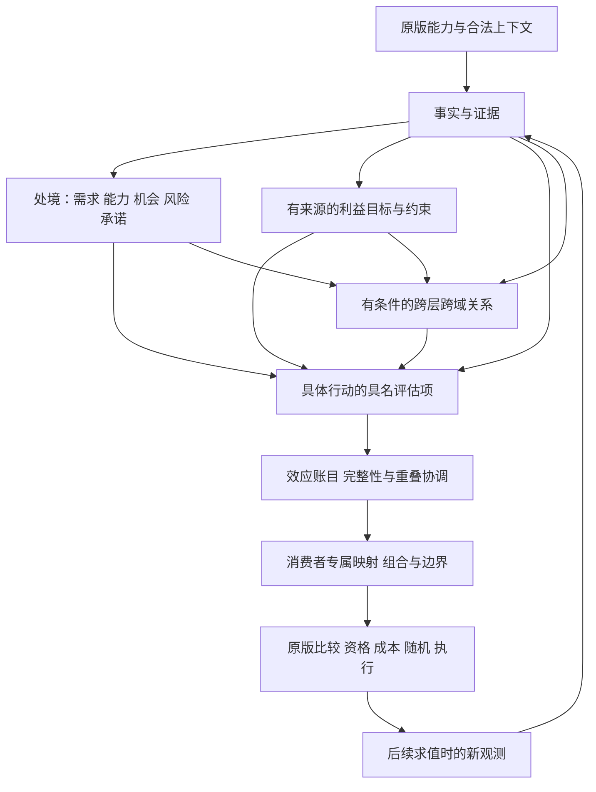

# Situated AI 1.15 架构设计

修订：R2，2026-11-10。目标底本：Victoria 3 **1.15.0**。本页是当前架构规范，R2 替代此前偏流水线的表达；不撤销已有代码与历史证据，也不签署实现完成。
实施顺序见[实施计划](exec/1.15架构-实施计划.md)，阶段状态唯一见[主计划](架构主计划.md)，接手事实见[工作清单](当前工作清单.md)。
遵守[Mod 开发原则](../principles/Mod开发原则.md)、[工程原则](../principles/工程原则.md)与[贡献流程](../../CONTRIBUTING.md)。

## 1. 目标与确定方案

**Situated AI 让每个国家基于自身处境和可观测信息，在原版机制内持续做出符合自身约束与利益的相对最优决策。**

采用 **行动中心、消费者收敛的分层决策网络**：七层划分职责，具名、有类型且可降低的有向无环图表达本次决策依赖；领域模块提供纵向能力，版本适配隔离原版差异。
事实、处境、利益和已观察承诺中的有效依据可以独立参与具体行动，也可以逐层派生或有条件联动。所有路径经过行动评估与效应协调，在精确原版消费者处形成一次有界自有调整。

“独立”不是每层都拥有写权或不需要必要条件；“联动”不是任意字段互乘；“统一”不是所有国家采用同一路线。
相对最优的比较边界是原版消费者实际提供的合法候选，原版仍负责资格、真实资源、随机和执行。国家级一致性来自共享事实、利益、因果和约束，不来自虚构全国总调度。

本轮确定设计和更新计划，不修改 Mod 生产逻辑、不重生成包、不部署。架构阶段必须实现下述合同并以真实纵切证明，不将所有领域深化提前纳入。
“最终方案”指已确定的实施基准，不承诺永远不修改；后续变更必须有原版证据、取舍和需求影响记录。

## 2. 发散比较与收敛理由

| 方案 | 值得保留的优点 | 决定性问题 | 选择 |
|---|---|---|---|
| 领域各自打补丁 | 接入快、局部直观 | 重复因果、多作者覆盖、联动靠私有旁路 | 拒绝作为骨架 |
| 严格逐层流水线 | 顺序简单、验证容易 | 简单事实也被迫经过全部层；独立依据和横向联动难表达 | 仅保留为工程构建流程 |
| 共享黑板／通用规则引擎 | 灵活共享、多方推理 | 可变状态、规则先后、隐式反馈与性能难审查 | 仅借鉴不可变事实索引 |
| 全国规划器／全局效用预算 | 容易表达统一战略 | 原版控制权不足；异量纲、虚假预留、全局扫描、强制路线 | 拒绝 |
| 行动中心的类型化依赖网络 | 短路径、派生与联动并存；依赖和输出可验证 | 前期合同较重；图本身不能证明政策合理或引擎执行 | **采用** |

取舍次序：原版语义与信息诚实 → 真实生产可验证 → 冲突和局部退化正确 → 扩展与解释 → 复杂度和成本。
网络不引入图数据库、自动因果发现、通用任意代码插件、在线 Python、全知预测或默认持久记忆。最简单行动只需一条已证实贡献；复杂性由实际决策需要承担。

## 3. 两个系统与三张图

### 3.1 工程结构

工程部分负责正确、可复现地开发与交付；Mod 部分负责如何依据国家处境评估行动。工程绿灯不能代替功能接线，产品模型也不能代替工程门禁。
这张图是构建过程，不是游戏中运行的 Python 服务。

### 3.2 决策结构

图中的反馈跨越真实执行与后续观测；不是同轮循环推理。图中收益和关系只是模型判断，不能成为“行动已成功”的事实。

### 3.3 职责层与领域

| 层 | 提供什么 | 不能做什么 |
|---|---|---|
| L0 版本与能力 | 版本身份、可读可写能力、合法时机与范围 | 根据领域或国名制定政策 |
| L1 上下文与证据 | 精确对象、来源、单位、值、已知性与时间 | 缺失填零、候选当结果 |
| L2 处境与利益视图 | 独立的需求、能力、机会、风险、承诺及有来源的目标 | 全国唯一路线、目标名称直接加分 |
| L3 行动评估 | 对具体原版机会表达收益、负担、风险和适用条件 | 强制执行、伪造原版资格 |
| L4 因果与关系协调 | 效应账目、重叠、交互、完整性、精确对象关系 | 任意改变其他域内部状态、跨消费者扣账 |
| L5 消费者组合 | 专属尺度映射、唯一写者、组合代数与边界 | 不同消费者合成一个全国赢家 |
| L6 版本适配与降低 | 合法脚本、原版结构保护、精确来源映射 | 偷改政策、绕过未支持能力 |

领域是贯穿这些职责的能力包，不是第八层。经济、政治、外交等只能通过公开事实、行动和关系合同连接，不能互读私有实现或拼接 PDX。
层不等于大文件、服务或固定调用顺序；L0/L6 等工程边界不产生政策分。依赖拓扑允许同层或跨层引用，但不得越过类型、对象、时间和单写者规则。

## 4. 三种影响路径与组合语义

| 路径 | 最小结构 | 成立条件 |
|---|---|---|
| 独立 `direct` | 事实或已知处境 → 具名行动项 | 本项必要证据和成本完整，不依赖无关层就绪 |
| 派生 `derived` | 事实 → 处境／目标解释 → 行动项 | 每一步显式依赖、单位与出处可追踪，不重复奖励中间节点 |
| 交互 `interaction` | 多项条件／已观察关系 → 额外行动效应 | 具名稀疏关系、对象映射、额外效应或替代范围清楚 |

三类路径最终都经 `ActionBridge`，这是公开的行动评估项到效应贡献的语义边界，不允许所谓直接路径绕过成本或消费者合同。
同一行动可混用三条路径；并不要求每个行动都凑齐三种。相同语义以短路径或派生路径表达时，结果应等价，增加层数不增加奖励。

例如道路维护：当前州的交通缺口可以独立支持行动；已证实地方生产事实可以派生运输机会；额外且已观察的供应暴露可以形成交互。
国家承受能力只对相关行动的真实负担起作用。缺少供应观察只撤回对应交互；必需成本不完整时则处理整个相关收益成本组。
这是合同例子，财政、生产、供应 reader 在具体写点能否使用必须由 A0/A4 证明，不能由例子授予读权。

## 5. 行动、目标和约束

`ActionDefinition` 代表原版机会类型，`ActionInstance` 代表 actor、精确候选 target、consumer 和本次时间身份；规则强弱档只是行动内部评估变体。
行动实例键必须包含行动定义 ID、精确物理消费者、完整候选绑定签名和本轮求值身份；能区分候选的建筑、模式、法律及辅助实体都进入签名。
稳定 `EffectAccount` 与本轮 `EffectInstance` 分开，后者绑定行动实例、求值时间和必要资源／后果对象。默认只在同一行动实例内去重；跨候选去重需另有合法联合程序证明。
“州 X 的道路维护”是行动，`road-severe` 是评估档，二者不可混同。消费者候选未暴露时只评估当前原版给定对象，不自行创造候选全集。

`ActorObjective` / `InterestSpec` 包含稳定 ID、适用主体与对象、可观察来源、期限、现状基准、冲突关系和消费者。目标只提供判断方向和比较语境，不能从目标名推出分数或国家固定路线。
处境与目标分开：低识字是需求依据，不证明学校投资一定可行；财政弱是相关负担，不证明没有教育需求。

约束分四类：原版硬资格（保留原版）、已证实语义适用条件、可降低能力条件、软成本／风险。只有前述明确的硬条件才能排除对应自有评价；软成本不可偷偷升级成全局禁令。
参考器对未知原版资格保留未知，不为生成成功伪造为真。原版成本结构已保留与 Mod 已评估边际负担是两项不同事实。

## 6. 效应账目、证据谱系与对立统一

### 6.1 两种身份

`EvidenceLineage` 记录规范事实根、reader 别名、派生边、actor/target、来源和时间。
`EffectAccount` 记录规范机制 ID、后果类别、actor/target 映射、consumer、单位、期限及比较基准。领域必须引用受审账目，不可仅换 `cause_id` 获得相加权。

共享证据是重叠警报，不自动意味着同一效果。同一战争事实可以支持军事需求和财政风险，两者应共同保留；同一交通缺口被三个模块重复描述不能计三次。
同义 reader 和表达式先规范化；新机制需提交与现有账目的重叠分析和反例。编译器不能自动证明现实因果独立，语义审查是显式验收责任。
不明重叠拒绝累加，必须明确为别名、同因分档、显式替代、残差或有证据独立；不得用通用 `max` 掩盖普通重叠。

### 6.2 三种组合与原版基线

- 同一效应的强弱档：取最强**已证实**适用档，未知高档不抹掉已知低档。
- 不同效应：各自保留收益、负担与风险，经消费者专属映射共同参与。
- 联合完整估值：显式替代其覆盖的基础项；若基础项继续参与，交互只提交未包含的额外残差。

例：基础收益 3、联合完整估值 5，只能取完整 5，或基础 3 加残差 2，不能得到 8。这是无单位教学例，生产数值必须由唯一政策声明给出。
残差必须在同一消费者的规范组合代数中定义，并具有相同对象、目标、期限和基准。加法残差是已映射完整值减已映射基础值；
乘法残差是已映射完整因子与基础因子的比值，须证明基础非零及有效域。非线性映射下不允许先减原始收益再映射，
也不允许把乘法因子的差当作可叠加因子。无法证明分解、逆运算或所需操作合法时，只能采用完整替代。
替代范围在编译时可查；嵌套或重叠替代必须可证明互斥并有唯一选择，否则拒绝。
静态覆盖范围不等于本次激活范围。替代只有在适用条件已知成立、完整估值已知且完整性组通过时才激活；否则重新保留仍满足自身完整性的基础集合。
基础项恢复不得越过必需成本未知的边界；残差和完整替代对相同未知输入必须有退化等价见证。
同效应相反估值若对应互斥情境须证明互斥；矛盾证据进入冲突／未知处置，不能正负抵消伪装成已知结论。

每一项都声明相对原版的关系：新增考虑、条件修正或有意再权重。原版已计入的负担不能无依据再罚；重新加权需有意图、插入位置和反例，不能把重复包装为新机制。

### 6.3 收益成本完整性

`AssessmentGroup` 将一项决策主张所必需的收益、成本和交互绑定为完整性组。必需成本未知时，仅可使用有来源且保守的界或已证明的低档；否则撤回本组自有调整，原版继续。
可用低档必须是一套自身完整性成立的评估，不能只减小奖励或留下部分轻度成本。若低档仍缺必需成本，则须有与消费者映射方向一致、对明确风险／偏好命题成立的保守界，否则仍撤回整组。
不能只删负贡献留下奖励；也不能让无关成本未知关闭其他已知独立组。组边界必须审查，不能通过把必需成本改名为“辅助”逃避完整性。
无额外成本读取要求也需说明依据，例如纯原版评分修正且不声称完成负担评估；这类演示不能代签多目标成本纵切。

同一候选为多个目标服务，其同一边际成本只计一次；不同候选各承担自己的成本，不能因另一候选“扣过”而免费。
跨消费者分别表达相关软负担，不建立真实资源总账、互斥执行或预算预留。保留对立项的独立解释，统一的是对象、证据、效应账目和输出规则。

## 7. 类型、未知、关系和时间

所有公开声明采用版本化严格模式；未知字段、重复 ID、非法枚举、非有限数、单位错配、对象串接和环在构建边界失败。
货币／周、人数、比例、布尔、制度等级、消费者分数不可直接相加；映射必须声明消费者、方向、定义域、期限、现状基准及反例。
不能根据正分猜它是收益、负分猜它是成本。映射后的方向与语义角色分别保留。

`known / unknown / stale / unsupported / invalid` 分别记录。unsupported 需能力证据；尚未研究或未实现不等于不支持；invalid 不可静默转 unknown。
布尔采用三值逻辑，条件已知为假与条件未知分别解释。未知不自动否决原版行动，只按依赖和完整性范围撤回自有评价。
增加细化层或关闭辅助模块，在相同输入下不能无故删除已证实独立项；有意替代必须显式声明并验证。

关系限定为事实派生、条件交互、已观察承诺、风险外溢和受支持的同消费者替代／竞争；每条边都有实体映射、来源、时间和影响范围。
同轮图必须为 DAG；环报告完整路径。真实反馈只能跨“执行→新观测”，候选高分、资格或意图不能证明供给改善、改革通过或战争胜利。
不一致时点不能拼成“同一快照”。默认按原版消费者求值时即时读取，不新增国家 tick、世界扫描或持久状态。
Python 增量重算只是参考能力；只有合法钩子、刷新与失效路径生成并有证据时，才能声称相应游戏时序已实现。

长期目标和惯性优先读取真实法律、既有能力及已发生承诺。默认不新增持久记忆；未来新增需独立价值、唯一写者、合法生命周期、TTL、重置、升级、卸载与存档证明。

## 8. 消费者程序与降低边界

每个消费者记录候选来源、上下文、可用事实、单位、操作、neutral、平局／随机／零分、原版基线和选择见证。
Pareto 或排序可作为独立参考；原版没有暴露同候选比较能力时，不生成一个虚构的运行时比较器。只能输出已证明的局部偏好。
加法与乘法不直接混算；需要转换时由消费者适配声明顺序与依据。同一物理字段只有一个 writer，领域提交贡献而不各写字段。

先处理完整性、重复与替代，再组合独立正负项，最后在声明的位置一次限制自有输出。**插入处的增量界与完整原版算式后的有效影响界分开记录**；后续原版乘法可能放大、乘零或后置加项恢复，不能声称二者相同。
全块独立解释或足够的结构分解证明应覆盖该影响；若无法得到最终统一界，明确条件界与尾部而不伪报全局保证。

支持矩阵为每种节点／算子／关系×消费者标记 `reference_only / lowerable / production_bound`，附适配器、合法上下文与见证；仅 production_bound 可在该消费者生产启用。
目标、处境与谱系可被编译展开消去，但必须有源映射和等价证明，不能因游戏包中没有类型对象就断言未接入，也不能以构建时合成快照通过代替降低证明。

## 9. 三纵切与扩展检验

当前已冻结的真实写点见[三纵切合同](exec/1.15-A0-纵切合同.md)，底本依据见[勘察](1.15底本勘察.md)。它们是待复核输入，不是 R2 全部出口的完成证据。

| 纵切 | 可复用起点 | R2 要证明的能力与风险 |
|---|---|---|
| 地方道路维护 | 同州基础设施读数、法令状态与完整原版权重块 | 真实行动与档位分离，direct/derived 等价，同因别名去重，恢复与需求、原版乘零和后置例外 |
| 学校制度分量 | 默认策略、教育议程和非默认策略原文 | 目标来源、真实多目标收益成本组、行政／财政与需求分离、活跃策略合成边界；低识字等未重证读数不得假启用 |
| 双边改善关系 | actor-target 态度与提议评分 | 对象定向、具名交互与已有承诺、机会成本、评分不等于实际提议或关系已改善；保留 will_propose 与概率 |

学校与外交若在当前写点不能合法表达必需的成本或跨域关系，先研究额外合法事实；仍不足时提出有原版证据的最小写点扩展及影响分析，在 A0 范围记录中决定后再实现。
这允许为完成原目标选择真实适配，不允许用合成 fixture、空接口、虚标 unsupported 或改目标来关闭缺口。找不到合法形态时阶段保持未完成。

R2 至少需要：三路径各自及混用的真实生产见证、一项收益成本相反权衡、一项已观察跨域关系、两对象差异与冲击／恢复序列、非默认策略保护。
可由少量纵切共同覆盖，不要求每个消费者都支持所有算子；每个实际启用的算子和写点仍须单独证明。25领域仅目标，不借架构深化开展全域调参。

## 10. 模块、配置、兼容与成本

建议沿用并拆清现有入口，以下是实施职责，不声称现在已存在同名新类型：

| 入口 | R2 职责 |
|---|---|
| `situated/core_contracts.py`、`schema.py`、`domain_registry.py` | 身份、能力、严格模式、配置、完整性及效应公共合同 |
| `situated/semantic_core.py`、`expressions.py`、`state.py` | 纯派生、利益与行动评估，消费唯一声明 |
| `situated/relations.py`、`programs.py` | 关系、规范效应账目、重叠协调与消费者程序；必要时按职责拆小模块 |
| `situated/ir.py`、`decision_ir.py`、`compiler.py` | 唯一语义模型到已验证程序，legacy 桥接与支持矩阵 |
| `situated/production_profile.py`、`decision_adapters.py` | 版本适配；逐步把当前混合政策与适配职责分离 |
| `mod/decisions/` | 政策、机制映射、事实和领域声明的唯一来源；核心不硬编码领域阈值 |
| `distribution.py`、`cli.py`、`tools/ci/` | 统一配置到生成／包／审计的接线、事务、版本门禁、完整依赖锁 |

编译器拒绝领域私有脚本、双写者、能力不足与循环。新增普通领域只增加声明、绑定和见证；新消费者可增加适配，新语义算子必须升级核心并回归旧见证。
兼容层逐项登记调用方与退役条件，不能另保留第二套政策。真实能力变化需要模式修订，显示名称和文件顺序变化不能改变语义身份。

配置由一份类型化声明解析，CLI、参考、生成、锁和包说明消费同一解析结果；关闭模块同时处理依赖，不能只移除 guard 却保留无条件贡献。
DLC 内容存在、授权与脚本可用分别证明；缺失时局部不生成。默认及非默认策略的写点与合并关系分别记录；第三方兼容分为未分析、无交集、冲突和已验证适配。
玩家路径保持原版；新局、同版存档、跨版升级和卸载分别声明。无持久变量不证明存档绝对安全，卸载也不撤销世界已发生变化。
所有支持语言的自有键、头、占位符与编码保持一致；无自有可见键时证明空集合，不伪造译文或继承旧语言数量。

交互具名且稀疏，不自动全配对或展开全部条件子集。预算在 A0 先固定查询形态和基线，A5 同口径测量节点、扇出、深度、重复读取、scope、对象展开和脚本字节。
现三纵切的零新增全局扫描、零候选笛卡尔积等约束继续有效；允许结构变化先做等价重构与预算差异审查，不能按生成结果倒定通过线。
超限失败并优化，末端限幅不能掩盖无限堆规则。构建墙钟／进程树 RSS 与游戏求值成本分别报告，不承诺从 Python 提速推出游戏提速。

## 11. 稳定需求与反例矩阵

以下 ID 是规范需求，不是完成率。阶段证据必须关联输入／源码／配置／底本／工具／产物身份及实际运行命令；详细当前状态只在主计划与接手清单维护。

| ID | 必须满足的要求 | 必须能发现的反例 | 责任阶段 |
|---|---|---|---|
| SAI-01 | 独立版本分母、国家全集和逐项处置 | 新内容、动态主体、解析失败被静默排除 | A0 |
| SAI-02 | 精确对象、作用域、单位、来源和时间 | 州 A 事实串到州 B，来源不匹配、bool 当数字 | A0–A2 |
| SAI-03 | direct/derived/interaction 各自及混用可生产降低 | 强制逐层、缺辅助事实抹已知独立项 | A1–A5 |
| SAI-04 | 真实行动与变体分离，唯一声明经 ActionBridge | 合成 gate 通过、实际 lower 使用另一份政策 | A1–A4 |
| SAI-05 | 国家目标有来源、期限、基准，软硬约束区分 | 国名选路线、目标名加分、软成本全国否决 | A1–A5 |
| SAI-06 | 效应账目与谱系分开，别名和重叠受审 | 换 cause_id 加分，战争证据的不同后果被误删 | A1–A3 |
| SAI-07 | 残差／替代／分档语义明确 | 基础3加完整5成8，普通重叠任意取max | A3–A5 |
| SAI-08 | 收益必需成本完整性组及局部未知 | 成本未知只留奖励，另一候选被免成本 | A2–A5 |
| SAI-09 | 有类型、对象与时间明确的跨域 DAG | 候选贸易当已实现供给、同轮环和幽灵承诺 | A1–A5 |
| SAI-10 | 消费者专属映射与选择见证 | 跨单位求总分、参考Pareto冒充引擎算法 | A1–A5 |
| SAI-11 | 唯一作者、代数和插入／有效影响边界 | 尾部乘法放大却仍称最终仅+4、覆盖零值例外 | A3–A4 |
| SAI-12 | 支持矩阵、来源映射与独立PDX/native证明 | reference_only启用、同求值器调用两次自证 | A1–A6 |
| SAI-13 | 合法按需刷新、时效、失效与反馈 | Python缓存冒充游戏重评、旧新事实拼接 | A1–A5 |
| SAI-14 | 配置、模块和DLC能力统一接线 | 包入口忽略开关、缺依赖只剥guard | A1–A5 |
| SAI-15 | 活跃策略、玩家、第三方及存档边界 | 默认分量冒充最终合计、无状态冒充安全 | A0–A6 |
| SAI-16 | 稀疏有界图与先定预算、同口径测量 | 自动全配对、超限后改门限、静态代签引擎性能 | A0–A5 |
| SAI-17 | 扩展只走公开合同、单源与兼容退役 | 新域改核心阈值、旧state副本继续旁路 | A1–A6 |
| SAI-18 | 全部支持语言和自有键合同 | 旧数量代替新分母、空键伪造完成译文 | A0–A6 |
| SAI-19 | 完整版本门禁、锁、事务、wheel与确定性包 | 缩哈希闭包、失败覆盖旧产物、包混入探针 | A4–A6 |
| SAI-20 | 分别签署工程、Mod功能与运行证据 | 测试数代签功能、未结束回归计通过、实现缺口推给用户 | 全阶段 |

比较性质至少包含：规则／文件重排等价、别名重命名等价、direct/derived等价、同因强档不叠加、残差与替代等价、未知的依赖局部性、配置关闭等价原版。
有意细化替代可能改变输出，必须注明覆盖范围和理由；不得把“更详细”当作自动正确。

## 12. 验收、当前资产与演进

| 证据／门禁 | 要证明什么 | 无法代替什么 |
|---|---|---|
| 工程 E | 正确工具、完整回归、编码、锁、事务与包 | Mod 全部功能接线 |
| Mod 静态功能 M | 每项声明→语义→生成→物理写点，独立预期与原版保护 | 实际引擎执行 |
| 运行执行 R | 具体消费者时机、作用域、合并与跨时点行为的实测命题 | 长期效果与总体最优 |
| 长期体验 U | 用户固定包上的行为质量、平衡、游戏性能与体验 | E/M 缺口 |

E 和 M 全部通过才可签署架构静态完成。R 可因无实机材料保持未验证，但生产启用的合法性必须已获得足够原版依据；缺合法读权不得先启用再交给用户试玩。
用户负责长期体验验收；助手负责实现与静态证据、明确 R 命题、准备复现材料及分析已有证据。没有运行材料不要求默认开启探针或后台任务。

独立验证可以完整解释消费者块，或证明原版 AST 保持＋新增片段等价＋插入组合语义的完整分解；后一种必须覆盖所有受影响的有序操作、零值、合并和尾部，不能仅验证增量数字。
完整引擎未知不妨碍诚实的有限静态证明，但不得把无法证明的命题写成已成立。

现有 `59764b2` 是候选资产，不是 R2 完成收据：有三写点生成、typed/reference核心、局部组合、包和定向测试；真实行动身份、完整性、效应注册、配置及所有三路径生产证明仍待复核／实现。
原版正负评分不是语义收益成本，合成快照不是实际观测，Python重算不是游戏增量通知；迁移时逐项纠正。
旧 A0/A3/A4/A5/A6 收据与 1.14.5 锁按原字节保留，当前纠正记录见[R2深化结果](exec/1.15架构深化-结果.md)。

旧版工程基线仍解释正式 3.2.0 / 1.14.5；A4 必须显式建立 1.15 当前合同和全量验收路由，历史保护不能靠刷新旧锁或跳过旧测试解除。
新旧测试应按真实输入版本重建可复核运行身份，完整门未通过则保持未完成；不以另加一条窄profile检查替代原定完整验收。

本设计确定后按 R2 的 A0–A6 依赖执行；代码、见证和包身份改变必须重新冻结受影响证据。以后增改机制先分析目标、效应重叠、能力、预算和验收影响，再演进模式。
