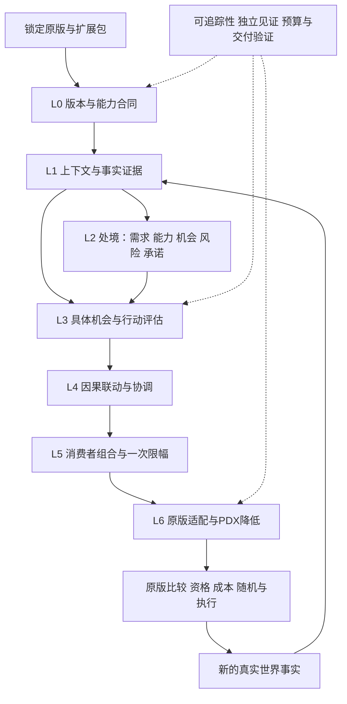

# Situated AI 1.15 架构设计

设计日期：2026-11-09。目标底本：Victoria 3 **1.15.0**。状态：设计提案，未实现、未发布。
本轮交付设计与计划；未来先实施[架构主计划](架构主计划.md)，[领域子计划](架构子计划.md)仅登记目标。
现有正式产品仍为 3.2.0 / 游戏 1.14.5，交付事实见[版本交付索引](exec/版本交付-结果.md)。

## 1. 目标与判断尺度

建立长期稳定的决策骨架，使国家在可观察事实、原版资格与实际能力约束内，持续形成可解释、有界、可扩展的行动偏好。
“最终架构”指核心职责、语义合同与演进规则能够长期承载后续领域深化；不声称存在已证明的全局最优、永久无需修改的实现，
也不以增加层数或规则数衡量优秀程度。架构取舍按以下顺序判断：

产品目标的国家主体通过绑定到该国家 actor 的一组原版消费者共同实现。相对最优只在同一消费者能够合法比较的候选集合内定义为有界相对偏好；
不同消费者之间保持并行、不可比的倾向，不虚构原版没有提供的国家级总调度、资源互斥或单一行动选择器。

1. 原版语义正确、玩家边界和未知回退可信。
2. 事实、行动、相反贡献与消费者之间可追踪，参考语义和实际 PDX 可独立核验。
3. 领域可独立扩展，扩展通过公开合同接入，核心不增长领域特例。
4. 跨领域联动有对象、因果、单位和时序依据，局部问题不会无依据升级为全国禁令。
5. 游戏消费者时机内可执行、成本有界，生成与交付可复现；实际游戏性能另行实测。

遵守[工程原则](../principles/工程原则.md)、[Mod 开发原则](../principles/Mod开发原则.md)及
[贡献流程](../../CONTRIBUTING.md)。本设计不替代这些规则。

## 2. 证据起点与旧实现取舍

1.15.0 的现场证据和限制见[底本勘察](1.15底本勘察.md)。当前只读勘察不是完整能力目录、兼容证明或引擎实测。
新架构必须重新盘点 1.15 的消费者、事实与合法作用域，不能将旧版枚举数量、默认策略字段或文档镜像直接作为新分母。

| 旧实现入口 | 保留的价值 | 新架构处理 |
|---|---|---|
| `src/pdx/lexer.py`、`parser.py`、`model.py` | PDX AST 与原始位置 | 对 1.15 语法验证后复用；不重写成熟解析底座 |
| `situated/decision_ir.py`、`compiler.py` | 单一语义 IR、精确上下文、原版尾部保护 | 保留合同思想，重新分离领域、语义、降低与原版适配职责 |
| `situated/programs.py` | 同因分档、独立贡献、一次限幅 | 明确类型与因果来源；禁止从正负号猜测经济意义 |
| `decision_adapters.py`、各机会模块 | 精确原版位置和候选对象 | 作为迁移线索，逐项在 1.15 重新证明 |
| `situated/state.py` 与 `mod/decisions/country_state.toml` | 能力与需求分离 | 消除手写规则副本；旧副本偏差见当前工作清单，不复制为新规范 |
| `distribution.py`、生成事务与生成锁 | 确定性包、路径/字节/底本保护 | 保留失败关闭和事务恢复；版本身份与产品语义拆分 |
| 现有领域 TOML、旧测试和收据 | 已知反例、领域知识、历史行为 | 不继承完成状态；分为重证迁移、原版保留、明确退役和待研究 |

“从零设计”是重新确立合同与边界，不要求丢弃正确工具，也不允许把旧规则机械搬入后声称新架构完成。

## 3. 方案比较与选择

| 方案 | 优点 | 主要代价 | 决策 |
|---|---|---|---|
| 按领域独立叠加原版补丁 | 初期迁移快，局部修改直观 | 多作者写同字段、因果重复、跨域耦合和回归成本高 | 不作为长期骨架 |
| 全国统一规划器与全局效用/预算 | 表面统一，容易表达长期愿景 | 引擎未必提供控制权；异量纲混算、虚假资源分配、全局扫描和排他路线风险 | 不采用 |
| 分层语义核心＋领域扩展＋版本适配 | 统一语义与验证，保留各域差异；消费者末端收敛 | 前期需建立严格上下文、类型和组合合同 | **采用** |

不建立在线 Python 调度器、全知世界模型或通用任意代码插件系统。构建期领域注册是显式、可审查、确定性的；运行包只有合法原版脚本。

## 4. 分层与依赖方向

层是职责边界，不要求每条规则穿越所有层，也不要求每层创建一个大文件。领域模块以纵向能力包连接这些层；
横向核心只定义数据、验证、组合和降低合同，不能以国家名称或领域名称分支编写政策。

| 层 | 输入 → 输出 | 唯一责任 | 不拥有的权限 |
|---|---|---|---|
| L0 版本与能力 | 原始文件、文档、DLC清单 → `CapabilityProfile`、`ConsumerSpec` | 确认什么可读、何时可读、什么可写、版本和证据身份 | 不推断引擎隐藏值，不自行决定政策 |
| L1 上下文与证据 | 精确消费者上下文、合法 reader → `Observation` | 对象身份、作用域、单位、已知性、时点及来源 | 不把缺失当零，不把候选当结果 |
| L2 处境 | 已知事实与派生表达 → `SituationFacet` | 分开描述需求、承受能力、机会、风险和已观察承诺 | 不产生全国唯一路线，不直接写权重 |
| L3 行动 | 具体候选、处境、行动合同 → `ActionAssessment` | 对该对象表达增量收益、成本、可行性依据与退出条件 | 不执行行动，不重新定义原版资格 |
| L4 联动协调 | 评估、已观察关系、因果声明 → `ContributionSet` | 去重、分档、条件联动、软竞争和已证实约束 | 不分配真实资源，不在候选得分间循环推断已发生变化 |
| L5 消费者组合 | 同一物理消费者内同单位贡献 → `ConsumerProgram` | 唯一写入所有权、组合顺序、消费者末端一次限幅 | 不跨消费者比较不可比得分，不吞掉原版尾项 |
| L6 适配与降低 | 已验证程序、1.15适配合同 → PDX与来源映射 | 精确插入、保留未改动部分、生成和包边界 | 不添加领域政策、不静默改底本或回退到旧文件 |

验证是横贯各层的工程能力，不是可以给决策加分的第七政策层。领域模块依赖核心公开合同；核心不反向导入具体领域。
版本适配只依赖语义类型与原版证据，不能反向决定国家政策。禁止领域互相读取私有实现或拼接 PDX 绕过 L5/L6。

## 5. 核心数据合同与扩展接口

以下为设计接口名，不表示仓库已有同名实现。序列化使用有版本的严格模式；未知字段、重复身份、非有限数、非法枚举和不兼容模式显式失败。
核心对象不可变；作者配置和派生结果分开保存，派生表、统计与指纹只能由生成器维护。

| 合同 | 必需语义字段 | 校验边界 |
|---|---|---|
| `CapabilityProfile` | 游戏/构建身份、输入哈希、DLC条件、接口模式版本、能力与证据状态 | 游戏版本字符串相同仍须核对依赖内容哈希；缺失不能由旧摘录补齐 |
| `EvaluationContext` | 消费者身份、actor、target/candidate、辅助对象、各对象种类与证据位置 | 国家、州、建筑、法律、商品、利益集团、编队等不能隐式互换；绑定缺失只影响依赖它的项 |
| `FactSpec` / `Observation` | reader身份、实体键、类型/单位、合法作用域、采集时机、已知性、来源、时效、值 | reader别名以规范身份去重；不能把任意confidence数字冒充已证实概率 |
| `SituationFacet` | 类别、依赖事实、带单位值或谓词、已知性、解释 | 能力与需求可并存；同一输入只能由一份表达式派生 |
| `ActionSpec` / `ActionAssessment` | 具体候选身份、目标向量、原版资格引用、硬条件依据、收益/成本项、退出、原版消费者 | 原版不可观察资格继续由原版决定；不伪造资格为true，不把软成本变成硬否决 |
| `ActorObjectiveSpec` / `InterestSpec` | 国家 actor 身份、可观察来源事实、适用对象、期限、现状基准、冲突/优先关系、绑定消费者 | 每个声明的国家利益必须能回到可观察事实并接入至少一个合法消费者；没有来源或接线只能标为未知/未接入 |
| `Contribution` | 原因ID、来源路径、事实与对象依赖、方向/单位、数值表达、强度档、未知策略、消费者ID | 每个独立原因明确声明；同一成本不能被基础项、状态层、关系层重复计算 |
| `RelationSpec` | 关系类型、两端语义、对象映射、条件事实、时序、因果ID、贡献作者 | 关系必须最终降低为有依据的贡献或约束；仅登记图边不算实现 |
| `ConsumerSpec` / `ConsumerProgram` | 物理定义与字段路径、求值上下文、操作、单位、neutral、组合顺序、边界、原版尾部 | 同一物理写点恰好一个作者；多领域只能提交贡献；同名但不同策略定义是不同写点 |
| `DomainManifest` | 模式版本、领域ID、提供/消费接口、事实/行动/关系声明、能力要求、对象预算、见证索引 | 禁止任意导入插件、运行时加载Python、跨域私有引用或自由脚本文本 |
| `ConfigurationSpec` | 配置ID、类型、默认值、有效组合、能力/模块依赖、关闭与回退语义 | 非法值或组合在配置校验边界显式失败；配置不能改写玩家资格或原版执行规则 |
| `SituationSnapshot` / `EvaluationSchedule` | actor/target、时间身份、维度与作用域、来源/新鲜度、合法触发、TTL、失效和幂等规则 | 每个消费者声明何时重评；引擎不能证明持续触发时标为unknown，不把静态循环图当成持续行为 |
| `SelectionWitness` | 消费者候选集合、硬资格、原版比较器、可比较目标、未知规则、neutral、平局/随机/全零语义、原版基线 | “相对最优”只证明该消费者原生比较中的有界偏好；跨消费者不得合成国家级赢家 |
| `LocalizationContract` | 1.15支持语言来源、自有键、语言头、占位符、生成路径与交付编码 | 语言分母独立核实；各语言键及占位符一致，不以旧版数量或未完成译文冒充支持 |
| `TraceRecord` / `BuildManifest` | 原始证据→规范身份→IR节点→PDX位置→见证、源码/底本/工具/包身份 | 解释基于真实参与项；失败、退出和未知也可追踪，不生成虚构因果解释 |

### 5.1 公开操作的语义契约

构建管线预期提供以下纯操作或受控边界操作；最终 Python 签名在 A1 合同阶段固化，领域子计划无需知道核心内部结构。

- `discover(inputs) → CapabilityProfile + NativeInventory`：只读原版，覆盖声明范围内文件；解析/读取失败留明细并使相关盘点不完整。
- `validate(manifests, profile) → ValidatedModel`：验证单位、身份、作用域、依赖图、写入所有权及能力条件；有错误不产生可发布程序。
- `derive(model, observations) → SituationView`：纯派生，不持久写入，不额外观测未声明对象。
- `assess(model, opportunity, situation) → ActionAssessment[]`：只评估原版当前求值机会，已知项和未知项分别保留。
- `compose(assessments, consumer) → ConsumerProgram + TraceRecord[]`：按消费者合同组合，不执行动作。
- `lower(programs, adapter) → GeneratedArtifacts + SourceMap`：只接受验证后的IR，严格保护原版结构及尾部。
- `verify(reference, artifacts, cases) → WitnessReport`：独立解读生成AST；不以调用同一个表达式求值器两次代替独立见证。

这里描述参考语义与构建接口；游戏内按合法消费者时机执行编译后的等价脚本，不运行这条 Python 调用链。

### 5.2 单位、操作与不确定性

保留货币/周、比例、人数、点数、布尔、枚举、消费者分数等不同类型；比值转换需声明分子分母、有效域与零分母策略。
允许多个目标同时存在，但必须由消费者专属映射把相关目标变为该消费者单位的增量；无依据的效用可比性禁止建立。

`known / unknown / stale / unsupported / invalid` 分别表示已知、缺少本次事实、过期、当前能力确实不支持、输入非法。
布尔派生使用三值逻辑；unsupported仍保留能力证据，invalid在生成/输入验证边界失败，不能靠统一转unknown隐藏错误。
未知核心项退出相应行动贡献；辅助准备档未知退回已证实低档；成本未知只允许使用明确声明并有见证的保守分支，不能无条件免费。

加法增量和相对乘法不得直接混算。每个消费者声明一种规范组合代数；若确有混合需求，适配合同须明确有序转换和原版位置，
参考/生成双路径共同验证。neutral=0或1必须由操作决定，不能从数值大小猜测。不得引入全局通用数值阈值替代逐消费者边界依据。

### 5.3 配置与本地化的横切合同

玩家可用配置通过已核实的原版入口或构建期配置表达，声明核心/模块开关及有效依赖组合；关闭只撤销相关自有贡献并局部回原版。
配置的参考语义、生成分支和包内说明使用同一声明来源；不借配置改变玩家资格、成本或执行路径。合同不要求新增UI、探针或运行时Python。
本地化依据独立核实的1.15语言分母覆盖全部自有键，校验语言头、键集合、占位符、路径及安装/包边界编码；受控源仍为UTF-8无BOM、LF。
更丰富的配置与展示只留在后续目标中；A1固化上述合同，A4接通生成与包边界，A5验证组合和隔离，A6集中核验完整交付。

### 5.4 国家处境、利益与持续评估

A0 必须定义可作为 AI actor 的国家全集、排除条件和处置状态；`ActorCoverage` 与 `ObservationCoverageMatrix` 按国家、消费者、目标对象和评估时点登记合法来源、
作用域、性能预算、完整观测、局部回退或原版保留。不能用少数纵切或存在 actor 字段代替逐国覆盖结论。

每个国家的 `SituationSnapshot` 由带时间身份的维度组成；维度必须声明国家/地方聚合、不可聚合、冲突处理和缺失策略。每个消费者的 `EvaluationSchedule` 声明合法触发、刷新时机、
新鲜度/TTL、失效和幂等性。事实变化只能重评依赖它的候选；若引擎未提供可证明的持续触发，状态保持 runtime-unknown。

国家利益必须由 `ActorObjectiveSpec` / `InterestSpec` 以可观察事实、对象、期限、现状基准和冲突关系表达，并接入合法消费者。相对最优的证据是消费者内的候选集合、
原版资格与比较器上的排序/非支配或等价有界偏好；静态语义兼容与运行时执行证据分开记账，加载或 AST 等价不能代替实际求值和长期行为证据。

## 6. 对立且统一：冲突与协同如何成立

“对立”保留收益与成本、短期与长期、地方与全国、发展与安全、独立与依赖的真实张力；“统一”只统一事实来源、对象、因果、
约束和具体消费者的组合合同，不把所有国家、领域或目标压成一种路线。

### 6.1 消费者内的固定组合顺序

1. 核实消费者上下文及每项必要事实；原版资格原样保留，不能可靠观测的资格不额外模拟。
2. 实例化具体候选及其相关处境；基础需求与附加准备分开，软成本不提前删掉收益。
3. 用规范事实/原因/对象/时点身份处理重复证据；同因同向强度档只取最强已证实档，不能按文件顺序先匹配胜出。
4. 不同独立原因的正负项共同参与；同因相反方向必须在声明中说明是可并存权衡还是互斥状态，不能仅凭符号自动决定。
5. 关系项只消费已发生事实或明确的同消费者候选比较；成本与机会成本使用同一因果账本，避免重复惩罚。
6. 在具体消费者末端形成一次有界调整，再接回原版的拒绝、特殊值、零分、随机及执行尾部。

行动强度档和收益函数可以有自身定义域/饱和，但不能用“层层限幅”替代末端合同或改变独立成本参与。
贡献排序仅保证确定性；除非原版合同明确规定，不用排序造成胜者全拿。相反项抵消是可解释结果，不代表代码冲突。
消费者内的候选比较必须由 `SelectionWitness` 记录；候选资格、未知项、原版比较器、平局、随机、零分和全零行为不能由 Mod 自行改写。

### 6.2 层间关系与求值图

关系分为事实派生、条件增益、替代/竞争、先决/使能、已观察承诺和风险外溢。每条关系声明作用实体和映射：
同国、同州、同栋、同市场、双边对象或同编队，不能借相同键名关联不同对象。

生成期依赖图必须有向无环；同一求值轮次不得用A的候选得分推出B已完成，再用B反过来抬高A。
真实世界允许循环因果，但反馈跨越“原版执行→新观测”的时间边界；该边界在图中显式区分，不做无界定点迭代。
有强连通分量时报告完整依赖路径，设计者需拆成共同事实、有限同消费者联合程序或后续真实观测，不能静默打断一条边。

### 6.3 不同尺度和时间尺度

地方缺口首先影响相应地方候选，全国承受能力只影响有真实国家成本的相关行动。低识字率、低合法性、负行政或小国规模
不成为禁止一切发展的开关。安全危机提高相关需求，同时保留财政约束与基础恢复机会。

短期危机、经常承诺和长期收益分别声明时点及单位；只能读取的历史采用原版已观察状态，不编造未来回报或执行概率。
目标项声明稳定ID、适用对象、期限及相对现状的比较基准；处境变化只重评相关行动项，不由目标名推出固定路线或保证未来收益。
惯性优先使用当前真实法律、已建产能、原版记忆和已发生承诺；主架构提供记忆合同但默认不新增持久状态。
未来新增记忆需证明独立价值，并声明唯一写者、合法刷新、TTL、重置、退出、版本迁移、卸载残留和存档边界。
影子预算只是机会成本信息，不能宣称资源已经预留或保证跨消费者互斥；跨消费者无法强制的约束只表达软倾向。

### 6.4 必须能解释的冲突场景

| 场景 | 架构应保证的表达 | 禁止的简化 |
|---|---|---|
| 低识字与严重财政压力并存 | 教育需求保留；具体学校/大学/研究分别核对实际成本与能力 | 财政层一票关闭所有教育 |
| 同州铁路缺口与恢复需求并存 | 基础缺口、真实准备和恢复档有明确因果去重 | 多层各加一次同一铁路缺口 |
| 产业机会与贸易依赖风险并存 | 相关商品、市场与候选对象绑定，机会与暴露成本共同参与 | 从候选贸易得分推断供给已经改善 |
| 战时军需、债务与民生并存 | 保留安全需求、偿付成本和民生脆弱性，分别进入合法消费者 | 把战时等价于无成本扩军或全国停发展 |
| 改革收益与政治阻力并存 | 精确候选法、现行法差异和已知支持分别表达 | 用国家名称或统一意识形态选路线 |
| 同一原因被两领域引用 | 规范因果ID与对象身份使重复贡献可见并拒绝 | 按领域文件数累加奖励 |
| 短期收益与长期负担并存 | 同一对象的目标分别标明期限和比较基准，相关收益与承诺成本共同参与 | 直接相加不同期限的原始值，或把长期预期当已实现结果 |

这些是架构契约场景，不在本轮选择政策阈值，也不证明相关领域已深化。

## 7. 兼容性与适配边界

### 7.1 原版与版本

兼容单位为精确物理定义/字段/求值上下文，不只是字段字符串。必须枚举默认与活跃策略、命名定义、DLC条件、
可到达读取入口及非策略消费者。解析得到字段不等于证实运行可达；文档、原版调用和引擎实测证据分开保存。

版本适配包声明原始依赖哈希、完整结构保护与允许插入位置；底本不匹配、重复定义、对象类型变化或尾部不符即失败。
只覆盖确有写入需要的最小合法结构，未授权部分逐字节或规范AST核验；比较采用哪种口径必须预先声明。
升级时生成接口差异与迁移处置，每个旧写点有明确结论；不把1.14.5默认策略整体覆盖到1.15。
开发工具的旧版分析能力可保留，但新产品只声称固定1.15.0兼容，不承诺跨版本同一包通用。

### 7.2 可选内容与第三方

DLC/内容包缺失使用能力条件和局部不生成，不伪造原版定义。内容存在、玩家拥有与脚本可用是不同证据，逐项确认。
同一声明集合在不同DLC组合下应可解释、可复现；实际授权组合无法验证时标为未验证。

扩展模块默认组合语义是“提交贡献”，不是各自覆盖原版字段。模式版本不兼容、两个作者占同写点、重名ID或依赖循环均拒绝构建。
核心关闭或模块移除时，相关自有贡献撤销且原版路径保留；旧持久变量必须单独有恢复/退役合同。

第三方兼容分为无写点交集、已发现冲突、已提供并验证的兼容适配、未分析。不能仅凭加载顺序或资源前缀保证兼容。
第三方来源不明或不在本地时只承诺提供冲突分析合同；运行期无法检测的冲突在构建/安装说明披露，不虚构自动修复能力。

### 7.3 存档与玩家

玩家国家的写入/倾向路径必须保持原版；本地AI开关不能改写全局游戏规则来间接约束玩家。
新游戏、同版本存档、跨版本存档和卸载恢复分别声明；禁止仅凭无持久变量就承诺跨版本存档安全。
卸载不能撤回已经发生的世界变化；恢复需要对应存档与原挂载。发行版本在实现验收时确定，本轮不修改3.2.0身份。

## 8. 广度、深度与扩展治理

广度分母来自1.15原版的独立盘点，并与行动清单分离：国家 actor 全集、物理消费者、可读事实、候选种类、求值对象、作用域、DLC条件分别登记。
每个发现项必须处置为已接入、明确保留原版、证实不支持、待研究或不相关（附理由）；“没有接入”不能自动标成unsupported。
无法证明可达时保留未知。覆盖统计必须能展开到原始定义，不用领域开关、读取器数量或规则数量替代功能覆盖。

深度用可追踪链衡量：国家 actor/具体对象→事实→需求/能力与利益目标→行动→收益/成本→关系与时序→消费者内比较→正反未知见证。
深度标记分别记录各维度的完成情况，不把某领域单一成功场景升级为全领域完成。
领域目标目录是规划分类，不是1.15已验证能力目录，后续可按独立分母细化，不冻结“所有方面”的不完备列表。

新增领域必须能只添加声明/适配绑定和见证，而不修改核心聚合器。新原版消费者类型可以增加一个受审适配器；
新语义算子须升级核心合同并验证所有旧见证，不能藏在领域私有代码中。稳定ID不随展示名变化，兼容字段有弃用/迁移记录。

## 9. 参考语义、性能与交付

参考器消费同一不可变IR以避免手写政策副本；独立见证还需手算期望/变形性质及独立PDX AST解释，防止参考器与生成器共享错误。
覆盖角色至少包括：逐国正向、反向、未知、关闭、玩家、原版尾部；再补边界、对象错配、重复因果、循环、混合操作、DLC缺失及底本漂移反例。
每个生产语义算子必须有见证，每个写点必须能追到作者与适配合同；“有接口、无消费”不能关闭架构出口。

默认按原版消费者需求求值，公共表达做有界去重，精确对象查询不扩散为全球扫描。构建期检查求值图规模、查询嵌套、
候选展开、生成脚本大小与热点消费者预算；A0先冻结旧版与原版样本成本口径、允许的查询形态及相对预算依据，A5据同口径测量校准数值门限。
不得仅按已实现规模倒定通过线；预算变更记录理由和证据，不能静默放宽，也不在本轮制定游戏内性能阈值。
Python成本和PDX静态复杂度不能替代引擎性能；串行同口径基准报告输入身份、墙钟与进程树RSS，游戏内性能由用户实测。

标准包沿用现有工程交付基线的编码、路径、哈希、确定性和最小内容原则；升级1.15合同须在未来实现中显式修订，
不能本轮改写现有1.14.5交付事实。生成锁必须保持相关源码变化即失效的保护；如拆分策略源/工具源身份，先提供完整依赖闭包证明，
不得通过缩小哈希集合绕过源码冻结。包不包含Python、原版底本、研究报告、测试、日志或探针。

## 10. 本轮与未来实施边界

本轮仅设计及规划，生产源、生成锁、游戏目录与正式交付均保持现状。未来架构主计划需形成可用的1.15构建链、
中立回退包和有限代表性生产纵切，证明各层真实贯通；不能只交空接口，也不顺带承诺所有领域优化。
未来A0–A3允许在隔离候选分支提交未完成阶段工作并定向验证；旧生产锁失配如实保留，不以刷新旧锁或跳过失败宣称完整验收。
A4须以完整1.15合同重生成并建立新锁，A6全部工程门通过后才形成可供主线审查的候选；此前不合入主线、不交付或污染现用部署。

代表性纵切按消费者形态和合同风险选择，覆盖多目标相反贡献、精确地方对象、跨域已观察关系与非默认策略保护；
具体合法写点在A0核实后列入受控范围。若某形态不可达，须有原版证据并选择等价架构见证，不以虚标unsupported降低目标。
每种组合还必须具备降低能力证明：变体选择与跨卡共享成本不能仅靠schema声明获得运行期语义。
若原版不能暴露选中变体，只允许经证明的有限同消费者联合程序；跨消费者强互斥无法保证时显式拒绝该要求，不能静默降级。
这些纵切允许最小已解释的示范政策，不设全域调参、长期平衡或领域最优目标。静态语义兼容、运行时消费者求值和长期行为分别记录；未有运行时证据时，
只能关闭对应目标的验收状态，不能把生成成功、加载成功或 AST 等价写成持续的相对最优决策。

设计完成不等于架构实施授权已经执行；阶段实施顺序、出口和当前状态见[架构主计划](架构主计划.md)。
