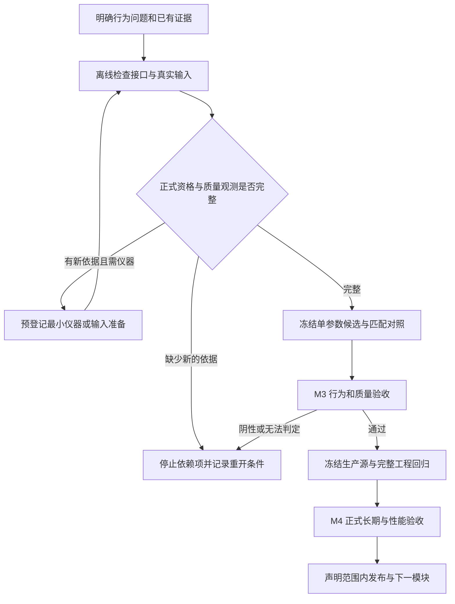

# Mod 制作提速实施计划 · 正确性优先

> **版本**：2.3；重审日期：2026-10-12。
> **状态**：2.1 已实施 R1/R2/R6 的正式入口、准备门禁、预算与控制先行工程增量，2.2 已将执行结构改为“准备包 → 单组 pilot → 扩大验收”；2.3 在此基础上增加“一个模块 → 一个可玩版本”的固定闭环，以减少长时间没有可交付结果的等待。精确证据复用、完整质量观测、最小包扰动与 R7–R9 产品出口仍未通过；任务状态以[当前工作清单](../当前工作清单.md)及结果页为准。
> **效力**：本页继续作为[最终执行纲领](mod重设计-实施计划.md)的执行效率附件。重排制作方法与工具增量，保持产品目标、M0–M5 质量门和既定实机预算；本页任务编号不代替产品阶段编号。2.1 与 2.2 的实测数字和失败记录保留在日期化审计中，不作为当前入口。
> **执行方式**：按当次任务授权逐项完成与复核；单次文档复核的操作范围不构成后续实施限制。主线协调共享代码、Git、游戏与正式测量；离线准备和实现反馈可以并行，游戏与正式性能测量始终串行。

**目标**：缩短从一个明确行为问题到合格证据、冻结候选和可验收模块的总时间，同时控制工具与游戏内存，保留全部失败、恢复与产品质量门禁。

**架构**：复用现有生成器、检查点目录、实验账本、运行锁、日志与恢复事务。先补正式实验资格接入，再建立按依赖复用的证据和有限输入准备流程；用最小观测包与分层检查完成一个纵向闭环，冻结后集中验收，随后复用同一流程扩展模块。

**技术栈**：仓库 `.venv`，Python 3.11+，标准库 `pathlib/hashlib/json/sqlite3` 与已有 `psutil/filelock/pytest/xdist/Hypothesis`。Python 工具兼容 Windows、macOS、Linux；GUI 实机目前只按 Windows 已有能力安排。不预设新增依赖或外部常驻规划服务。

**设计依据**：[工程原则](../../principles/工程原则.md)、[Mod 开发原则](../../principles/Mod开发原则.md)、[处境决策设计](../03-处境决策设计.md)、[工程基线](工程基线-1.0.md)、[M3 可测性清单](M3-可测性清单.md)。人工作出的设计、预登记与验收结论继续由相应文档所有者维护。

## 1. 这次改变什么

旧版 1.1 的二十个方向覆盖了工具、IO、测试和游戏操作；已有收益和关闭决定仍有效，详见[2026-10-10 执行记录](../../audits/2026-10-10-speed-execution.md)与[2026-10-11 工程复核](../../audits/2026-10-11-工程提速.md)。旧版完整任务、预算和原始文字通过 Git 历史恢复。本版不把未勾选旧项全部重开。

| 路线 | 收益与代价 | 决定 |
|---|---|---|
| 按最小产品闭环组织资格、输入、观测、实现与验收 | 优先解决无法形成有效样本的前置缺口；少量工具增量直接服务下一出口 | 本版采用 |
| 继续广泛优化 Python、完整 pytest、目录和自动化 | 已有工具收益；不能补出行为机会或政治接口，容易增加非产品工作 | 保留现有成果，只修阻挡闭环的缺口或有实测依据的热点 |
| 扩大国家数、窗口、实例或同时开发全部模块 | 表面运行量上升，但目前缺合法输入与隔离证明，失败和归因成本更高 | 当前不采用；相关条件改变后单独评估 |

首个产品闭环仍为财政风险对第三方外交响应的影响。后续顺序仍按主纲领的财政与存续、外部安全和承诺、市场、政治推进。M3-B 完整机会分母未知的路径保持关闭，不能要求先解决全部隐藏引擎候选集合才推进独立的 M3-A；政治和市场可做有限独立研究，生产启用仍各自完成 M1–M4。

本次提速包括减少无效启动、正确复用已有证据、缩短修改反馈、降低实验返工和模块复用成本，并让每个模块尽快形成可玩的增量包。生产 Mod 的模拟耗时与内存另由 M4 验收；制作工具变快不能写成游戏 AI 运行变快。2.2 的历史重排和 2.3 的增量版本规则见[提速计划重审](../../audits/2026-10-12-提速计划重审.md)及[增量可玩版本重审](../../audits/2026-10-12-增量可玩版本计划重审.md)。

### 1.1 2.3 的三车道与四道速度门

当前执行分成三条互不污染的车道：A 车道负责输入、资格和质量准备；B 车道负责一个候选的实现与离线反馈；C 车道负责控制先行、单组 pilot 和正式实机证据。A、B 可以在不触碰游戏和正式证据的前提下并行，C 一次只运行一个游戏问题，并始终复用 `RunLock`、恢复事务和完整错误门禁。

任何实机启动前必须通过 G0 静态准备门，确认来源、版本、挂载、输入 SHA、目的、质量字段、观测包和预算。G0 通过后先执行一个不计入正式样本的 G1 pilot，只判断机会、响应和质量是否可测；只有 G1 同时满足共同机会、单字段差异、实际响应、代价和最低质量观测，才进入 G2 多组配对。M3 候选冻结后才进入 G3 的 vanilla 噪声、长期、后期和性能出口。缺条件时生成停止包，不用长跑替代判定。

### 1.2 2.3 的增量版本闭环

2.3 把产品交付拆成 V0.1–V1.0。每次只实现一个新增模块，先在离线车道完成，再按 G0/G1 验证最小可测性；通过该模块自己的 M1–M4 后必须生成一个可安装包，执行新局、观察者、快捷键 `5`、空格推进、保存、重载和继续推进的可玩性烟测。烟测通过才允许建立版本标签并开始下一模块；继承模块只做兼容性回归，受影响时重新跑对应出口。

每个版本的最短反馈顺序是：冻结模块范围 → 生成与定向测试 → 单组 pilot → 模块行为/质量出口 → 稳定性与性能出口 → 可玩性烟测 → Python 生成交付包 → 版本记录。版本失败时保留上一版可玩包和失败证据，修复或撤回当前模块；不以降低窗口、质量、错误或资源门禁换取版本号增长。版本范围和出口由[最终执行纲领的增量可玩版本路线](mod重设计-实施计划.md#11-增量可玩版本路线)维护，本页只负责缩短这条闭环的等待和返工。

## 2. 当前瓶颈与证据

以下为本版实施前已有记录与只读代码审查，保留原始瓶颈依据；正式资格恒 false、CLI 目的缺失与预算接线现已修补，实施结果见[正式入口审计](../../audits/2026-10-11-正式实验入口.md)。没有重跑历史基准或将工程实施当作新实机。不同时间点与测量范围分别保留。

| 事实 | 来源 | 对制作顺序的影响 |
|---|---|---|
| 137 份外交报告、34 份严格基础干净、0 合格行为配对 | [M3 输入复审](M3-结果.md#2026-10-11-输入复审没有新的合格行为配对) | 当前无法计算合格吞吐的加速倍数，优先补有效输入与可测行为 |
| 最新 19 个保存输出全部被拒绝，另 3 个原版检查点只有仪器资格 | [严格来源盘点](M3-结果.md#2026-10-11-严格来源盘点复核) | 不重复扫描同一批输入期待自动出现机会；需要新的来源或受支持接口依据 |
| `checkpoint_catalog.inspect()` 固定 `formal_pair_suitable=False`；正式 M3-A/M3-B/M4 预检均依赖该值，未接资格证据 | [检查点目录](../../../src/pdx/checkpoint_catalog.py)与[运行器](../../../src/pdx/game_run.py) | 必须补证据验证入口；不能手填 true 或关闭预检 |
| `decision_behavior.py` 没有正式 purpose 入口；账本请求使用默认 reconnaissance，财政注入默认 stress | [行为入口](../../../tools/probe/decision_behavior.py) | 明确区分准备、仪器、侦察和正式对照，正式对照必须显式无财政注入 |
| 同一账本场景的六臂上限是 M3 探索规则；M4 还需独立 vanilla 噪声测量与长期窗口 | [账本](../../../src/pdx/experiment_queue.py)、[M4 出口](mod重设计-实施计划.md#3-m4独立安全验证先做正式候选验收后做) | 按实验目的落实已规定预算，不能让一个通用布尔值或探索上限阻挡不同合法出口 |
| 运行 manifest 把全部 `src/pdx/*.py` 指纹放入冻结 environment；任意文件变化都会改变同场景条件 | [运行器](../../../src/pdx/game_run.py)与[账本比较](../../../src/pdx/experiment_queue.py) | 完整溯源继续保存；证据兼容性需基于明确依赖判定，未知依赖仍失效 |
| 多次政治仪器总流水线约 218–499 秒，却未获得完整候选/最终组合；阶段概率路径触发断言并已停用 | [M5 结果](M5-结果.md) | 先审核调用环境与证据缺口；这些时长包含整个运行，不能称为纯启动成本 |
| 完整回归约 541 秒，自动选 4 workers；已验证快照差分和黄金回归有局部收益 | [工程复核](../../audits/2026-10-11-工程提速.md) | 使用现有定向反馈，批次末完整验收；不再把测试调度优化作为 Mod 主线 |

“有效实验比例低”和“正式入口缺接入”已有直接依据；各类成本占总墙钟多少、组合探针是否划算和精确失效能节省多少，目前只是待测假设。不能将历史总流水线时长拆成未经记录的阶段成本。

## 3. 必须保留的门禁

- 正确性第一、速度第二、内存第三。工程和 Mod 同时遵守原则页；候选先通过正确性、稳定性与硬性资源预算，再比较速度，只有经测量确认等效时才比较内存，无法判定不算等效。受控文本 UTF-8 无 BOM、LF；游戏 BOM 只在交付边界添加，原始证据保留字节与可恢复性。
- 版本、完整基础与探针挂载、源与部署内容 SHA、合法存档、观察者状态、进程身份、完整日志、正式严格错误和恢复门禁保留。独立界面资源诊断按[主纲领目的契约](mod重设计-实施计划.md#测试目的与已知界面资源问题)执行，不把单个已知缺图标变成所有实机的停止条件。
- 自然与受控机会、评分、行为和质量分层。控制臂准备压力不能成为正式处理差异；未知、缺失、零、预算截断、采样遗漏和运行失败分别记录。
- M3 两臂使用相同检查点、观测包、激活起点、声明机会与阶段；只允许预登记的单字段变化。机会分母不得用 hook 哨兵、命令合法性或只观察到的行动数代替。
- M3 初轮仍至多两个新场景，每场至少两个合格响应国、最多三组配对、单臂不超过六游戏月。失败消耗预算，同类原版错误两次停止；换名称不能刷新停止事实。
- 正式 M4 仍用 M3 冻结候选、真实早期和后期输入，各三组 vanilla/候选配对，先三次 vanilla 噪声测量并冻结资源预算；长期至少 24 游戏月。仪器/安全工作与正式候选验收分别判定。
- 原版 AI 执行。禁止免费资源、暴力削弱、强制加入/立法、国家固定剧本、改模拟速度或事后挑样本制造成功。
- 生产 `aggression` 偏置为零；政治与市场开关保持关闭，直至各自完成出口。整体目标完成与首个有限模块发布分别声明。
- 游戏始终复用 `RunLock` 与部署恢复事务。正式性能、重测试与剖析串行；同进程切挂载、双实例和多机目前不启用。
- 复用标准库与成熟能力；新增实现只填明确缺口。保留完整回归、覆盖率及核心下限；清理先检查消费者、证据引用和生成入口。
- 中文提交按独立完整目的组织，源码、测试和生成物一起维护。当前计划交付不自动触发提交、推送或发布。

## 4. 制作流程与范围控制

每个候选先写一张短实验登记，放到对应 M3/M4/M5 结果页；完整机器输入及输出在忽略的 `tools/out/`。登记包括要改善的具体行为、依赖、允许处理、处理前场景、机会范围、实际行动、成本/放弃收益/反例、采样与窗口、资源/失败预算、冻结与重开条件。不得同时在新配置中维护一份阶段状态。

默认流向如下：

证据不完整时可以排队做独立输入准备、质量观测研究或接口否证，但不能派处理臂。每轮每局只回答一个决定下一步的主要问题；已有安全仪器可附带记录共享信息，新增 getter 先隔离验证，不在主线实验里临时加探针。

同时维持一个正在实现/验收的产品候选、至多一个独立研究问题；这限制待验收工作量，不限制一个通用规则作用于多国。只读离线准备可与非基准后台推进重叠，先登记内存/CPU 上限；部署、恢复、完整回归与正式资源测量不重叠。没有独立可验收任务就保持串行。2.3 继续要求所有实机任务先生成 readiness packet，并在模块通过 M4 后生成可玩包；缺来源、质量、机会或预算字段时只做离线修补，不占用游戏锁。

### 4.1 2.3 的漏斗执行

1. **静态准备**：先筛全量候选来源和质量字段，记录完整 SHA、版本、挂载、机会定义与停止预算；筛选没有支持提名时立即关闭该来源。
2. **离线实现**：只维护一个财政/外部候选，运行定向契约、生成一致性和离线 baseline；生成物与数据源不一致时不进入实机。
3. **pilot**：控制先行后跑一个最小控制/候选配对或自然响应窗口。pilot 只回答可测性，不计入正式样本；缺机会、缺质量、同类错误或方向相反就停止路线。
4. **扩大**：G1 通过后才冻结重复数、窗口、反例和资源预算，按 M3 规定完成配对，再转 M4。

5. **交付**：新模块通过 M4 后立即打包当前增量版本，完成最小可玩烟测和继承模块回归；交付包通过后才开始下一模块，避免多个未验收模块同时堆积。

同一输入被拒绝后不得只换标签或延长窗口重试；只有新的来源、受支持接口或不同的处理前依据才允许重新登记。

## 5. 实施任务

本节 R1–R9 的复选框记录完整出口；含多个前提的项只完成一部分时保留未勾选，并在状态段说明。工程增量与验证见[正式入口审计](../../audits/2026-10-11-正式实验入口.md)，文末自检只记录方案复核。必要正确性修复单列，不强求比不安全旧实现更快。

### R1：打通按目的验证的正式实验入口

**实施状态**：M3-A 资格与实际时间原件、准备无注入源码、catalog/runtime/CLI 接线已实施并形成反例；M3-B 完整分母与 M4 冻结质量继续明确拒绝。正式 M4 显式性能包已与源契约对齐，未获实机扰动与质量出口。R1 整体保持部分完成。

**优先级**：最高。**依赖**：无需等待新实机场景；先复核已有目录、运行器和入口契约。

**修改**：`src/pdx/checkpoint_catalog.py`、`src/pdx/game_run.py`、`tools/probe/decision_behavior.py`、`tools/probe/decision_stability.py`。**可新增**：`src/pdx/experiment_evidence.py`，只负责证据解析、内容核验和资格判定；不启动游戏、不维护另一个任务库。

**测试**：现有 `tests/test_checkpoint_catalog.py`、`tests/test_game_run.py`、`tests/test_behavior_probe.py`、`tests/test_extensions.py`；新增资格模块时增加 `tests/test_experiment_evidence.py`。

- [x] 给 `inspect()` 接入可选的资格报告路径。无报告继续未知/拒绝；报告绑定检查点 SHA、来源报告/原始日志 SHA、游戏内容与版本、场景/对象、两国、采样、处理前资格、观测包和判据版本。校验实际原件，不能信任调用者提供的合格布尔值。
- [x] 资格核验复用 `game_run.read_reviewed_report()`、现有来源复核和观测分析器，只有新事实缺现有验证才补规则。资格证据需要来自同一冻结输入或有完整关联的重新载入验证；准备局的窗口、保存后的世界与原输入不能混用，保存输出必须重新验证。
- [ ] 输出按 purpose 分开的资格与理由，保留旧字段兼容。M3-A 验证指定响应机会与共同风险/未决资格；M3-B 另需完整且可审计的发起候选分母；M4 验证干净性能输入、时期、噪声/预算登记与 M3 冻结候选引用，不能要求每个性能输入都有外交机会。
- [x] 行为 CLI 接入显式正式 purpose 与资格报告；正式模式固定 `fiscal-injection=none`、拒绝未登记差异和准备模式，探针/政治观察配置进入同一登记。以 mock 运行器证明完整证据可到达启动边界，缺证拒绝发生在部署与日志移动前；随后才允许实机验证。

**关键反例**：手填 true、改名坏档、不同 SHA/版本/语言/挂载、证据读取中变化、资格来自处理后结果、单国可支持、只有 ENTRY 却无生产 ACTIVE、错误日志缺失、把 M3-A 资格用于 M3-B、把仪器运行当正式 M4。

**出口**：资格可证明时入口可达，缺失/伪造/过期仍严格拒绝；启动资格只是许可，不代表未来两臂必然出现相同机会或实际质量。运行后仍由比较器重新验收。

### R2：精确证据失效、停止事实与目的预算

**实施状态**：用途窗口、有限非负越窗预算、SQLite 增量迁移、实时与最终错误合并、跨登记停止事实、完整 provenance 和保守兼容性判定已接入；控制样本复用仍需当前控制原件复核，精确动态依赖范围未验收。R2 整体保持部分完成。

**依赖**：R1 的资格契约；证据依赖盘点可先做。

**修改**：`src/pdx/experiment_evidence.py`（R1 若未新增，在本项新增）、`src/pdx/experiment_queue.py`、`src/pdx/game_run.py`、`src/pdx/m3a_screen.py`、`tools/probe/decision_compare.py`。**测试**：`tests/test_experiment_queue.py`、`tests/test_game_run.py`、`tests/test_m3a_screen.py`、`tests/test_decision_compare.py`、`tests/test_checkpoint_catalog.py` 及 `tests/test_experiments.py`；资格模块实现时同步增加并复用 R1 的 `tests/test_experiment_evidence.py`。

- [ ] 将完整 provenance 与兼容性依据分别记录。保留全部工具/游戏/源 SHA；只在已审查依赖范围明确时判断无关文档、测试或工具变动不使现有证据失效。关键依赖包括实际生成数据/底本/生成器、探针、配置、读取与错误门禁、分析器、模型及导入依赖；无法解释的变更保守失效。
- [ ] 统一证据状态：可复用、必须重解析、必须重跑、无法判断。分析器修正可从同一不可变原件重解析，但旧运行缺了必要观测必须重跑；不能修正解析器就把历史失败自动放行。已停止接口和场景绑定输入/环境/错误签名与重开条件，改 plan_id/scene_id 不消除同一上下文停止事实。
- [x] 在现有账本按 purpose 落实预算。M3 保留既定有限上限；M4 分开记录 vanilla 噪声准备与正式三组配对、至少 24 月窗口，正式登记冻结后才派发。两类记录共享失败停止事实，不能用独立登记绕过门禁。旧 SQLite 状态保留并做版本化迁移和新进程恢复测试。

**复用规则**：完整控制臂只有在原预登记、输入、观测、窗口、允许差异与日志均匹配时，才能作为它原来的那一个样本复用。一次控制运行不得复制成三组独立重复；缺质量观测的仪器不能升为行为样本。重载或崩溃后是新 run_id，片段不得拼接。

M4 三次 vanilla 噪声测量只有在事前登记其一对一对照用途、观测/窗口/环境与正式配对完全一致且原出口满足时，才评估复用为相应原控制臂；两种统计用途仍是同一组原件，不能增加样本数。环境漂移、用途或采集不符就重新取得匹配控制，不能为了省启动让既定配对不可比。

**关键反例**：未知动态依赖、关键脚本变动、同版本不同内容、仅改文档、仅改解析器、原件缺失、重复引用控制臂、换名字刷新失败计数、预算事后变更、旧数据库中断/迁移失败。

**出口**：可解释地保留未受影响证据，关键变化与歧义继续拒绝；M4 可按既定出口执行，M3 上限没有被扩大。精确复用未验收前保留现有保守全指纹冻结。

### R3：主动准备干净环境与合法输入

**实施状态**：精确维修图标诊断和快捷键/后台安全已实机通过；单 host 战争仪器有限实机因后样本缺国拒绝。显式最多两份原件的有界财政/外交预筛已实施，真实输入均无可支持提名；来源与字段未知保留。自然暂停保存、重载资格、正式环境影响及真实后期输入尚未取得，R3 整体部分完成。

**依赖**：R1/R2 才派发新实机；已有环境与官方资料的只读检查可先做。

**修改**：`tools/probe/make_clean_checkpoint.py`、`src/pdx/checkpoint_catalog.py`、`src/pdx/checkpoint_screen.py`、`src/pdx/natural_probe.py`，按需要扩展现有 `decision_stability.py`；不新增独立启动器。**测试**：`tests/test_make_clean_checkpoint.py`、`tests/test_checkpoint_catalog.py`、`tests/test_natural_probe.py`、`tests/test_game_run.py`。

- [ ] 先定位已有原版错误对应的内容与环境，核对安装完整性、当前官方修订、实际 DLC/语言/挂载/用户状态。已知界面资源问题允许有具体引用与本地字节依据的有限隔离诊断，先验证资源路径处置，再继续可独立回答的接口或准备问题；不修改游戏本体或白名单错误。严格 vanilla 安全局与正式样本仍需对应新前提，不重开已关闭的模拟断言窗口。
- [ ] 扩展现有检查点准备器的有界用途：来源全程可审计，零生产处理、零财政注入；预登记候选国家/机会筛选条件与终止预算，尝试保存自然风险与真实尚未决机会的处理前状态。观察国从处理前风险、内部结构与合法响应余地选取，不惯性沿用 RUS/PRU；声明候选池并保留落选理由，不为换标签重复同一阴性世界。保存输出必须先过完整来源门禁并在重载后重新验证；仅正常借款或有限命令 yes 不构成共同 ACTIVE。
- [ ] 后期输入在同一干净环境中独立准备。优先核查已有合法档，其次有限原版观察者推进并保存真实发展状态；开始前在 M4 结果页明确目标日期和世界成熟度依据、墙钟/游戏时间上限及质量。早期跑久、改存档日期、财政压力档均不当后期。

**输入目录**：仍由现有 catalog 生成，不复制大档入 Git。记录早期、后期、自然/受控、风险/无风险、原始/输出与来源完整性。受控机会只能用于明确隔离研究，不替代自然验证。

**关键反例**：把准备局结果当作原始输入、用改日期或财政压力档冒充后期、缺来源或重载不一致仍派发、把单国支持或命令合法当作共同机会。

**停止/重开**：自然输入准备达到主纲领有限预算仍未取得条件，输出“未取得”及所有拒绝项；新的登记必须有具体不同的处理前依据，不能改标签续跑。恢复失败停止下一局。环境不能干净运行时停止受影响实机，转 R4 的独立只读研究；没有合法输入不能保证完成发布日期。

**出口**：获得可重新核验的输入，或明确环境/来源/机会/时期缺口及可操作重开条件。准备器变快但没有有效输入不能称为 M3 解锁。

### R4：先验证接口与质量观测，及时否证

**实施状态**：独立战争仪器实现、反例和一次有限实机已完成；缺国使整局拒绝，逐 tick 时间包围跨多日，关系真值与质量保持未验证。未追加同档碰运气运行；R4 的完整质量观测仍未通过。

**依赖**：只读工作独立；仪器局需 R1/R2 和与诊断目的匹配的 R3 环境。已知资源路径诊断可先完成，不能一概等待严格 vanilla；正式样本仍需完整资格。

**修改**：按实际缺口扩展 `src/pdx/decision_probe.py`、`src/pdx/natural_probe.py`、`src/pdx/extension_probe.py`、`src/pdx/political_surface.py`、`src/pdx/political_approval.py`。**测试**：`tests/test_decision_probe.py`、`tests/test_natural_probe.py`、`tests/test_extensions.py`、`tests/test_political_surface.py`、`tests/test_political_approval.py` 及相关来源/CLI 契约测试。**记录**：M3 可测性及 M3/M5 结果页，继续单一所有者。

- [ ] 以版本、数据类型、作用域、调用环境、组合/覆盖语义和正反例列出所需接口。先核对现有可执行面、官方资料和当前游戏源码；GUI getter 存在不证明可在只读日志中调用。已断言路径继续关闭，新依据必须说明具体改变了哪一前提。
- [ ] 首个外交闭环在正式配对前补可观测质量指标：实际角色/加入/退出与时延、战争/承诺、财政风险持续和读数、退出结果及正常防御/有利行动的放弃代价。长于探索窗口的结果使用单独预登记随访，计入总成本，不无限延长六个月探索臂；缺失代价或反例则质量未证明。
- [ ] 每轮仅选一个有依据的未知接口，最小仪器先取得身份/布尔/数值正反例、安全及扰动证据。无法读完整分母、候选或组合时结论保持未知，按主纲领换受支持的通道或停用；保留否证，停止重复不安全 getter。

**政治/市场边界**：直接 Law/IG 输入已有有限证据，优先评估合法权重等已有受支持通道的适用范围；最终候选、排名、方向限制、风险否决、更新与概率组合仍须按 M5 出口证明。不得用部分源码静态枚举补成完整引擎集合，不把阶段概率数字或 +99 贡献当最终概率；市场 margin 不是实际参与。

**关键反例**：GUI getter 能读却未证明日志调用环境、静态枚举缺候选分母、阶段概率被写成 AI 启动机会、评分变化被写成行动质量、断言路径只因重复运行而重新打开。

**出口**：所选候选的输入、动作和质量出口都有可解释观测，或其不可行性明确到接口/条件。静态核对结果不能替代新接口实机验收。

### R5：收紧生成与修改反馈周期

**依赖**：明确一个候选的规则与接口；已有工程入口可立即复用，不以本项阻塞独立资格研究。

**修改**：只触及该候选的 `mod/decisions/fiscal.toml` 或 `extensions.toml`、`src/pdx/decisions.py`，以及必要的已有探针/CLI。**测试**：`tests/test_decisions.py`、`tests/test_extensions.py`、`tests/test_modgen.py`、相关 CLI/分发/规则测试。

- [ ] 数据、阈值、解释和本地化继续单一来源，生成器产生脚本与机械说明；先冻结原版底本与合法单字段处理差异。合并同一目的所需变更，不在一个实机系列中持续改源。
- [ ] 定向反馈覆盖未知输入、迟滞/TTL、退出/重复、作用域/组合、原版其余分支保持、实际生成脚本和交付 BOM。用已有 Hypothesis/参数化与变形测试验证真正不变量，不只重复 Python 参考函数。
- [ ] 迭代时运行受影响测试与静态检查；每个可独立交付批次、共享契约/生成器/依赖变更和冻结候选前执行适用完整 n-auto、覆盖率及 baseline。记录测试选择依据；不能将无覆盖率快速反馈包装成完整回归。

**关键反例**：手改生成物或本地化、同一实机系列中途改变多个字段、未知输入静默当作零、只测参考函数不测实际脚本、用更新黄金指纹掩盖真实漂移。

**性能**：使用现有 `tools/benchmarks/decision_runtime.py` 与 `pdx.performance` 对受影响生成/分析调用链计时和测峰值内存；无热点证据不重构缓存、序列化或测试调度。改变 golden 只接受解释过的真实产物变化，不用于掩盖失败。

**出口**：从修改到明确错误反馈的时间可测，生产生成物一致，完整门禁保留；频繁运行完整回归的次数可减少，但必需出口不能省略。

### R6：最小观测包、自动分类与有限派发

**实施状态**：控制先行、正式候选 reserve 前的当前控制原件复核、错误分类与资格/窗口绑定已接入；`vanilla-performance` 仅作显式 M4 观测包契约，最小包资源扰动和正式 M4 质量出口仍未通过。R6 整体保持部分完成。

**依赖**：R1/R2/R4；实机需要 R3。

**修改**：`src/pdx/game_run.py`、`src/pdx/experiment_queue.py`、`src/pdx/m3a_screen.py`、`tools/probe/decision_compare.py`、`tools/probe/decision_behavior.py`、`tools/probe/decision_stability.py`；**测试**：`tests/test_game_run.py`、`tests/test_experiment_queue.py`、`tests/test_m3a_screen.py`、`tests/test_decision_compare.py`、`tests/test_behavior_probe.py`、`tests/test_extensions.py`。脚本生成继续在现有探针模块。

- [ ] 预登记最低必要观测包与可选仪器，并把其完整字段写入 readiness packet；行为入口当前附带政治观察，先核对是否为本轮必需，再用回放和安全对照证明关闭不会丢证。M3 pilot 默认只启用回答当前问题所需的观测，不同时启用尚未验证的 getter；M4 性能包必须另行登记。
- [ ] 从归档原件自动生成严格错误/挂载/恢复判定、资格、样本覆盖、评分/角色差异、无变化/方向反例与下一动作。规则明确的完整性结论可自动判定；质量解释和边界由主线复核，缺指标不自动设 true。
- [x] 控制先核验，失败则不派处理；达到预算、无新前提或停止签名则暂停该依赖，转独立工作。实时安全错误立即结束，预算截断与负结果分开。行为早停事前登记且两臂对称，不能看处理效果截断有利样本；M4 固定窗口不变。

**扰动验收**：回放等价后，用同输入/环境比较原包与最小包的脚本数、日志量、CPU/RSS、流水线时间和可观测完整性；任何必需通道少采、时间轴不明或资源超限则回退。现有快捷键 5、条件空格、后台推进和恢复保留；本任务不顺带缩短就绪/退出等待或资源采样。

**关键反例**：为省资源删除必需观测、处理臂先于控制臂通过、按有利结果提前截断一侧、把预算截断写成阴性、未测组合包默认启用或把最小包的缺失字段当作无机会。

**出口**：最小包能完整回答登记问题，自动拒绝不合格局并输出可复核理由，减少人工读日志与确定无效的下一次启动。未测组合包不默认启用。

### R7：完成首个行为与质量闭环，冻结候选

**依赖**：R1–R6 的相关出口通过，有处理前资格、有效输入及质量观测。

**修改/记录**：候选数据、生成器与必要解释；预登记及全部结果进入 `M3-结果.md`，当前工作清单仅摘录状态。沿用 `decision_behavior.py`、`decision_compare.py`、`m3a_screen.py`，不另造比较器。**测试**：`tests/test_decisions.py`、`tests/test_modgen.py`、`tests/test_decision_compare.py`、`tests/test_m3a_screen.py`、`tests/test_mod_hygiene.py`、`tests/test_modguard.py`，并执行适用的完整回归。

- [ ] 冻结场景、源、观察包、单字段差异、窗口、顺序、重复和质量指标；先做一个不计入正式样本的 pilot，只有完整可比且具真实响应余地才进入剩余主纲领预算。每个国家至少三组有效配对，全部无变化、反向和失败保留。
- [ ] 完成自然验证、正常防御/有利行动反例和非极端参数敏感性复核。若另需质量随访或新一轮条件，开始前单独登记理由与有限预算，禁止依结果扩大惩罚或选指标追认。
- [ ] 独立判定仪器、评分、行为与质量；通过后冻结生产候选与生成内容 SHA，运行完整工程门禁。若评分可变而行为/质量仍未通过，停止此候选，按主纲领换受支持接口/规则；不把重复阴性配对当推进。

**关键反例**：检查点、挂载或激活时点不匹配仍做反事实；只凭评分、策略切换或脚本机会宣称行为质量；挑选有利国家/窗口；把重复阴性、仪器通过或质量缺失写成候选冻结。

**出口**：首个模块达到主纲领 M3 出口，或得到可复核的否证与关闭决定。后者是有限研究完成，不是 Mod 完成。

### R8：集中验收运行效率、稳定性与交付

**依赖**：正式候选需要 R7；干净环境、后期输入和已有独立安全证据可提前准备。

**修改**：按实际缺口维护 `tools/probe/decision_stability.py`、`tools/probe/perf_compare.py`、`src/pdx/distribution.py`。正式参数与结果在 `M4-结果.md`，复用现有采样、CSV、锁和恢复机制。

**测试**：`tests/test_game_auto.py`、`tests/test_game_auto_verdict.py`、`tests/test_perf_compare.py`、`tests/test_install_hygiene.py`、`tests/test_extensions.py`、`tests/test_game_run.py`；已有分发契约由 `tests/test_repository_upgrade.py`、`tests/test_upgrade_edges.py` 和 `tests/test_decisions.py` 覆盖，新增交付行为时扩展相应测试。

- [ ] 同一冻结候选完成早期/后期各三组配对、vanilla 噪声预算与至少 24 月长期窗口；测模拟每游戏日耗时、CPU、RSS 峰值/趋势及可解释 task 计时。源/仪器改变先做影响分析，相关基线和出口重新验收，不跨候选拼成一份通过。
- [ ] 复用未失效的生命周期、安装/卸载、保存/重载证据；缺项一次集中补齐。重复状态/清理与无界扫描优化保持原规则，并用正式预算测游戏运行成本，不能拿开发基准替代。
- [ ] 对实际启用字段形成发布证据映射、版本/覆盖冲突、双语解释、同版本存档限制与平台矩阵；交付包仍由 Python 生成，禁止把未通过扩展偷偷打开。

**关键反例**：用早期长跑冒充后期、跨候选拼接性能样本、把 Python 基准当作游戏运行性能、忽略引擎错误/恢复失败、缺少安装卸载或平台证据仍发布。

**出口**：声明范围内的有限模块可发布。后期、兼容或平台缺证则保持相应出口未通过；内部、外部、政治三类目标未覆盖时不称整体 Mod 完成。

### R9：复用闭环逐模块扩展，持续优化有证据热点

**依赖**：首个闭环后按主纲领顺序执行；每个模块自己的 M1–M4 不能继承为通过。

**修改**：对应现有决策数据、生成器、探针与测试；只有已有入口无法承载明确职责时才增模块。**测试**：每个模块的 `tests/test_decisions.py`、`tests/test_modgen.py`、`tests/test_mod_hygiene.py`、`tests/test_modguard.py` 与新增接口的定向契约/实机测试；结果由对应阶段页维护，任务队列只在当前工作清单。

- [ ] 复用输入、资格/错误/恢复、规则模板、解释与测试工具；列明每个扩展新增的行为接口、信息约束、成本与失效条件。国家标签不能代替通用机制。
- [ ] 外部安全与既有承诺先闭环，再市场依赖，再政治可行性/政府身份偏好；独立受支持接口研究可以提前，最多一个，未验收扩展不开生产开关。
- [ ] 每个批次回看总墙钟、有效样本、失败和资源。仅在热点已测、预期收益超过实施/验证维护成本时实施新优化；关键缺口先修。清理没有消费者的临时实现，原证据和可复核否证保留。

**关键反例**：把首个模块的 M1–M4 通过继承给新模块、用国家标签替代通用机制、未完成行为/质量出口就打开生产开关、没有热点测量就重构性能路径、删除失败或否证证据。

**出口**：逐模块形成可交付闭环和整体目标覆盖映射；所有声明启用模块有自己的行为、质量与运行证据。工具项目完成不冒充产品完成。

## 6. 依赖与第一批

| 批次 | 交付 | 可以先做的独立工作 | 放行下一步的条件 |
|---|---|---|---|
| 第一批：正式入口 | R1；定向、完整回归及来源/无副作用反例 | R3 环境只读复核，R4 接口/质量缺口整理 | 无证据拒绝、合法证据可达；尚不因此启动正式局 |
| 第二批：证据复用与预算 | R2；数据库恢复、依赖失效与跨登记停止事实 | R5 复用已有测试选择，无需新调度器 | 冻结身份与旧记录可解释；新实机预算明确 |
| 第三批：有效输入与观测 | R3/R4/R6 的相关增量，R5 最小候选 | 先有界资源诊断，再独立接口与输入准备；不与测量争用资源 | 诊断不代替正式环境、机会、共同风险、观测及成本出口 |
| 第四批：首个产品出口 | R7 然后 R8 | 提前准备合法后期输入与独立安全项 | M3 质量与冻结候选通过后才做正式候选 M4 |
| 后续批次 | R9；每个模块自己的循环 | 一个有新依据的独立研究 | 逐模块出口，不将整体目标收缩成财政模块 |

任务交付以完整目的组织中文提交与审查，不能按文件机械拆提交。预算、实验日期和真实指纹在批次开始前落到结果页/原始登记；本页不伪造未来存档 SHA 或实测阈值。

## 7. 怎样证明提速与控制内存

### 7.1 产品制作指标

扩展既有 `StageTimings` 与实验账本，汇总侧保留旧报告 `schema`，新增字段明确版本；不替换现有键或另外维护阶段真值。

| 指标 | 计算与限制 |
|---|---|
| 首份合格证据耗时 | 从登记到取得并复核的总墙钟，含准备/失败/恢复；未取得则 null，并报告预算耗尽前等待时间 |
| 每个合格配对/输入/模块的成本 | 各自总墙钟、启动数和资源；不能把一个模块的多国当独立样本 |
| 有效产出与失败 | 计划/启动/完成/拒绝/未知/合格数量，拒绝分类和停止原因；成功比例附分母，不删超时/OOM/错误 |
| 修改反馈与批次成本 | 修改至首个相关反馈、相关检查、完整回归、生成、归档、解析/复核分别计时 |
| 资源 | Python/游戏/进程树范围分别采 CPU、RSS、适用的私有内存、Python 分配与磁盘；采样间隔/漏测明确 |
| 运行性能 | 正式 M4 的匹配窗口和候选；不与工具吞吐、FPS、不同世界或不同探针对比 |

阶段时间有重叠时用起止区间与真实总墙钟，不能相加。历史可解析但门禁无效的报告只能用于工具回放/反例；筛选历史证据不能把失败局“回收”为新的行为样本。

### 7.2 优化验收与回退

每个入选热点开始测候选前，冻结输入内容/环境、主指标、重复顺序、速度与内存上限、最小有用改善、噪声方法、失败预算和回退开关。默认离线至少三组固定 AB/BA 交错对照，以中位数比较，保守噪声采用两臂相对中位数最大偏离的较大值；收益需超过噪声和预登记改善量，同时满足资源预算。若另选统计方法，必须事前冻结。

候选选择按[工程原则的性能取舍](../../principles/工程原则.md#验证与性能)执行。速度等效范围与内存改善判据须事前声明，并用上述对照、噪声方法分别核验；不能将无法判定的速度差异直接当作等效。报告分别列明速度、内存与预算结论，不取消任何内存测量或门禁。

冷应用缓存、热磁盘/空 memo、热 memo 分测；`cache.clear()` 不当空磁盘，操作系统页缓存未知单列。缓存/基准目录按任务隔离，不清共享用户缓存；正式计时、tracemalloc、RSS 和剖析分别采，不能拿 Python 分配峰值代替 RSS。沿用现有 n-auto 自适应 worker/内存预算，实际自选四不成为固定上限。

新功能没有同语义旧实现时只建立成本基线，不宣称改善比例；必要正确性修补可以增加成本。整体行为吞吐目前基线为零，提速比为 null；未来不同机会/版本/源或样本集合仍不可比，不给“几倍”承诺。首次合格闭环是产品进度，只有匹配对照才能证明相应流程改善。

资源超限、完整性差异、收益低于噪声或无法解释失效范围则不默认启用。任何原件/恢复/身份问题立即停止依赖操作。保留原流程开关和失败证据，必要时回退优化；不能回退严格错误/来源修复来换速度。

## 8. 旧成果与本版不再投入的方向

| 既有方向 | 本版处理 |
|---|---|
| CSV 一次解析、存档流式复制、内容缓存正确性、持久恢复 | 继续复用；新缺口按原入口修补 |
| 快照 fixture、差分路径、黄金回归和 CI 去重 | 继续复用已验收成果，数值见日期化审计 |
| 完整测试调度/worker、LRU 调参、compact/新序列化器、生成跳写 | 当前没有新的收益依据，不重复评估或更换默认 |
| 缩短启动/退出等待、改变采样、系统渲染设置 | 当前关闭新增优化；可靠就绪/完整性与受控收益证据齐备才重开 |
| 双实例、多机、同进程切脚本/挂载 | 当前缺隔离/重载/设备证据，保持单实例 |
| 全仓改名、重建分析/快照/通用工作流平台 | 非本版制作缺口，不列为前置任务 |

关闭方向仍保存当时结论。只有新瓶颈测量或对应条件变化才重开，不把已有工具再次写为新交付。

## 9. 验证入口、文档维护与计划完成定义

以下 `python` 指本工作区解释器：Windows 使用 `.venv/Scripts/python.exe`，macOS/Linux 使用 `.venv/bin/python`，从仓库根执行。R1/R2 已交付入口的实际参数见工具手册与 CLI 帮助；新增参数须在实现、帮助与测试完成后再写成可运行命令。

文档计划改动验证：

~~~text
python -X utf8 tools/ci/run_check.py encoding
python -X utf8 -m pytest tests/test_engineering_contract.py tests/test_docs_consistency.py tests/test_cli_docs.py tests/test_repo_numbers.py -n 0 -m "not integration and not benchmark" --no-cov
git diff --check
~~~

R1/R2 的定向入口（新增资格模块测试由实施时一并加入）：

~~~text
python -X utf8 -m pytest tests/test_checkpoint_catalog.py tests/test_experiment_queue.py tests/test_game_run.py tests/test_m3a_screen.py tests/test_decision_compare.py tests/test_extensions.py -n 0 --no-cov
~~~

代码批次与候选冻结时使用：

~~~text
python -X utf8 tools/ci/run_check.py lint .
python -X utf8 tools/ci/run_check.py format --check .
python -X utf8 tools/ci/run_check.py types
python -X utf8 -m pdx.cli modgen --write
python -X utf8 -m pdx.cli modgen --check
python -X utf8 tools/ci/run_check.py baseline
python -X utf8 tools/ci/run_check.py test --cov=pdx --cov-branch
~~~

仅改数据/生成逻辑时才运行写入式 modgen；相关脚本基准清除普通 `addopts`、串行并隔离输出。既有跨平台 CI、离线与 Windows GUI 证据分别记录，缺设备的平台不声称实机通过。

执行事实与参数进入 M3/M4/M5 结果页或有日期的审计，当前工作清单摘录下一任务；本页维护方法和依赖，不不断增加新的总计划。原始 JSON/SQLite/日志/存档/CSV/截图/性能输出继续按现有规则忽略，不因提速另建入库副本。机械汇总通过 Python 派生，结论必须复核，生成物不手改。

本版方案完成的定义是：瓶颈有来源、任务明确到已有入口/新增职责、每项有反例与出口、依赖和停止分支完整、与主纲领无冲突并通过文档校验。后续“提速实施完成”必须报告 R1–R6 的实际交付/关闭与测量；R7–R9 属于产品继续推进，完成与否仍按 M1–M5 证据判定。计划落盘、工程通过和有限否证均不能称整个 Mod 已完成。

## 10. 方案复核（2026-10-11）

- [x] 对照当前生产源、生成器、检查点目录、账本、正式/仪器入口和结果页，区分已有能力与未来任务。
- [x] 把资格恒为 false、purpose 不明确、M4 专用预算和全工具指纹失效纳入具体修补任务；没有把修补写成已实现。
- [x] 保留全部主纲领行为、质量、窗口、重复、长期、后期、错误、恢复、生产开关与整体覆盖出口。
- [x] 增加主动但有界的输入准备、质量观测先行、不可测接口否证和资源错峰，避免等待与无依据重复运行。
- [x] 第一批交付直接填正式入口缺口；已收口的通用工程优化与高风险并发没有成为产品前置。
- [x] 区分研究成功/失败、工具提速/游戏成本与局部发布/整体完成；未知或零基线不承诺倍数。

## 11. 2.2 计划重审（2026-10-12）

- [x] 确认工程完整回归和自动化安全已具备，当前主要瓶颈是有效 M3 输入、机会分母和质量观测，不再把泛化工程优化列为 Mod 前置。
- [x] 把输入/资格、离线实现和实机证据拆成 A/B/C 三条车道；允许离线工作并行，保持游戏、恢复和正式性能测量串行。
- [x] 加入 G0 readiness packet、G1 单组 pilot、G2 扩大配对和 G3 M4 出口；pilot 不计入正式样本，失败或不可测时立即停线。
- [x] 把无效启动率、修改反馈时间、有效证据吞吐、证据复用率和资源成本列为速度指标；没有同输入 AB/BA 对照时只记录成本基线。
- [x] 清理当前入口中的版本引用，将 2.1 实测保留为历史，当前执行统一改为 2.2。

## 12. 2.3 增量可玩版本重审（2026-10-12）

- [x] 确认当前速度问题不只来自无效实机，也来自模块长期堆积后才交付；将“一个模块 → 一个可玩版本”加入唯一执行附件。
- [x] 保留 M0–M5 作为质量门，新增 V0.1 最小可玩纵向切片、V0.2 外部安全与承诺、V0.3 市场依赖、V0.4 政治可行性与身份偏好、V1.0 组合版的交付顺序。
- [x] 规定每个版本必须经过生成一致性、模块 M1–M4、最小实机可玩烟测、继承模块回归和 Python 交付包检查；未通过时保留上一版可玩包，不移动生产开关。
- [x] 将版本失败、回退、兼容性复用和可玩性烟测写入主纲领与当前工作清单；2.1/2.2 结果保留为历史，当前执行统一改为 2.3。
