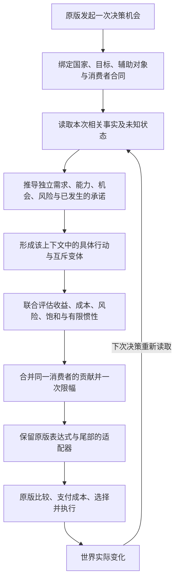

# Situated AI 架构主计划

> 架构版本：A1.0，2026-11-02。状态：**设计已落盘，待用户评审；实现未开始**。
> 本页是新一轮重设计的唯一架构主计划；具体实施拆为[架构子计划](架构子计划.md)。
> 本轮只设计，不恢复旧 D 阶段，不修改生产源、生成物、版本、发布包或游戏目录。
> 旧 31.4 的未完成范围与失败仍见[旧实施计划](exec/mod重设计-实施计划.md)和[当前工作清单](当前工作清单.md)，不因新计划建立而关闭。

## 1. 目标、范围与完成含义

**Situated AI 让每个国家基于自身处境和可观测信息，在原版机制内持续做出符合自身约束与利益的相对最优决策。**

本次从决策机制重新推导架构；已有源码作为资产审查，不作为必须保留的架构前提。推荐采用：
**以具体行动为最小决策单元、以局部多目标评估为决策机制、以实际事实构成跨域因果联动、以原版消费者完成选择和执行的架构**。
Python 在开发期负责分析、类型检查、编译、验证和打包；游戏中只运行有限的 PDX 脚本。

“最优秀”在本项目中落实为可检验的选择：在合法接口、原版兼容、正确性和运行成本约束内，覆盖尽可能多的有效决策面，
使每项收益、成本、关系和时间机制都改变应改变的生产输出，同时消除无效复杂度。它不是对所有可能架构的数学最优证明。
深度以真实决策区别衡量；卡数、条件数、文件数和测试数不作为质量目标。

四项边界必须同时成立：

1. **功能边界**：需求已进入生产决策链，逐项有正反、未知、成本、阈值及适用关系见证，不能只有配置与报告。
2. **工程边界**：参考语义与实际生成 PDX 一致，字段、作用域、方向、尾部、回退、包合同和回归通过。
3. **原版边界**：保留原版资格、实际成本、资源、政治支持、随机、最终选择和执行；不赠送资源、不强制行动、不改变玩家路径。
4. **证据边界**：长期游戏行为、数值平衡、游戏内性能和玩家体验由用户验收；这些边界不能解释未实现功能或静态语义错误。

约束来源为[工程原则](../principles/工程原则.md)、[Mod 开发原则](../principles/Mod开发原则.md)、
[贡献流程](../../CONTRIBUTING.md)与[工程交付基线](exec/工程基线-1.0.md)。正确性第一、速度第二、内存第三。

## 2. 设计依据与方案选择

### 2.1 已核对的现实边界

本次只读审查的底本为 Victoria 3 `1.14.5`，没有启动游戏。依据包括：

| 依据 | 对设计的约束 |
|---|---|
| 原版 `common/ai_strategies/00_default_strategy.txt` 的 `wanted_construction_output` 注释与公式 | 其他策略对该字段有加法语义；不能将所有同名策略字段统一视为覆盖或统一视为倍率 |
| 原版 `common/ai_strategies/01_admin_strategies.txt` 的农业策略 | `building_group_weights`、商品姿态与策略权重属于不同机制，不能伪装成具体建筑队列指令 |
| 原版 `common/technology/technologies/10_production.txt` | 科技有自己的 `ai_weight` 和研究资格；增加倾向不能解锁科技或保证原版立即研究 |
| 原版 `common/company_types/companies.md` | 公司 `ai_will_do` 是触发器；`ai_construction_targets` 是带州条件与等级的目标；不能统一当连续权重 |
| [科技作用域证据](../../research/situated/victoria3-1.14.5-technology-scope.json)及同目录锁定证据 | 定义对象与运行期对象不同；不能假定所有候选都有 `scope:target` |
| [现有编译器](../../src/pdx/situated/compiler.py)与[现有 IR](../../src/pdx/situated/decision_ir.py) | 已有统一来源索引，但旧规则 lowering 与显式行动仍有不同决策语义；统一登记不等于统一内核 |
| [当前工作清单](当前工作清单.md) | 旧候选有适配器等价失败、法律证据接口缺失和全量内存终止，不能继承“已通过”结论 |

原版文件位置由项目配置解析，不在新实现中硬编码本机 Steam 路径。现有静态证据仍须由 P0 复核哈希与精确用途。
本次未进行外部网络最佳实践调查，也不把本地静态接口证据称为引擎行为实测。

### 2.2 候选比较

| 方案 | 长处 | 与本项目的冲突或代价 | 结论 |
|---|---|---|---|
| 条件规则链／行为树 | 易编译，少量优先事项直观 | 容易形成全满足门槛；收益、风险与多领域竞争被顺序隐藏，增加条件后难审计 | 仅用于资格、互斥分支和有限状态转换 |
| 全国 GOAP／多步搜索／统一资源优化器 | 能表达行动序列、资源预留和全局组合 | 脚本通常拿不到完整候选、执行结果与可控调度；影子预算不能预留真实资源；搜索与扫描成本高 | 不作为游戏运行架构 |
| 局部多目标行动评估＋可观察因果联动＋有限记忆 | 能在原版每次决策时联合考虑多个因素，保持执行边界，编译成本可约束 | 不能保证全国全局最优；跨接口只有协同倾向，不能原子地分配资源 | **采用** |

选择第三种，因为本项目能够验证和交付它，而不需要假定 Mod 拥有引擎没有提供的控制权。
未来若发现新合法接口，先补能力证据和合同，再扩展同一架构；不以增加另一个旁路规划器替代它。

## 3. 总体结构

### 3.1 游戏中的决策流程



图中“形成”是由生成期展开模板、运行期对当前对象求值。它不表示脚本枚举全国所有行动，或先在 Python 中选好国家路线。
国家可以同时对研究、工业、改革、外交和安全作评估；这些评估通常由原版不同消费者在各自时机发起，不保证发生在同一游戏日。

### 3.2 模块职责与接口

| 模块 | 输入 → 输出 | 唯一职责 | 不承担 |
|---|---|---|---|
| M0 原版能力与上下文 | 锁定底本 → `SurfaceContract`、`ContextContract` | 确定何处可读、可写、如何合并及执行 | 从字段名猜作用域 |
| M1 事实与处境 | 上下文、`FactSpec` → `Observation`、`Situation` | 保留单位、身份、未知与新鲜度，推导需求和约束 | 用全国健康分封锁局部行动 |
| M2 行动模型 | 处境、`ActionSpec` → `ActionEvaluation` | 对当前具体选择表达收益、成本、风险和关系 | 直接写字段或强制执行 |
| M3 协调与时间 | 已评估贡献、已观察承诺、有限记忆 → `ConsumerDecision` | 去重、限幅、互斥、机会成本、惯性及退出 | 虚构资源预留或完成状态 |
| M4 原版适配 | 决策、原版 AST、`ConsumerContract` → PDX | 按精确操作保留原版语义，形成唯一 writer | 再运行一套独立条件规则 |
| M5 编译与验证 | 声明、类型化 IR、证据 → 包与追踪映射 | 单一生产生成链、参考器、独立 PDX 检验、确定性与预算 | 用自身生成的预期自证正确 |

能力证据、覆盖追踪与证据分类贯穿各模块。模块划分不是另一条与行动模型并行的决策链。

## 4. 最小单元、身份与数据合同

### 4.1 什么是一张行动卡

**行动卡是一个有明确对象、目的、局部权衡和原版落点的具体选择模板。** 例如“缓解某类关键投入供给不足”，
根据接口可落到特定建筑类型、特定州或商品姿态；“工业发展”只是领域，“短缺大于某阈值”只是卡内条件。

对象层次如下，禁止混算数量：

| 对象 | 身份与作用 |
|---|---|
| 领域 `domain` | 组织与开关，例如产业、政治；不是必须先开启的战略路线 |
| 目标 `objective` | 为什么行动，例如缓解短缺、提高能力；不是单独的字段 writer |
| 行动模板 `action` | 一个可区分的选择及其评估合同；有稳定 ID |
| 行动实例 `instance` | 模板 × 合法目标定义 × 消费者；对象参数完整，不能把一个模板算作全目标实现 |
| 行动变体 `variant` | 同一具体选择的强度、风险或情形分支；互斥变体不计为多张卡 |
| 决策机会 `opportunity` | 原版此次请求评估的 `actor/target/auxiliary/consumer` 上下文；不要求存在持久 ID |
| 生产绑定 `binding` | 一个实例到某定义某字段的合法投影；单卡可有多个绑定，但不代表多个独立选择 |

若原版只暴露国家层建设目标，该实例只能影响建设目标，不能称为“选择了某州某建筑”。
真正不同的行动需有不同的对象、用途、约束或消费者结果；阈值换一档、换 ID、复制倍率不构成新增深度。

### 4.2 必需的数据记录

以下为目标合同名，不声明当前已经有这些完整实现。P2 需将其固化为类型并编入生产路径。

| 记录 | 必需字段 |
|---|---|
| `SurfaceContract` | 底本哈希、文件、定义、字段路径、可读/可控类别、证据、待决原因 |
| `ContextContract` | actor、target、auxiliary 的类型与绑定来源、合法 reader、求值时机、对象不存在策略 |
| `FactSpec` | ID、单位、范围、reader 完整参数、依赖、已知条件、新鲜度、代价级别、消费者用途 |
| `Observation` | 值、`known/unknown/unavailable`、对象身份、原因；不得以数值零代替未知 |
| `Situation` | 需求、能力、风险、机会、承诺分别保存的有界维度及来源，不增加一个统领所有领域的总分 |
| `ObjectiveSpec` | 利益含义、时间尺度、需求曲线、偏好权重范围、饱和条件；不假定原版内部目标可读 |
| `ActionSpec` | 目的、适用对象、资格、核心/辅助事实、收益、成本、风险、关系、变体、输出方向、退出 |
| `RelationSpec` | 类型、两端、条件、共同事实、去重组、上下文映射、影响上限与适用反例 |
| `MemorySpec` | 状态、进入/退出、紧急失效、TTL、冷却、合法刷新入口、清除与旧存档策略 |
| `ConsumerContract` | 操作类别、单位、原版方向、同名合并规则、资格/零分/拒绝/随机/限幅尾部、最大扰动、唯一 owner |
| `DecisionTrace` | 要求 ID → 实例 → 事实与项贡献 → 输出 → 生成 AST 路径 → 见证与包来源 |

实例键为 `(action_id, target_definition, consumer_id, context_variant)`；reader 键还必须包含对象身份和全部参数。
运行期没有合法对象时，不生成伪目标；定义期常量与运行期值不得混用。不能把跨国事实错误地读成行为国自身事实。

## 5. 决策机制：一次评估到底如何发生

### 5.1 先限制权力，再评估价值

1. 确认是 AI、模块开启、上下文合法、原版定义匹配。否则原样走原版。
2. 只读取当前消费者需要的事实，沿有向依赖图计算处境；不存在对象与读取失败均保留原因。
3. 原版资格由原版负责。Mod 的硬门仅用于已证实的必要资格与安全边界；不能把“财政较差”“识字率低”当全部行动无资格。
4. 行动的核心事实未知，该行动在当前消费者中不作额外调整；其他不依赖该事实的行动继续评估。
5. 辅助事实未知，取消它的额外贡献或降到已证实低档。必要成本或重大风险未知时，该行动不能凭空获得偏向额外承诺的正增量。
6. 对可评估行动计算联合净贡献，经过同消费者协调后，才由适配器写一次有界调整。

“无额外调整”不代表原版不建设、不研究或不改革。中性回退仍保留原版全部能力。
危机也只能约束相关高风险承诺，不能自动关闭粮食修复、必要投入供给、研究或低成本外交。

### 5.2 状态、目标与效用

处境至少区分：财政偿付与融资、行政容量、政治支持与合法性、劳动力与社会福利、产业供给与运输、知识与教育、
军事与安全、外交与海外联系。需求强弱与行动承受能力独立；国家规模用于合理归一，不能让小国天然失去发展资格。
目标允许同时激活：生存稳定、民生、生产与财政能力、知识积累、治理可行性、安全、外部合作与自主利益。
目标权重是有边界的政策偏好，不是假定有精确可计算的未来 GDP 或国家福利函数。

数值处理分三层：

1. 原始单位保留在事实层，例如货币、占比、人数、产量、容量、等级。
2. 每个目标内使用有明确定义的分段曲线，把相关事实转换到 `[-1, 1]` 的贡献尺度；定义域、拐点、方向和端点都需见证。
3. 只有转换后的贡献能进入同一消费者的效用合同。不同消费者的分值不可比较成全国统一收益。

对一个行动实例 `a`，使用有限的组成项：

```text
q[g] = group_reduce(同一因果组中已知贡献)
benefit = Σ objective_weight[g] × q[g]
burden  = Σ cost_weight[k] × normalized_cost[k]
risk    = Σ risk_weight[j] × normalized_risk[j]
u[a] = clamp(benefit - burden - risk + relation_effect + memory_bias, -1, 1)
```

每个加和组的权重有总量上限；缺项不重新归一化，避免知道的信息越少反而评分越高。
同一短缺的价格、缺口与紧张度若高度相关，应使用指定主证据、`max` 或权重和不超过 1 的组聚合，不能重复计三次收益。
相关性去重不把不同因果后果混在一起：短缺造成的福利风险与投入成本可以分列，但必须说明是否已被原版计入。
本来由原版完整处理的因素，只允许有依据的处境残差修正，不能再复制一遍原版奖励。

曲线采用经类型检查的线性、分段线性、有限枚举和明确的 `min/max/clamp`；无运行期搜索、学习或任意表达式执行。
无法由已核实 PDX 数学表达的曲线，必须在生产中显式改为经过误差验收的有限分段，并让参考器检验该实际语义。
不允许“Python 连续公式、游戏只有粗略条件档”却宣称等价。

### 5.3 同字段如何协调，多个方面如何并存

每个消费者将行动贡献划为互斥变体、同一因果组、独立目标三种：

- 同一行动的互斥变体先得到唯一结果；其优先顺序只解决重叠定义，不代替收益与成本比较。
- 同一因果组按明确合同去重；共同成本在同一字段只扣一次，不按卡数重复计罚。
- 独立目标按固定、有上限的权重合并；正贡献与负贡献共同参与，最后只限幅一次。不得“第一条奖励胜出”把后续成本屏蔽。
- 输出为当前目标的一次有界调整。原版有候选集合时由原版比较不同目标；只有合法接口显式暴露有限候选集合时，才允许局部比较。

不同消费者没有共同的原子提交事务。教育、建设与外交可以同时受到合理支持；某一行动收益很高，不自动使其他领域归零。
战略取向只改变有上限的目标偏好。机会成本通过已观察财政、行政、军需、运输、承诺等表达，不使用虚假的“国家预算余额”。

### 5.4 六类关系的精确定义

| 关系 | 生效依据 | 边界与反例 |
|---|---|---|
| 使能 | 已完成科技、已有容量、已生效法律等实际事实 | “科技权重被提高”不是科技已研发 |
| 互补 | 两项行动服务同一可观察瓶颈，且前置或能力真实存在 | 不能仅凭两卡同时得高分互相奖励 |
| 替代 | 不同行动可缓解同一需求，且本国可行性、成本可比较 | 建设与进口跨消费者时只能调整相对偏好，不能假装全局二选一 |
| 冲突 | 同一对象上的排斥，或已发生承诺造成资源压力 | 不同对象上的相似名称不构成冲突 |
| 机会成本 | 已观察到的财政、行政、投入、劳动力与安全负担 | 不重复扣原版已全额表达的同一成本 |
| 饱和与退出 | 需求下降、容量足够、风险上升、目标失效 | 不因曾经支持某路线永远给加成 |

同一次决策中，事实→状态→效用的依赖图必须无环，拓扑序固定。现实世界中“研究→生产→税收→教育→研究”的循环，
由多次原版决策和实际世界变化构成；不能在一次求值中循环放大自身分数。

### 5.5 有限记忆

默认按需求值，不为每个行动建立变量。需要惯性的只有已证明会因小波动来回切换的政策倾向。
记忆是对未来偏好的有限承诺，不是已执行或已完成的标志；评估函数必须无副作用。

新设计上限为 **3 个可选记忆轴**，每轴最多一个模式、最后切换时刻、失效时刻，共最多 9 个持久值；
每轴最多 4 个模式（含中性）。轴分别描述资本承诺、国内调整、安全姿态，彼此不互锁。
参与同一行动的各轴记忆偏差绝对值之和不超过 `0.15`；这些是设计预算，不是当前生产参数或已证明的最佳平衡。

P4 必须为每个轴证明独立价值、合法刷新和时间比较入口，冻结进入/退出迟滞、TTL 与冷却。
未证明价值的轴不创建；无法证明合法生命周期的轴仍未完成，不以永不清除的变量代替。
正常到期、关闭、玩家接管、国家消亡、未知核心事实与紧急危机均有明确转移；紧急失效只撤销相关惯性，不能锁住全部发展。
旧六路线与旧 TTL/冷却是迁移输入，不能与新轴同时运行，也不自动成为本设计参数。

## 6. 原版消费者适配与兼容

### 6.1 不同类型的消费者分别处理

| 类型 | 允许的投影 | 必须保留 |
|---|---|---|
| 候选数值权重 | 对当前合法候选施加经标定的有界加法或正倍率 | 原版资格、方向、零分、拒绝与排序语义 |
| 国家连续倾向 | 将本国各相关行动投影成该字段同一单位的净调整 | 该字段作用范围、同名策略合并、上下限 |
| 布尔资格／触发器 | 只有专门合同允许时调整 AI 意愿，不能放宽原版实际资格 | 布尔逻辑与全部原版前置；不转成浮点分数 |
| 枚举姿态／模式 | 生成有限合法变体或原版可表达的倾向 | 模式替换与动态切换能力的真实限制 |
| 静态倍率／定义参数 | 仅作为已核实的低频或定义期能力处理 | 不能声称会随国家实时变化 |
| 无合法控制入口 | 保留原版，登记仅观察、间接或不可控 | 不发明 getter、effect、钩子或 target |

适配器通常形如 `native_value × bounded_positive_factor` 或 `native_value + bounded_delta`，但必须由字段合同选定。
原版终结零分、拒绝或不可行状态必须保持；原版负分、可为零的权重与不同单位不能套统一公式。
扰动上限逐字段标定，有符号方向的反例；分数增加不一定意味着更愿意执行。
调整的嵌入位置必须明确到 AST 节点，原版后续 `min/max/乘零/返回` 仍生效。

### 6.2 单作者与完整策略覆盖

writer 的身份是 `(source, definition, field_path, context_variant)`。一个身份只有一个组合后的 owner。
某行动需要多个字段时，各字段引用同一行动语义，不复制另一份业务条件。
覆盖策略必须按字段核对默认、活跃策略和引擎合并类型，不能只改默认策略便宣称所有国家路线都生效。
只能按锁定原版同名定义的合法覆盖规则生成；保留非 Mod 所有的内容与原字节证据。

模块关闭、全局关闭、玩家国家、未知核心事实均必须与对应未调整原版在合同范围内等价。
不承诺其他 Mod 兼容；不修改原版安装目录，不携带本体资源，不通过全局惩罚制造 AI 差异。
发布前锁定原版、源、生成器与包哈希；原版升级时重新盘点，不静默使用旧冻结产物生成新包。

## 7. 广度与深度：怎样做到全面而不虚报

### 7.1 发现分母独立于已有行动

P0 从锁定原版及接口证据独立发现全部相关读取面与 AI 消费面，随后才与生产 action/binding 作外连接。
未解析、未知作用域、缺失映射仍在范围内；不能因为现有代码没用到，就从分母中删除。

每个发现项的能力类别为 `direct`、`indirect`、`observation_only`、`engine_unexposed` 或 `capability_pending`；
实施状态另列 `not_started/in_progress/implemented/verified`。间接影响必须列中间消费者与损失的控制精度。
只有带精确否定证据的项才可标 `engine_unexposed`；不知道、未做、解析失败均不是否定证据。

全域登记不要求每次读取所有信息。生产 reader 必须有真实决策用途；对输出无影响的读取删除或留在研究目录。
只观察信息能帮助解释和用户反馈，但不计为已控制决策面。

### 7.2 最低领域矩阵

以下是必审清单，P0 发现的新面必须追加。括号中的行为是目标，不声明现有原版均提供直接接口。

| 子计划 | 领域 | 必须区分的深度 |
|---|---|---|
| P5 | 财政、融资与偿付 | 借款与违约、流量与存量、短期承压与长期可负担；不全面禁发展 |
| P5 | 建设与投资 | 基础需求、关键投入、建设容量、扩张与维护负担、政府与私人边界 |
| P5 | 资源、农业与工业 | 原料/中间品/消费品、就业、配方投入、技术可用性、供给饱和 |
| P5 | 生产方式与产业升级 | 已研发与未研发、投入承受、劳动力替代、实际生产方式接口 |
| P5 | 市场、交通与基础设施 | 市场连接、运输瓶颈、局部容量、港口铁路替代与维护 |
| P5 | 科技与教育 | 技术前置、实际解锁用途、人才与创新、持续研究、边际教育投入 |
| P5 | 人口、就业与迁移 | 劳动力供需、生活条件、可读迁移因素、规模与地域差异 |
| P5 | 粮食、健康与社会保障 | 民生缺口、财政负担、制度能力、短期救济与长期生产修复 |
| P5 | 公司与投资组织 | 公司资格/意愿/权重/建设目标各自语义、产业基础与集中风险 |
| P6 | 行政、税收与制度 | 行政缺口、机构负担、税基、制度扩张与修复的成本区别 |
| P6 | 政府、利益集团与合法性 | 支持、阻力、联盟、稳定性、改革空间，避免全局意识形态偏置 |
| P6 | 法律、改革与政治运动 | 法律具体后果、利益约束、危机机会、风险与退出；不保证立法成功 |
| P6 | 身份、国家形成与等级 | 资格、民族/地区利益与外交成本，不按国家标签写剧本 |
| P6 | 人物与领导因素 | 仅使用合法可观察特征与消费者，不能虚构可控领导选择 |
| P7 | 贸易与外部供给 | 进口/出口、替代供给、路线成本、依赖与封锁风险 |
| P7 | 关系、条约与合作 | 利益互补、可信承诺、机会成本、对象差异 |
| P7 | 外交博弈与战争目标 | 威胁、收益、实力、升级风险、谈判与退让的替代 |
| P7 | 宗属、自主与独立 | 自主收益、保护价值、实力与外部支持、原版实际控制边界 |
| P7 | 殖民、海外与市场投射 | 距离、运输、海军保障、产业收益、过度承诺与退出 |
| P7 | 势力集团、地区与影响力 | 成员/领导利益、地区姿态、合法杠杆、合作与排斥 |
| P8 | 军事结构、装备与军需 | 编成、科技、装备、供给与财政，不能把军费增加当战力提升 |
| P8 | 动员、作战承受与战后恢复 | 威胁、损耗、持续负担、恢复优先与无用动员抑制 |
| P8 | 海军、物流与安全姿态 | 舰船、运输保障、海外承诺、升级能力与实际可控接口 |
| P5–P8 | 额外发现面 | 独立盘点追加到所属子计划；不能以表格未列为由省略 |

### 7.3 每个实例的深度合同

每个实例必须逐项处置下列维度。适用的维度需要改变实际 PDX 输出的反事实见证；不适用须解释接口或行动语义，不能空填。

| 维度 | 通过边界 |
|---|---|
| 具体目的与对象 | 同一国家对不同真实目标有可解释差异；不能只复制全国倍率 |
| 需求与强度 | 无需求、轻度、重度与饱和时方向明确，阈值两侧和等值均有见证 |
| 承受与成本 | 成本上升不能无故增加净支持；正常借款与偿付危机分开 |
| 时间与风险 | 即时修复和长期投资区别明确，必要前置与未知风险有局部回退 |
| 替代与互补 | 关系两端均有生产落点，条件成立/不成立各有见证，不用目标选中代替实际完成 |
| 冲突与机会成本 | 同一资源/承诺的影响不重复、不跨对象误传、不假装全国预留 |
| 饱和与退出 | 实际改善或风险恶化后支持相应回落；适用惯性有失效与清除 |
| 兼容与生成 | 原版尾部、玩家/关闭/未知、全部目标展开、唯一 writer、参考/PDX 等价 |

覆盖报表至少分别给出：发现项数、合法可控项数、目标展开数、完成绑定数、通过语义见证数、pending 数。
卡族、模板、实例、writer、字段分母分别报告，不相加为“全实现百分比”。

## 8. 贯穿全流程的最小例子

以下数值仅用于说明算法与验收，不是已经生成的生产数值。只有 P0/P2 证实具体 reader 与消费者后，才能生成该实例。

假设某国工具供给紧张，具备相关技术；财政有借款但尚未违约，行政与识字率偏低。

1. 原版请求一个合法产业候选或产业倾向评分，绑定行为国和该候选。若只能接建筑组权重，例子的结论就限定为组级倾向。
2. 读取真实短缺、已研发技术、投入负担与融资事实；识字率和一般行政不足不作为工具修复的必需资格。
3. 短缺需求产生 `0.60`，可用产业能力产生 `0.15`；相关价格信号不再次计奖。成本 `0.35`、风险 `0.10`，净支持 `0.30`。
4. 若投入成本增至 `0.65`，净支持降至 `0.00`；原版仍可自行选择。若关键成本未知，该行动额外支持回到中性。
5. 若进口可行，可在贸易接口中产生另一项有边界支持；不宣布“全国决定只进口”，两类行为仍由原版成本与执行约束。
6. 适配器把 `0.30` 转为该字段允许的一次调整，保留原版不可行、终结零分和限幅；不直接建厂。
7. 此后真实供给改善，需求降至 `0.10`，旧奖励不继续维持。若科技只是被优先研究而未完成，仍不得使能依赖该科技的生产升级。

同一时期教育可以因低识字率得到自己的合理需求，行政可以因缺口得到修复支持；财政成本分别在各自行动中参与权衡。
没有“所有条件都好才发展”的总门。该例同时覆盖 A03、A05、A06、A08、A09、A10 和 A12 的验收要求。

俄罗斯、英国、荷兰等国家使用同一机制：政治阻力与外部安全变化可改变改革净收益；贸易利益、投射与财政能力可改变海外取向。
这是条件化决策的预期，不是已验证的历史重演、增长承诺或国家专属路线。

## 9. 编译、代码边界与迁移

### 9.1 唯一语义生产链

```text
锁定原版与证据 + 声明式事实/行动/关系/适配合同
  → 类型化校验与依赖裁剪
  → 同一个 ActionIR / ConsumerDecisionIR
  → Python 参考求值 + PDX lowering + 追踪映射
  → 实际 PDX AST 的独立求值与合同检查
  → 生成锁 + 标准包
```

IR 共享业务语义，参考器不调用 PDX 解释器来生成预期；独立手写场景预期约束两者。
PDX 检验器不能从同一编译器生成的“正确结果”反过来证明该编译器正确；三者发生分歧必须保留并定位。
未知信息必须在 PDX 中有真实的对象存在/合法 guard 表达。测试里注入 `unknown` 而生产脚本无对应保护，不构成未知回退实现。
数值精度、舍入、溢出、除零与布尔短路分别登记；适配、合并、最终限幅的顺序属于语义，不能为提速重排后凭近似值放行。
不为每张卡生成无界决策表；只对相关、可达的分段组合生成，共享逻辑按合法 scope 复用。

### 9.2 目标代码布局

这些是后续子计划的职责落点，本轮不创建占位代码。可复用现有文件；实际改名须同时迁移调用、CLI、测试与生成合同。

| 落点 | 责任 |
|---|---|
| `src/pdx/situated/vanilla_inventory.py` 及证据模块 | 独立原版面、证据来源与版本校验 |
| `src/pdx/situated/schema.py`、`decision_ir.py` | 记录类型、完整身份、唯一行动及消费者 IR |
| `src/pdx/situated/facts.py` | reader、未知与处境依赖求值；新文件仅在职责拆分需要时创建 |
| `src/pdx/situated/actions.py`、`coordination.py` | 行动效用、因果组、局部协调与有限记忆合同 |
| `src/pdx/situated/compiler.py` 与独立 lowering 模块 | 编译编排、消费者适配、类型化 AST；不把全部业务装入单文件 |
| `src/pdx/situated/pdx_eval.py` | 独立实际脚本求值、对象身份与数值语义 |
| `mod/decisions/` | 分领域声明；每个事实、行动、关系和参数唯一来源 |
| `src/pdx/decisions.py`、`distribution.py` | 保留 CLI 生成入口与标准包边界 |
| `tests/` | 独立手写预期、属性、字段集成、冻结生成、包与性能合同 |
| `tools/ci/situated_closeout.py` | 接入新要求与子计划收据；旧 D 门不自动成为新架构完成门 |

### 9.3 旧资产怎样处理

| 资产 | 处置 |
|---|---|
| 原版解析、版本锁、来源索引、快照、包与本地化工具 | 逐项核查后复用；与新语义无关的工程能力不重写 |
| 现有事实 reader 与 scope 证据 | 带完整参数和对象角色迁移；有失败或未知证据的先修复或继续 pending |
| 显式卡与旧规则 | 按原目的映射至行动/变体/适配基础设施；不能把每条旧规则重命名为行动便宣布完成 |
| 旧数值、优先链、四层八需求与六路线 | 作为迁移用例和历史基线；不强制保留影响新决策机制的结构 |
| 原版尾部、零分、玩家/关闭回退 | 保留并扩大独立见证，迁移不得弱化 |
| 旧参考器、适配器、重复声明 | 新垂直路径通过后按 writer 切换；最终删除生产旁路和冗余逻辑 |
| 历史包、标签、收据、原始证据 | 原字节保留；旧失败不改写为成功，不进入新运行包 |

不设置长期双内核。允许迁移期逐 writer 切换，同一 writer 始终只有一个生产实现；迁移映射保留旧输入、预期变化、原因、
新落点与见证。行为有意变化须以手写设计预期验收，不能要求新设计机械复制所有旧缺陷。

## 10. 正确性、性能与验收

### 10.1 必须覆盖的反例

P3–P10 必须形成可追踪场景：低识字/行政不足仍可基础发展；正常借款不等于违约；投入短缺不被增长奖励覆盖；
价格与缺口不重复奖励；不同对象成本不串线；核心未知仅局部中性；辅助未知不升档；选择不等于完成；
已有运输改善后产业收益变化；安全威胁增加时财政与外交共同作用；政治阻力与危机共同改变改革取舍；
海外利益受保障能力与承诺成本约束；同名策略合并按字段处理；同字段正负贡献并存；切换迟滞、紧急退出与卸载清除；
原版零分不可复活；玩家与关闭保持原版。

每项适用边界有 `just_below/at/just_above`，包括负数、零值、空对象、缺失对象与未知。未暴露状态不编造测试值冒充生产 reader。

### 10.2 运行成本预算

先限制成本结构，再优化实现。以下为架构约束或拟定门限，不是游戏内已测性能：

- 每次消费者只计算其可达事实与行动；静态无关分支裁剪。不存在按国家×全部世界对象×全部行动的循环。
- 不新增每日全世界扫描、每行动持久变量、外部常驻决策服务或运行期多步搜索；现有合法作用域枚举须登记长度与触发频率。
- 每个 `(reader, 全参数, 对象角色)` 在单次求值的语义依赖图中只有一个来源；生成脚本若无法缓存，报告实际展开次数，不能把 Python 缓存冒充引擎缓存。
- 生成期记录每个消费者路径的谓词数、算术节点、最大分支深度、集合遍历与产物字节。冻结绝对上限与基线增幅后才接受优化。
- P3 先用一个完整纵向样本做展开实验；若组合过大，先分解因果组并共享合法表达式，不缩减收益/成本语义。
- 新记忆最多 9 个持久值；没有内在价值的状态不创建。删除、玩家接管、关闭和迁移均有生命周期验收。

P3 的预算收据必须列出每项指标的固定数值上限、输入规模与推导依据；缺值或使用“合理范围”等文字时，P3.07 不通过。
绝对数值由真实纵向展开样本确定，不在架构讨论阶段凭空宣称已测预算。P5–P9 逐消费者复用该门；超限必须先优化并证明等价，
确需修改预算时提交带范围和成本影响的架构修订，不能静默放宽。

Python 测试保留既有内存看门狗与完整测试身份；先定位已知单 worker 异常，不提高 worker 数掩盖问题。
性能实验冻结相同源、输入、测试集合、worker、覆盖率和缓存条件，报告墙钟、树 RSS、单 worker 峰值、跳过与失败。
局部基准和静态脚本预算不能证明整体测试提速或游戏提速。游戏内帧率与百年运行成本由用户验收。

### 10.3 原子验收记录

最小验收键为：

```text
(requirement_id, action_instance_id, binding_id, context_variant, witness_id)
```

每条记录包含输入身份与哈希、手写预期和理由、参考结果、实际 PDX AST 结果、原版保留片段、生成来源、实际状态、
证据类别与失败原因。没有脚本落点、没有反向影响或没有对应见证的配置不能标实现完成。
构建、检查或包哈希改变时，受影响收据失效并按依赖重算；无关收据可依确定的来源哈希复用。

测试规模按依赖分解：每个实例检查其真实使用的核心事实、每个分段端点、每项成本与关系的反事实；实际共享因果组、
共同成本或互斥关系的交互必须单独覆盖。结构上已证明独立的无关项无需构造全国事实的全笛卡尔积；抽样不能替代适用项验收。
独立预期与场景输入按需流式执行，共享只读底本解析；不得将所有实例、完整 AST 与全部组合同时复制进每个 worker。
是否复用缓存以完整身份与源哈希为依据，测试身份、失败语义和覆盖要求不得因批量化或并行化改变。

### 10.4 全局完成要求与子计划归属

| ID | 必须满足的架构要求 | 负责子计划 |
|---|---|---|
| A01 | 独立原版分母、完整能力分类、pending 不隐藏 | P0、P10 |
| A02 | 合法 scope、完整对象与参数身份、上下文无猜测 | P0、P1、P2 |
| A03 | 未知、单位、新鲜度、辅助降档和局部回退 | P1、P3 |
| A04 | 行动是具体最小选择，模板/实例/变体/绑定分开 | P2、P5–P9 |
| A05 | 多目标联合净贡献、成本风险参与，数值可解释 | P3、P5–P8 |
| A06 | 基础发展没有无关全满足门，多领域可同时受影响 | P3、P5–P8、P10 |
| A07 | 因果组去重、相关证据不重复计、原版成本不重复惩罚 | P3、P4 |
| A08 | 使能依据真实完成，联动无当次循环、自我奖励或串对象 | P1、P4、P5–P8 |
| A09 | 替代、互补、冲突、机会成本、饱和与退出逐项处置 | P4–P8 |
| A10 | 合法消费者类别、方向、同名合并、原版尾部和零分保持 | P0、P2、P9 |
| A11 | 唯一生产语义与 owner，无旧规则旁路 | P2、P3、P9 |
| A12 | 全合法范围逐目标展开、全实例深度与场景见证闭合 | P5–P10 |
| A13 | 记忆有限、无副作用求值、迟滞/失效/清除/迁移可证 | P4、P9 |
| A14 | 玩家与关闭等价，不强制行动、不赠资源、不改原版安装 | P2、P9、P11 |
| A15 | 手写设计预期、参考器、实际 PDX 独立核验一致 | P2、P3、P10 |
| A16 | 有界求值与持久量、静态预算、同口径工程测量 | P3、P4、P10 |
| A17 | 旧能力迁移映射、失败解决或真实保留，历史不改写 | P0、P9、P10 |
| A18 | 全本体语言、标准单包、哈希、回滚与用户验证交接 | P11 |
| A19 | 要求→子计划→原子项→生产源→见证无孤项 | P0–P11 |
| A20 | 完成按实际出口，长期行为与静态语义验收分开 | P0–P11 |

最终只有当 A01–A20 全部适用原子项 verified、合法范围无未接线项、无 pending/blocked、全部 P0–P11 达到出口，
且全量工程回归与标准包检查通过，才能称为“架构计划实现完成”。不可控项必须有能力边界证据，不能被当作已实现功能。
如果发现目标无法合法实现，保留未完成事实并给出带影响的设计变更；不得用改名、删分母或降低断言静默关闭。

## 11. 主计划、子计划与推进方式

主计划负责目标架构、接口、不变量、范围和最终出口；[架构子计划](架构子计划.md)负责 P0–P11 的依赖、交付物和最小验收项。
子计划可以深化参数、实例与文件拆分，不得另建不同业务语义。主计划变更要列受影响要求、子计划和失效证据。

建议执行依赖：

```text
P0 原版能力与基线
  ├─ P1 事实与处境
  └─ P2 行动模型、消费者与纵向编译骨架
       P1 + P2 → P3 联合评估 → P4 联动与时间
       P1–P4 → P5 经济社会知识 / P6 内政 / P7 外部 / P8 军事
       P5–P8 → P9 全迁移与整合 → P10 全域复核 → P11 标准交付
```

P5–P8 是逻辑独立的领域批次，不意味着当前获准启动子代理。P2 就必须打通一个真实生产消费者，不能先搭大批没有脚本落点的抽象。
每个后续领域按“完整行动→消费者”纵向批量实现并集中跑相关检查；候选冻结后一次完整回归。
新发现只扩充有用途的面和深度；不反复改名、重写计划版本或提前发布，代替完成当前批次。

本次交付是架构设计与实施分解，**不表示用户已批准具体架构、不表示任何 P 阶段已经实施，也不启动游戏长期验证**。
当前旧源码、生成锁与旧 D 阶段检查器仍保持原样；它们不会自动验证这份 A1.0 计划。接入新要求和验收门属于 P0/P2/P10。
