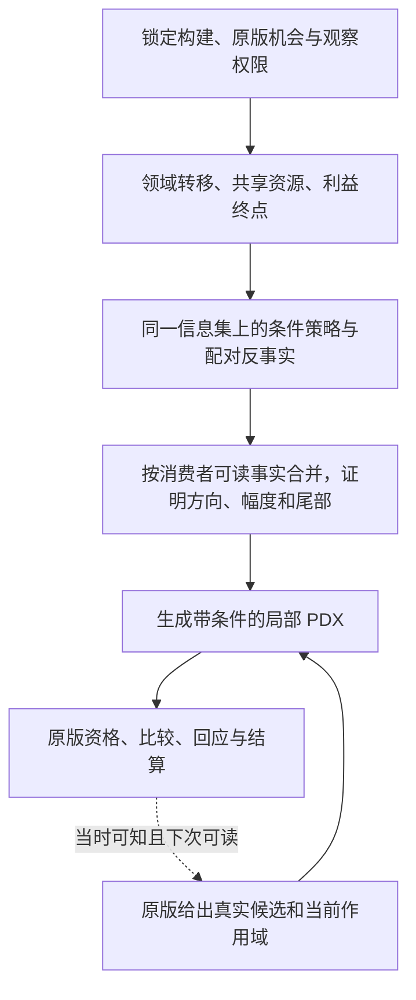

# Situated AI 架构主计划

Situated AI 把每次真实的原版国家决策看作一个带条件的未来分叉。离线用分层时序影响图比较从当前候选出发、随后仍由原版逐步提供机会的条件策略。游戏内在接到真实机会时，按该国当时的控制权、信息和消费者上下文求值一段特化 PDX。国家利益贯穿各个领域，原版裁决每一步是否发生及发生后的状态变化。战略可以调整，已经发生的后果和承诺进入下次比较。

本页定义架构、共用接口和首个开发发布阶段。[架构子计划](架构子计划.md)安排首个正式版本之后的领域和方面阶段。[当前工作清单](当前工作清单.md)登记实际生产状态。[工程交付基线](exec/工程基线-1.0.md)和[贡献指南](../../CONTRIBUTING.md)维护验证、包与交付流程。[Mod 开发原则](../principles/Mod开发原则.md)

## 从全体国家到一个原版字段

对一个国家有利的行为，可能使其他国家面对的价格、义务、资格或可替代伙伴改变。若它们也改用新判断，同一国家的下一次最佳选择又可能反转。因此采用**各国独立按可知历史决策、在同一原版世界结算、按国家分别验证完整部署**的架构。共享的是开发期的机制和证据。游戏中每个相位重新绑定操控者与实际候选，国家只收到本国依法可获知的观察。可执行的结论落实到具体原版算子。

| 从哪个问题进入 | 负责的层与交接 | 详细设计 |
|---|---|---|
| 游戏中还有哪些选择未被考虑？ | 从全安装、机制与主体三条线向机会目录交叉索引，对未知和新增机会保留开放分母。构建、玩法组合、决策国、相位、角色、对象和可知时段构成接入边界。 | [资料与机会](architecture/资料与机会.md) |
| 一项国策对谁、在何时、经哪些机会产生净影响？ | 状态与资源层保留所有权、地理与期间，领域提供正反作用；国家按共同基准和许可历史比较。先求单国，再检查伙伴和竞争者同样调整后的利益反转、延迟与分布改变。 | [跨国反事实与跨期求解](architecture/跨国反事实与跨期求解.md) |
| 哪些判断能够进游戏、失效时如何恢复？ | 把条件策略投影到确切的原版字段。合成者核对独立贡献和必须共同成立的贡献、原版运算顺序与生效范围，正式产物回读覆盖后续原版路径。 | [原版算子与投影验收](architecture/原版算子与投影验收.md) |
| 下一批实施什么，什么证据足以采用？ | 先完成共用实现与代表性生产闭环，验收并发布首个正式版本。领域归口、逐方面实施和补证从该正式版本展开。 | [领域与方面目录](架构子计划.md) · [阶段出口](#阶段出口) |

## 架构选择

| 方案 | 在财政、产业投入和战备共享资源时的表现 | 使用条件 |
|---|---|---|
| 每个原版字段独立加权 | 能独立表达眼前成本。多个字段都看到同一国库时，会漏掉产业投入挤出后续战备的代价，也可能重复计入成本。 | 作为比较基线。只有局部后果可证时，保留有独立净影响证据的局部贡献。 |
| 领域竞价或全局排序 | 能把财政、军队和产业放在一张表上。它要求统一可比较的标尺、同一时点的候选集合和兑现竞价结果的接口。跨时点相互排斥与各阶段是否发生不能仅凭出价确定。 | 离线如有共同单位、同一可行集及组合模型，可以用优化算法搜索。执行时仍由每次原版机会决定可比较的范围。 |
| 全知联合滚动规划 | 可以估计全知上界。若规划器在真实共同历史下为各隐藏状态分别选动作，或令后续行动必然出现，会高估眼前选择，且无法编译为合法条件。 | 可作为离线反例或诊断上界，输出不具有生产授权。 |
| 合法观察的滚动时域或信念状态规划 | 以同样的可见历史更新对隐藏状态的信念，按真实可行候选与机会重算。若信念是有关未来的充分统计量、时域与目标相同、信息约束和末端值相同，能得到与影响图相同的策略。 | 作为强对照和可替换的离线后端。引擎内的可表达性、预算、同版存读与证据依赖逐项验收。 |
| **分层时序影响图与条件策略** | 同一国与基准下合计终点和资源，在未来机会实际存在且新事实可知时分支。观察不足时缩小判断范围。超过接口表达能力的部分停在研究或模拟。 | 采用。高级机制逐项通过因果、合法观察、误差和原版合成验证后接入。 |

在两期产业／战备案例中，一条手写局部公式也能完全求解。若两者可以同做，`ΔI = V_I + q × 联合额外作用`。资源互斥时，`ΔI = V_I − q × V_M`。其四格结果与分层时序图完全相同。接入第三阶段的伙伴回应、延迟观察以及两处不同消费者时，应同时扩展该局部解、合法的滚动时域规划和影响图，以相同的事实、机会、终点、资源、时域、计算预算及原版权限比较。先用精确小图复核三者在共同可表达范围内的值与选择一致，再比较其新增绑定数、需改写的既有模型数、重复记账反例、求解时间与峰值内存、最终 PDX 分支、验收用例及来源变更后的正确撤回范围。若简式同样可靠且更省，可采用简式。这里选择影响图作为跨域语义与证据组织方式，求解器可以替换。

图的上半段在开发机完成，产物只有特化后的局部判断进入游戏。虚线表示下一次机会所能使用的合法反馈。



### 从国家利益到真实候选

| 层级 | 决策契约 |
|---|---|
| 国家利益 | 按当前决策国、政体和处境确定本国净收益的终点和相对尺度。以有依据的财政承受能力、生活与生产、政治执行力、国家安全等解释价值取舍。终点间无可核对的交换尺度时保留可证明的偏序或上下界。 |
| 可改的战略 | 一组随已知处境变化的目标、期限、风险和承诺权衡。对同一机会的所有候选用一致权衡。仅在净收益接近时让有效的历史倾向或战略风格参与，且其幅度不得压过已证的实质差异。只有发现原版策略选牌机会并取得其独立裁决合同，才写该机会的字段。 |
| 条件路线 | 有向时序图表示行动、外部事件、可获知的观察、资源变化和终点。每条路线只在它的前置条件和时间窗内成立，预测机会的出现、拒绝和延迟都属于路径。评估不同路线共同依赖的瓶颈和互斥条件。 |
| 真实候选 | 原版在本次机会实际递给接口的对象。只在同组候选、同国家当时视角、同尺度下比较。单候选接口仅评价该候选相对可行的现状或其原版判断。 |

主动决策涵盖游戏中的 AI 国家，包括新成立、重建及控制权切回 AI 的国家。每个接入点都要证明判断主体是国家操控者。开启、关闭自动管理及委托可以是国家政策，启用后自动执行的具体选择归原版。控制权切回玩家时，其操作按原版运行。自有选项通过标准接口加入后，合资格玩家与 AI 默认都可用，保留既有选项。私人投资者等独立主体仅通过合法的国家政策和原版世界状态间接受影响。[MP-03、MP-47](../principles/Mod开发原则.md)

## 原版机会与证据

### 机会合同

`Opportunity` 由构建与 DLC 条件、原版入口及调用相位、实际决策国和控制权、原版候选及阶段、参与者的有向角色、原版资格与执行路径、同一比较内可用的基准构成。相位指定这一阶段何时求值、有效作用域、是否允许读目标、可用当前或维持路径、后续的独立门与随机规则。采用同一 `action_id` 的初筛、提案、受理、激活、维持与退出是不同机会。另登记谁调用字段、谁在这次机会作主动决策、从谁的视角估值、谁有权最终批准。组件回调和缓存命中可能只是另一个国家在起草时调用的估值步骤。每个读点按实际用途复核这些身份及其信息交集。动态身份取引擎在求值点提供的绑定，国家标签、同名脚本键和重复发生的事件不充当实例身份。无法以标准作用域证明一致绑定时，依赖该身份的贡献归于中性。[MP-25、MP-46](../principles/Mod开发原则.md)

每次求值要先通过构建、当前国家控制、实际角色、作用域与指向、决策相位、读点存在性、观测时效及单位约束。真实资格、可选集、对手的判断、原版随机、支付和执行由原版确定。原版若无明确的维持或等待选项，用该候选未被调整时的原生判断作局部基准。历史比较和模拟可以报告反事实，生产不得据此制造一个本次机会并未提供的竞争者。

### 从完整资料到国家观察

| 核对层 | 必备证据 |
|---|---|
| 开发研究 | 以版本锁定的整个安装为独立分母。登记原始文件身份、格式、语法解析、语义理解和处置，不因脚本暂不能使用而遗漏资料。官方资料、原版示例、实测及研究推断分别留来源。 |
| 引擎可用 | 按官方标准确认具体字段、时机、读法、作用域和操作。单独核对候选来源、赋值对象、合成方式、后续否决与执行。只凭实测采用的用法，以及实测与官方明确说明冲突后采用的用法，逐正式构建复验。组成用法分别有官方文档且仅组合效果依赖实测时，按接口或行为变化复验组合。 |
| 国家可知 | 用游戏机制证明当前国家此时可知，绑定对象、归属、方向、实际观测时点、时效和单位。开发者掌握的定义、隐藏数据和未来结果属于研究材料。若确认受改原版判断使用不可获知输入并可单独移除，移除该输入并采用合法依据，核对其余判断。不能单独移除时，保留该原版判断整条路径。 |
| 消费者可达 | 针对当前相位和 ROOT、辅助作用域、目标角色给出正反见证。消费者对某信息的可达性独立于该国在游戏中知道此信息。最后回读正式产物，证明实际接线、作用归属及原版尾部。 |

`Observation` 按构建、观察者、被观测对象、角色与方向、含义和单位、事件时间、实际获知时间、有效窗、来源指纹、适用机会及证据状态标识。同一事实的晚报从实际获知后才可用。不同市场的相同价格、相反方向的义务及候选国与观察国数据互不能代用。显式区分已知值（含零）、有依据的估计或区间、未知。失效信息可以留作有来源的历史样本，其预测作用须经过时效与工作模型的声明。引擎无法区分缺值和实际零值时，只在独立存在性保护成立时使用对应读数。[MP-10](../principles/Mod开发原则.md) · [官方资料指纹](../../research/official-docs-1.15.2.manifest.json)

本轮定位 Victoria 3 1.15.2、校验码 `fb14`、Steam public build `26763837`。完整安装目录、官方随附接口资料、静态声明、按国可知事实及生产消费者分别建立可追溯分母。静态清册描述脚本形状和来源，历史安装目录仅能证明它保存的定位信息。当前符号解析及分层处置取自适配当前工具的研究目录。[官方补丁公告](https://store.steampowered.com/news/app/529340/view/1849827110428155) · [随附官方资料指纹](../../research/official-docs-1.15.2.manifest.json) · [静态盘点入口](../../src/pdx/situated/vanilla_inventory.py) · [资料与机会](architecture/资料与机会.md)

冻结报告定位为 `tools/out/sa-full-game-analysis-1152/frozen-8d58deee066d15609858af79f3fdf0a1db34be66/installation-catalog/`。安装 epoch 为 `4fa973e8d7589a5d04c90f2f8eb7902ea97839b9dbc5b4508779878d73db1a70`，`COMPLETE.json` 的 SHA-256 为 `d20a3022b4b4dc6a6b04722d75feadc135fb343634f757c2960153fa0c89e315`。SQLite 和目录报告各自的原始哈希在该清单登记，换机器时可用正式研究入口重做盘点。[完整安装研究与查询](../../CONTRIBUTING.md#完整安装研究)

维护相互可追溯的分母。资料按包、路径和配置扫描，静态候选按机制与阶段去重，逐次接入以“机会家族 × 相位 × 候选角色 × 读取或写入”登记。领域接口目录是研究排程，生产声明以各项实际接线和逐国可证的观察范围为准。保留解析失败、未知、未探索、保留原版与已证不支持的明确理由。新玩法 DLC 或补丁先差分盘点，再按原始字节、解析、语义、合法运行观察、生产接线五段重证。例如 1.15.2 补丁移除了 `breaks_if_subject_not_protected` 和两项 `on_diplo_play_subject_released…` 用法，并新增 `conclude_journal_entry`。对应依赖分别重新定位、判断语义变化或撤回。新增效果独立取证，进入资料目录并不代表已经找到国家判断机会。[工程原则 EP-38 至 EP-43、EP-62](../principles/工程原则.md) · [原版策略与字段索引](02-可执行面-1.15.2.md) · [原版政治候选索引](02-政治候选面.md)

## 条件策略与反事实估值

### 图的时间、信息和因果语义

对决策国 `c` 在机会 `o` 的合法观察历史记为 `h`。一次推演的显式状态包括可观察物理量、可能的隐变量、已知义务及期限、活动中的原版行动和未来机会的出现条件。国家策略 `π(h, o)` 只能使用该国当时的观察历史和原版实际给出的选择。模型可存储隐藏世界及他国状态以解释不确定性，两段历史在该国所有许可读点上一致时，策略必须给出同一决定或同一原版随机分布。离线可用历史比当前消费者可读历史更丰富时，还须对消费者读点重新合并等价类。

图含决策、机会到达、外生变化、行动结果、观察、资源和后果节点。以明确的前后关系连接节点。同时发生的决策按各自的主体、机会角色和消费者许可读点划分信息集。同一主体面对同一许可历史时，不能借序列化顺序提前获知并行决定或结果。反馈边必须携带正的时间延迟或新的原版求值机会，同一求值中的循环依赖在构建期报错。合同登记谁在何时获得何种观察，事件已发生与决策国已获知分别建模。未来的伙伴回应由伙伴自己的视角及原版决定，决策国只能使用该分支的有据概率或有界不确定性。

每条因果作用登记干预、被影响终点、方向、时延与持续期、适用上下文、对照基准、模型与证据来源。静态定义可以给出数量、公式和候选身份，因果大小还需证明当前主体可受其影响。对价格、贸易、财政等有共同原因的变量先连接共同驱动，再判断行动带来的边际变化。例如油价同时关联军需开支与供给紧张。价差可作观测，只有额外证明的财政损失和服务损失分别记入终点。不能仅凭共同变化把两者都换算为损失。

### 净得失与跨域合成

各领域向共享图提交观察、资源约束、转移、终点和反例。终点登记受益或承担方、对象方向、期间、共同反事实基准、归因实例、单位和适用视角。现金流、存量和能力用不同类型。流量按明确期限积分到同一价值基准，已完结的过去损益只影响当前可用状态。各国利益函数可随已知政体和处境取不同权衡。在同一次比较内固定其口径。近期履约与生存、过渡期收益和远期产能分别登记到达时点、折现假设和残余价值区间。远期证据不足时，缩短推演并保留未展开尾部的上下界。

1. **单次归因。** 以“决策视角、对象方向、后果及单位、期间、基准、归因实例”为键归并。对同一终点记录多个解释或来源，计算一次收益。事件拆到相邻无重叠期间可以累加，累计量与其流量之和互斥。已由原版比较计入的影响只允许写可证明的残差。原版已计部分未知且方向可能抵消时，撤回对应残差。
2. **联合作用。** 在相同初始条件和外生历史下，双因素额外作用为 `U(A,B) − U(A,0) − U(0,B) + U(0,0)`。只有四种干预解释均有依据且同属可比较基准时才单列。互斥行动不能虚构共同执行的状态，直接比较合法路径。高阶组合同理按条件残差或整组估值，不能在同一终点上把整组值再加回各边际值。
3. **资源和机会代价。** 分开表示存量、产能流、义务和可用时间。原版支付或开始履约之后，才用已实际观察的金额与状态更新历史。已建、已开工、在途、可使用和已耗用各有时点。假设行动只在其反事实分支改变资源，未出现、未采纳、被否决、未能完成依其原版后果处理。用选择该行动后挤掉的最佳可行延续路线测机会成本。资源已挤掉一条路线后，不另扣同一机会的影子价格。可在已证局部线性区间用影子价格近似显式约束，须验证两种表示的误差。
4. **政体和风险。** 政府或联盟延续本身可为有穷终点，特定政体即便稳定和执行力不变，也可为延续放弃有利改革。亡国的巨大损失与有据可能性进入整体权衡。只要低概率高回报方案的预期净收益确实占优，即使存在安全路线亦可选择。两者都需要单独的试验反例，以检出绝对禁止或无条件偏好。
5. **信息价值。** 等待有时间和错失机会成本，试探有真实动作代价、损失上界和可得到的观察分布。只有在原版提供可行的等待、试探或直接行动时，才比较其各自延续策略。若试探所获观察不能影响后续选择，则其决策信息价值为零。已足以采取行动时可直接行动。[MP-02、MP-35](../principles/Mod开发原则.md)

### 求解与宽度控制

1. 从真实候选 `a` 和基准 `b` 的共同机会向后选取可影响两者差值的终点、资源和后续决策。保留资源竞争、共享驱动、交互与终点合并的完整依赖。可剔除在所有可行路径上相同的加性常量。仅两分支边际分布相同，不能据此删除影响联合约束的节点。
2. 构造当前合法历史容许的模型集合 `Θ(h)`。每个模型给出机会出现、世界转移、观察到达与原版响应的联合分布或有据区间。只有在证据支持条件独立时才分解概率。用同一外生情景配对评估候选和基准，各自推演行动造成的内生变化。允许哪些模型、采用哪个校准集、如何外推必须先声明。无依据概率保留范围或未知。
3. 小图可直接枚举完整条件策略树，或采用带有效上下界的确定性分支限界搜索。优化使用后向归纳时，须先满足下述信息和歧义集合条件。分支键为可观察历史及实际机会。每一根行动可配不同延续策略，但一条策略必须对全部相容模型和隐藏状态实行相同的信息规则。预先选定求解准则，如分布有据时最大化期望，概率集合不稳定时先按偏序剔除被支配策略。需要单一稳健代表时，可在已声明的模型集合上选择最大化最差有据净收益的延续策略，再固定它做配对复核。该下界是判断可信度规则，不能把任何亡国风险改写成原版否决。
4. 可核查的比较对象是固定的可行策略对。对每个 `θ` 计算同一模型下的 `Dθ = Eθ[U(πa) − U(πb) | h,o]`。若声称某一根行动优于所有基准延续，须使其可行策略下界超过**所有可行基准策略**的上界，或提供等价的最优性证明。只胜过指定的原版基准策略时，授权范围仅限该比较。隐藏信息完全可知时得到的最优值只可用作上界。
5. 对每个可编译的观察单元取所有相容历史与模型的配对差下界及上界，并扩大以包含搜索缺口、截断尾、分桶、数值误差及适用的抽样误差。误差来源可能相关时采用保守的联合界。区间和最终算子响应均严格支持某一方向，才授权该方向。区间跨零时可独立证明某个在原版基准上仍成立的局部残差，并再次检查它在完整写点的净方向。其余贡献撤回。相近差距或证据不足时保留原版含随机的比较。
6. 建立预算 `(H, N, W, K, E)`，分别限制时间窗、展开节点、依赖分界处需联合枚举的状态数、输出分支数和允许误差。按小图精确解测近似的差值与方向。需要比较实现成本时，记录该机会的求值频率及包规模。剪枝须给出剩余上界。超预算可分解被证明独立的子图、合并有误差界的状态、缩短窗口或仅留可证局部贡献。达到预算和达到可比较精度分别记录。任何时间预算耗尽都不能把未展开的有利或不利路径记成零。

固定当前行动 `a`，令 `Πa(h)` 为可在所有相容世界实施的延续策略，`Ja(π,θ)` 为该模型下的期望总效用。选择稳健代表时用 `max[π∈Πa(h)] min[θ∈Θ(h)] Ja(π,θ)`。先为每个隐藏模型求一个最优策略再计算差，会给策略附加一个不合法的模型标识。要证明 a 对 b 的全部延续都有优势，可以找同一个 `πa` 使 `min[θ,πb∈Πb(h)] (Ja(πa,θ) − Jb(πb,θ)) > ε`，其中两个价值来自同一个 θ，ε 覆盖误差与已声明的最小有意义差。具体实现可用更保守的上下界代替。个别模型各自有一种获胜策略，不足以满足这个共同策略条件。

同一个模型的跨期相关性也须保持。设下一期有两个等概率可见情境，模型 θ₁ 的路线价值分别为 (0,8)，θ₂ 为 (8,0)。两模型均以同一个 θ 贯穿整条轨迹。对该路线取最坏期望是 4，逐个情境取最小再平均则是假造两模型都不具有的收益 0，会把真实价值 4 错排在固定收益 2 之后。单一模型有充分信息状态时可做常规 Bellman 递推。模型集合已证明具有矩形性（各信息集的许可条件分布可以任意拼接，且拼接后仍属于原集合）、状态充分且目标时间一致时，可以在递推中逐点取最坏分布。否则保留每条可行策略按全局模型索引的回报向量或等价的联合参数约束，在根处重新组合并取最差，必要时枚举整棵策略树。引入保守的矩形外包络时，须声明新界宽度和可能导致的弃权，真实模型集合仍用于核验方向。

路线中未来由本 Mod 判断的动作还须有延续可实现性。实际部署的下一机会若由原版随机或他国独立决定，沿其已证原版续策或有据的响应范围估值。若拟联合修改本国多个相位，在每个可达信息集复核当时会采用的投影、继续或转向的成本，以及已经获得的新信息。未来重新权衡后会改选时，以真实可执行的续策重新评估当前候选，不能用一个自己以后不会实施的最优计划向当前借收益。

离线场景树的最坏规模随时域和联动维数指数增长。实现可按可观察历史归并，把对未来分布和效用等价的资源状态共享为有向无环图。消元时保持资源与相位的联合边界。近似状态须保留上下界，以超过误差的配对优势作为准入。多阶段试探只有在试探观察真正区分了后续可选动作时才增加展开深度。通用学习模型和蒙特卡洛树搜索可用于提出路径或校准有来源的参数。生产表达和结果仍须过相同见证。缺乏覆盖的黑箱值函数仅留研究。

### 共享资源的手算试验

取一个可精确枚举的两期设计试验，数值为无量纲净价值或资源单位，分别计算。当前原版只给产业投入 `I` 或维持现状。资源总量为 7 或 10，已观察到的义务占 2，实际可用量为 5 或 8。`I` 占 4。设下期外生军需机会 `M` 到达的概率为 `q=0.75`。执行占 3，能否执行另由实际剩余容量决定。正常情况下 `I,M` 单独净价值为 6、5，合做时额外 +1。已经合法获知断供时，单独价值为 2、9，合做时额外 −1。两分支共享外生的 `M` 到达事件，原版只在它出现时才可采纳它。设每个可行的 `M` 在本试验都值得采纳。

| 已知处境与可用量 | 投入后的期望值 | 维持后等待军需的期望值 | 本次投入相对优势 |
|---|---:|---:|---:|
| 常态，5 | 6 | 0.75 × 5 = 3.75 | +2.25 |
| 断供已知，5 | 2 | 0.75 × 9 = 6.75 | −4.75 |
| 常态，8 | 6 + 0.75 × (5 + 1) = 10.50 | 3.75 | +6.75 |
| 断供已知，8 | 2 + 0.75 × (9 − 1) = 8.00 | 6.75 | +1.25 |

常态下容量不可区分，优势区间为 `[2.25, 6.75]`。断供已知而容量不明时变为 `[−4.75, 1.25]`，需要证实低容量才可降低该投入偏好。若 `q` 仅有区间，低容量断供时的式子为 `2 − 9q`，以区间两端求界。低于、等于、高于 `2/9` 的临界值分别检验方向和回退。高容量常态下的优势为 `6 + q`，若再扣“错失军需的价值”会制造不存在的资源冲突。未知玩家计划引发的断供，在该国依法获知迹象前不能用作当前分支条件。

附加反例把两种等概率隐藏世界的两个后续选择回报分别设为 `(8,0)`、`(0,8)`，可合法观察的历史完全相同。可执行的任一固定选择期望都是 4，按隐藏世界逐个取最大会报告 8。若原版后来实际提供可披露该状态的试探，信息带来的最大增益为 4。试探及等待全部成本超过 4 时优先直接选择。两种版本成对验证信息权限、延迟和推演器的策略约束。本节的数值只用于检验设计模型和参考算法。

## 原版投影与运行生命周期

### 原版字段干预的价值

根选项优势回答“如果实际选择 A 或 B，沿各自可行续策有何净得失”。生产写入的是原版消费者字段。设 `x0` 为原版字段向量，`x` 为拟部署的一组联合修改，`Pθ(τ | h,o,x)` 为同一模型下原版从该机会继续搜索、产生或跳过其他候选、排序和随机、作出与接收回应直至结束所生成的轨迹分布。轨迹含未行动、延后与失败。字段干预价值为 `ΔJθ(x) = Eτ~Pθ(x)[U(τ)] − Eτ~Pθ(x0)[U(τ)]`，两分支共享外生情景。若字段还改变等待、搜索成本或后续行为，把这些后果放入同一轨迹的效用。将整组候选与继续搜索扁平化为互斥终点且后续价值固定时，上式简化为 `Σj (p_x(j) − p_0(j)) V(j)`。

例取三个实际候选，`V(A)=5, V(B)=0, V(C)=9`。提高 A 的字段使 A 的概率增加 0.2，若全部来自 C，国家期望净值变化为 `0.2 × (5 − 9) = −0.8`。若来自 B，则为 `+1.0`。A 相对 B 的优势在两个案例中相同。每次联合投影须验收整个候选组、其外的继续搜索和实际原版尾部。将多个字段分别调优后合并，必须把合并后的字段向量重新作为一次干预，与原版及单独干预对照。能界定概率质量来自哪些候选且它们均被 A 支配时，可证明净方向而无需知道精确概率。来源范围、响应或尺度不充分时，仅登记模型条件下的根选项优势与静态字段响应，不能授予“整体净收益为正”的结论。可能挤出更优候选而无法界定损失时，对应联合干预保持原版。若局部比较有独立合法证据、原版作用范围明确、后来可比多局达到 MP-47 的判断改善条件，可单独决定该局部调整的采用范围并保留实际成效待证。[MP-25、MP-46、MP-47](../principles/Mod开发原则.md)

### 最小中间表示与写入归属

| 模块与唯一职责 | 输入 → 交付 | 可独立核对的契约 |
|---|---|---|
| 原版与证据目录 | 版本化安装、官方说明与实测 → 原版机会、读取/写入能力、原文位置、指纹与失效关系 | 目录消费原始证据。供给、模型和编译模块仅引用有版本身份的能力，不反向扩充许可。 |
| 领域模型 | 已核定的机会和事实 → 类型明确的观察、约束、转移、终点及反例 | 各领域拥有其事实含义、转移及校准证据。共用的商品、资源、观察角色和原版时点登记一次。无领域拥有某个国家的最终权重。 |
| 决策模型和参考求值 | 领域条目、共同资源、利益及机会 → 按观察历史比较的策略对、配对界、撤回依赖 | 只认识语义类型和原版能力标识。小输入可独立精确重演。折现、交互、归因、策略信息集和误差都能单独替换并检验。 |
| 编译与原版适配 | 比较结论、证据、确切消费者及其原版 AST → 有保护条件的局部 PDX 与写入凭据 | 每个最终字段或允许的组合范围只有一个合成者，合成者负责所有已注册贡献。原版上下游由对应消费者定义。 |
| 生成、独立审计与包装 | 生产声明、原版和局部 PDX → 经回读的完整 Mod、生成锁、独立证据及确定性包 | 生成使用[既有正式入口](../../src/pdx/decisions.py)及[分发入口](../../src/pdx/distribution.py)。审计从固定原版与实际包读回作用，参考机不调用生产编译器的评分代码。 |

最小语义中间表示只需要下列节点。`Read` 表示有类型和信息权限的原版观察。`Guard` 表示存在、控制权、身份与范围。`Opportunity` 和 `Choice` 表示真实机会和依照同一信息集做的选择。`Transition` 带事件、时延、资源增减和观察到达条件。`Endpoint` 带归因与价值尺度。`Compare` 带共同基准、策略、区间及误差。`Emit` 带授权的写点、对原版操作的有界改动、实际生效条件和恢复方式。领域只声明前六类所需的语义输入。写点保持原版消费者适配器的单一归属。首片可用现有解析器、类型和生成入口实现，先按以上依赖方向建立可测试边界，再决定是否拆成独立 Python 模块。[现有生产声明](../../mod/decisions/) · [原版适配证据](../../research/situated/1.15.2/consumer-adapters.json)

适配器至少能完成以下四件事。**定位**从所锁原版取得唯一目标、同类活动策略、父上下文、原版操作顺序和后续门。**绑定**给出此相位可读的国家、候选、目标、即时事实与中性行为。**降低**把可表达的观察区域和获证方向变成作用于原版确切位置的操作，并记录所需尺度、取值域及依赖。**回验**从实际产物重建生效条件和算子，确认撤回自己后恢复约定的基础 AST，独立贡献与顺序保留。未知写点、重复写者、类型错置、底本漂移、未经证明的覆盖或缺失产物必须显式失败。正常运行中的缺失信息走对应机会的局部回退。

例如用动员作适配器的独立契约测试，可以把可观察保护条件写成以下伪代码。符号 `k` 是经过原版算子幅度校准的正乘数，取值与单位由该消费者证据给出。编译期若没有该幅度证据，整个分支使用中性值。

```text
来源      当前编队 → 此时的所有国 → 此时该国的市场 → 本候选用到的商品
保护      所有国由 AI 控制，身份和单位匹配，两项商品读数均已合法获知
判断      配对净得失区间支持额外成本，且已扣除原版货币成本比较所计部分
投影      若保护和判断同时成立，对原版权重乘 k（0 < k < 1），其他情况乘 1
回读      原版单位基础值 × 原版权重 × 此乘数 → 原版比较货币成本 → 原版裁决
```

开发侧还需核对成本残差确有独立物理后果，降权时 0 基数、临界值、资格或原版尾部没有被误改。能合法看到价涨、却没有额外损失证据的编队，不能仅因价涨再次受罚。该例的条件和符号用于测试未来特化实现。

### 各原版算子与整条路径

| 原版情形 | 投影方式与验收反例 |
|---|---|
| 默认策略 `institution_scores` | 原版注释说明相同字段在各策略间加法合成。学校制度评分按本消费者单位调整，核对其他活动策略和完整原版项。财政层或教育层已计的同一后果只给残差。把加数误写为系统总分必须被检测。 |
| 默认策略 `goods_stances` | 不同策略可覆盖默认值。核对哪些活动策略实际遮蔽本次写入，以及该枚举在原合同中如何合成。扩展一个合法供给条件时保留已有 OR 分支和原版优先关系，无法证明最终可见时保留原判。 |
| 动员选项 `ai_weight` | ROOT 是编队。对编队所有国绑定合法的当前市场与商品。权重先乘单位修正的基础 AI 值，原版再与货币成本比较。原生 goods 数量系数、市场价格、货币成本和最终价值为不同单位。原生零基数不会因正乘数产生正偏好。 |
| 外交 `evaluation_chance`、`propose_score` 与条约 `proposal_weight` | 初筛概率、提案分数和条款纳入倍率各有消费者与时机。一个机会对源国适用，另一机会可能评估目标国的利益。原版否决、阈值、截断、其他候选、顺序与合理随机都可能限制局部数值的效果。 |
| 新消费者或自有机制 | 可以采用标准接口支持的新选项、整组替换、开关、组合接口或其他算子。逐项证明原版比较、玩家可用路径、权限、具体副作用及撤回。覆盖整组时列全原组差异，逐一核实其余原功能。 |

对一个字段的差值先证明方向，再证明**尺度及最大可写幅度**。模型中的价值单位不得直接当成 PDX 加数、百分比或乘数。以确切的原版输入范围、目标单调区间、是否可饱和、是否改变否决、候选竞争和请求处理决定允许的参数区间。例如 `base × factor` 的贡献在 `base=0` 时为零，若允许负基数还可能反向。无法校准幅度或原版最终算子时，保留相应原生判断。同组有多个动作时，以同一观察区域内的已证偏序作约束。归因、尺度或上下文不同导致循环时回查来源，不把互相矛盾的两两偏好编译成排序。若原版整组归一化或随机加权，同一动作的修正会改变其余候选的份额，须用整组复核。可接受近等价时，使用原版合理随机。即使静态能证明字段增加，也只声明所能证明的最终作用，例如“在该片段增加初筛值”，不得提升为“该国更常执行此行动”。[原版消费者结构](../../research/situated/1.15.2/default-strategy-structure.json) · [动员候选及单位](../../research/situated/1.15.2/mobilization-opportunities.json) · [条约候选](../../research/situated/1.15.2/treaty-opportunities.json)

合成必须验证从首次机会到预期终点的联合变化。设一个设计试验最终采纳率为初筛率与通过初筛后的受理率之积。初值 `0.4 × 0.5 = 0.20`，两个参与者的改动分别把条件率改为 `0.6` 和 `0.75`。两者共同生效得到 `0.45`，相对原版增量为 `0.25`。单处改动各增 `0.10`，额外 `0.05` 来自联动。真实游戏可能存在相关性、资格与更多回应阶段，其各项概率和尺度须另证。若两处重写使用的是同一收益理由，还须检查整个联合变化是否超出该理由能授权的幅度。选择只改其中一处或把整组重新校准。

### 防御条约的跨期闭环

1. **初筛。** 在 1.15.2 的防御条约条款 `ai.evaluation_chance` 中只有正在考虑的国家 ROOT。A 可以依据合法可读的本国处境评价是否考虑该类条款。伙伴 B 的数据尚未绑定。若调整需要 B，贡献在本阶段为中性。
2. **构造提案。** 当 `proposal_weight` 已实际提供相应国家作用域，A 才可按已合法获知的 B 的关系、共同利益和自己的承受能力评价该对手。原版决定是否成案、发送，及能用哪些条款。不同包的组合与绑定期若影响得失，只在能依法读取相应信息的阶段计入。
3. **估计受理与实际回应。** 原版可在 A 自己起草、增添条款时调用对 B 的受理估值。受评国家 ROOT 为 B，主动决策者仍是 A。`inherent_accept_score` 可复用，原版不在每次加入条款时重算。`scope:article` 在这里无法提供完整条约。`contextual_accept_score` 有 `scope:treaty`，A 自己向草案添加内容时即可重算。只有原版实际把提案交给 B 决断，B 才在自己的信息和控制权下选择，玩家 B 自行操作。A 判断对方意愿只使用 A 合法可获知的信息。两阶段共用一个字段又无法证明调用相位时，采用对所有可能调用者和用途均合法、时效均有效的成分。B 的私有变量、仅 B 可见的新信息和 B 的真实接受动作不能借缓存泄露给 A。在草案阶段或只读到受理分数时绝不登记 B 已承诺。
4. **批准与生效。** `can_ratify` 和 `requirement_to_maintain` 的 ROOT 为条款，不能从 ROOT 直接读取国家事实。本例沿防御条约的自愿谈判路径，在原版检查相关方前置且各方批准后生效。其他带强制标志的条款另验战争目标实现后的生效、两个原版回调及实际后果，见[法律承诺的强制路径](architecture/原版算子与投影验收.md#条约从条款到实际债务)。拒绝、未批准、仍在草案与已生效分别记录，A 只在实际获知生效后将可证明的义务计入其后财政和战备比较。
5. **履约与重评。** 如后续原版实际提供决定履约或作出其他回应的机会，由决策国重新比较。原版判定履约、拒绝、损失及其可观察后果。只有当所需军需、产业能力、国内成本已由 A 可见，才在对应国家机会调整动员或产业投入。订约并不直接证明某次军需实际发生。A 在原版再次提供维持、续订、重谈或退出机会时，依已知履约史和转向成本重新评价。没有该机会时维持实际原版路径。

防御条约在目标构建为互惠条款。`first_country`、`second_country` 是若生效将受约束的两国，当前评估者须由该相位重新绑定。定向条款另有 `source_country` 和 `target_country`，不能将互惠双方的位置当成付款方向。测试应交换 A、B，切换一方控制权，在初筛塞入伪伙伴，在 A 草案重算 B 分数时分别改变 B 的私情与合法公开信号，核对两分支和缓存都不能泄露前者。于生效前虚构已付义务，并把第三国相同值注入。本轮以原版文档和静态字段支撑相位划分。实际初筛、采纳、执行、观察与以后重评仍须取各自的 R 证据。随附 `common/treaty_articles/treaty_articles.md` 第 527–530、581–607 行分别给出初筛作用域、基础受理值与情境受理值的调用条件。[1.15.2 条约机会与原件定位](../../research/situated/1.15.2/treaty-opportunities.json) · [防御条约计数的静态证据范围](../../research/situated/1.15.2/engine-defensive-pact-reader.json)

### 失效、重入和存档

默认在真实消费者求值时无状态读取。如果时序判断需要历史，只采集由官方标准机制产生、且决策国当时有权得到的观察。可持久记录的最小内容为观察者与对象角色、事件/生效身份、观察时间与有效期、实际获知的值或区间及来源。只有能证明需要、可绑定、可保存与读回且不重复计数时，才建立自有历史。无法区分两次事件或事件是否重复时，优先读取当前生效的原版状态，或放弃依赖次数的判断。

每个写入凭据保存规范化的**实际**生效条件及其闭包，包括控制权与范围、必要观察、完整性组、互斥或替代关系、归因、比较基准、消费者算子及底本版本。原始分支条件相同，但新增一个必需的桥接条件导致联合有效范围变化时，旧授权失效。按反向依赖索引重算受影响的组和写点。合法的可选读点失效只撤回对应贡献，无法分割的同因组整体撤回。去掉最后一项扩展时复原原版字段，仍成立的独立判断照常合成。

控制权切换、换国、重建、条约终止、编队改属、市场变化、DLC 条件和读档均触发身份与有效性复核。切换到玩家后停止对其国家判断的贡献。重新由 AI 控制时，按当时合法可获知的事实重建。若无法证明仍可使用以前的观察，则撤回该段依赖。只有已知变化会改变判断、等待下一原版机会确有代价、且有官方接口证据时，才允许附加重评。附加机会核实触发去重、重入、冷却、原版资格与后续动作可达性，防止反复创建同一判断。关闭功能撤回后续贡献，已经由游戏实施的条约、支出和世界结果按原版生命周期延续。[MP-31、MP-49](../principles/Mod开发原则.md)

## 扩展合同与实施顺序

每个方面接入时登记稳定 ID、机会与相位、已证国家主体、原版候选与基准、所需读点、资源和终点、可能联动的其他方面、拟写消费者、原版中性行为、反例与当前证据状态。写点可空。市场读点供军需和工业共用，各自用本次国家和市场重新绑定。新增领域可以提供一个共同终点或来源，无需创建独立策略笼统加权。建立“实际原版机会减已登记机会”的差集来发现破产、政策开关、法律修正案、舰队自动补舰或投降等遗漏。逐步核对每项究竟是国家选择、原版委托执行还是独立主体行为。方面清册及其处置以[架构子计划](架构子计划.md)为准。

### 分层接入与写入边界

一个新方面先交付四组信息。第一组从原版取实际决策主体、机会、候选与原生基准。第二组列国家可知的事实、当前消费者能读的作用域、确切算子及待取证据。第三组列对同一对象和不同时段的收益、损失、分配、相反作用、间接响应与共同约束。第四组给出最小正例、能击穿错误实现的反例和失败时保留的独立判断。领域模型只能供给这些有出处的条件，原版适配器持有实际写点。

以海峡为例，控制方可从收费中得利，依赖通道的另一国承担费用，并可能转用其他航线或就此交涉。根据实际权限分别识别设定通行政策、政策改变后原版自动计算的费用、他国接下来的国家选择。同一个通道事实可供海军、贸易、财政和外交四方面使用。当某国失去控制权时，撤回只依赖该权力的原政策判断。仍有凭据的路线和价格观察可以继续使用。若另一个国家的措施已改变通道条件，再按该变化的获知时刻更新。这条链可以先验证来源与国家角色，待某一端具有可校准的写点后单独投影。[原版机制族与撤回反例](architecture/原版算子与投影验收.md)

### 高级机制的选择门

| 机制 | 可以实施或深化的条件 | 证据失败时的处置 |
|---|---|---|
| 可观察历史上的有限时域参考机 | 先实现精确小图，手算四个资源案例、观察等价反例及概率边界均一致。合法历史外的任何值都不能影响输出。 | 修正参考语义。保留稳定原版和独立消费者。 |
| 跨期条件策略与资源联动 | 至少一项当前真实候选经已证资源竞争、未来机会或相互作用改变相对方向，并以共同基准重现。可见投影过粗时保留相容历史的全部区间。 | 缩短时域或按原生相位输出单项可证残差。领域联动保留为研究。 |
| 学习或概率校准 | 记录可见训练特征、出处、留出国家／时间窗、预测与校准误差。在分布漂移、未见处境下有有据误差界或失效规则。按处境报告二元机会的 Brier 分数或校准误差，并与原版频率、简单分层估计比较。 | 不用其估值驱动生产，可做离线候选发现。无样本时以有据的范围计算。 |
| 长历史、自有记忆和附加重评 | 在相同即时原版读数下，合法历史确有不同、能改变选择，收益超过记录或等待成本。实机验证控制权、重复触发、加载顺序及同版存读。 | 使用无状态原版读点，或等待下一原版机会。 |
| 更深搜索、近似消元与共享编译子图 | 在相同输入上与精确小图及上一级深度对照。校验误差包络、最大 regret（可行基准最优值减选中策略值）、编译分支数、最坏求值路径和吞吐，达到预先声明的同口径预算。 | 在预算内改用界限更宽的结果。没有足够净优势时走局部中性。 |
| 长期全局策略、国别倾向、信息试探 | 有合法本国利益路径与真实机会，非近似等价候选的顺序不受风格逆转。试探必须能在以后产生可用于自适应选择的信息。 | 不建立国家标签脚本或无依据的全局乘数。对可证的当期机会继续局部判断。 |
| 引擎外在线规划、全知玩家预测、跨国共享隐情、影子预算强制预占 | 违反合法信息、实际机会或引擎裁决边界。 | 排除生产实现。可用全知最优作离线误差上界，原版资格、支付和执行完整保留。 |

### 阶段出口

| 阶段 | 交付物 | 出口与失败路线 |
|---|---|---|
| 主计划开发与发布 | 共用机会、合法观察、条件策略、原版投影与回读链路、一个有跨期反馈的代表性生产闭环，以及首个采用本架构的正式 Mod 版本和发布收据 | 用同源候选完成工程与 Mod 静态语义验收，按固定包取得支持声明所需的运行实测，按成效证据确定采用范围。在获授权的公开渠道回读正式包并确认玩家可获取后，进入领域和方面阶段。核心闭环或发布前提仍缺证时保留证据、原版路径和阻塞，继续完成本阶段。 |

首个正式版本聚焦共用实现与代表性闭环。以防御条约为主线验证同一条款在不同相位的信息边界，以产业和战备案例验证可以独立手算的资源取舍。对现有生产消费者逐项核对回归和原版路径。拟改变的既有行为逐项说明预期的 PDX、行为差异与依据。代表性闭环以外的方面迁移从该正式版本进入各自阶段。 [领域与方面的阶段边界](架构子计划.md#领域与方面的阶段边界)

### 阶段内实施

| 步骤 | 交付与核验 |
|---|---|
| 固定资料与共用合同 | 核对最新官方公开稳定构建、完整官方玩法 DLC、独立资料分母、原版接口证据及既有生产边界。按工程原则和 Mod 开发原则核对实施设计及适用的反例。冻结首片候选的初筛与条款提案相位、ROOT 与对手绑定、单候选原版基准。确定机会、观察、状态转移、资源、终点和消费者的共用合同与各自验收。 |
| 独立参考与首片生产投影 | 用精确小图重放机会、选择、作用和观察顺序。手算产业／战备四格差值与隐藏世界例得 4。以相同信息和约束核对强局部公式与小图的四格结果完全一致，并检验只计当期价值在低容量断供时方向反转。防御条约首选 `proposal_weight`，落实量纲、原版中性保护、唯一写者及正式生成路径。从正式 PDX 与独立原版 AST 回读正反差分，证明 B 依赖不能进入只有 ROOT 的初筛。条约缺乏合法、可校准的贡献时保留其原生值。学校或动员的已核合同可为局部投影补证，收据按各自范围签署。 |
| 跨期生产闭环 | 将条约提案、对手自主回应、批准、生效、履约或拒绝、军需和产业机会，以及本国获知结果后的重评串成条件图。按共用合同新增一种原版算子及一种领域接口，记录各自所需改动。在正式产物覆盖至少两个不同相位或消费者，验证机会缺失、利益反转、迟报、失去资格、玩家接管，以及撤回单项后原版和其余独立贡献继续生效。首选链路受阻时记录每个缺环与补证条件。若以其他可证链路作为代表性闭环，须满足同样的跨期反馈、原版裁决和回读验收。 |
| 冻结候选与验收 | 绑定锁定构建、包身份、玩法 DLC、模式、场景和对照条件。运行完整回归与独立原版语义见证。用纯原版、仅本国部署、仅他国部署和全体部署的可识别结果，核对全体部署后的方向反转、退步和跨国反馈，记录国家分母、观察窗和无法隔离的效应。工程 E、Mod 静态语义 M、引擎 R 与长期体验 U 按各自证据签署，按 MP-47 记录采用范围、退步和长期未证项。 |
| 正式发布 | 按交付流程合并已验收的源、冻结并回读正式标准包，核对包 SHA-256 与相应的实测证据。按 MP-41、MP-66 声明已通过验证的模式，逐获授权渠道登记实际可获取的包和相应的游戏构建、支持切换或恢复。候选、合并提交、各渠道发布各有状态。记录失败或部分成功，并按渠道核实后恢复。完成发布后，记录供后续阶段引用的包、构建、提交及发布身份。 |

首片差分收据应可重放本地输入、参考策略、优势界、实际 PDX 条件及原版尾部。按机会提供、求值、原版执行、结果获知和重评分段签署。 [发布与恢复合同](exec/工程基线-1.0.md#发布与恢复合同) · [一键发布](../../CONTRIBUTING.md#一键发布) · [版本交付索引](exec/版本交付-结果.md)

### 模型、引擎与玩法验收

| 层次 | 见证与判定 |
|---|---|
| E 工程 | 真实锁定安装生成并打包，重放同一输入得到相同包。核对来源、所有写者、规范化条件、生成锁与实际包。离线审计、真实输入、确定性 ZIP 和运行取证各自绑定身份。版本漂移、漏掉参与组合、重复写者、不完整输入及被遮蔽的覆盖须产生预期错误或明确处置。 |
| M 静态语义 | 建立独立小参考机与手写预期表，分别回读原版与正式 PDX，逐格核对候选、作用方向、幅度边界、哪些条件保留原版及祖先和后续门。测试金标输入、阈值两侧与恰好相等、加／乘／OR／覆盖、候选互换、行动或维持、玩家与 AI、同像隐藏世界、选项受理与否、各类未知。正例伴随能击穿错误实现的反例。 |
| R 引擎 | 用同版本、哈希、DLC、模式和记录条件复验加载、新开局、同局存读、原版功能及玩家操作。分别记录机会被提供、读点及相位、局部值、原版采用或拒绝、实际执行、成本与结果、观察到达和下一次重评。对原版随机用条件频率和区间，不把短跑未发生登记成不支持。 |
| U 玩法及成效 | 选择合理性按当时可获知信息评估。另按预定比较期、成本、实际财政／履约等终点以及接受的损失界做条件可比的多局对照。预先规定最小有意义改善和有限损失尺度，以国家处境、风险和持续退步分层报告。足量对局给出成对差、不确定区间与大多数适用国家的获益情况，样本不足则说明能支持的范围。 |

对比实验包含原版、单字段当期基线、强局部对照、合法滚动时域或信念规划、完整图及分别移除跨域交互或历史信息的配置，可按研究问题分轮实施。固定比较候选、版本、起始状态、外生情景与观察窗。可控制随机种子时按种子配对，游戏实际分叉后的新信息与引擎随机另记。若同局同时影响各国，按独立对局或场景分组估计不确定性，避免把同局交互国家当独立样本。记录比较分支的外交外溢与不同暴露机会。对模型记方向误判、配对区间宽度、截断误差。对特化记录可授权范围、实际 PDX 分支数、整组干预净值上下界、无依据输出数和未知回退。对实机记机会、局部值和结束状态。架构选型需要比较候选开销时，可另记同口径的每单位游戏进度墙钟时间及内存。样本量、测量预算、关键处境及可接受的损失界应在看结果前登记。发生原版更新按受影响证据重算。[工程交付基线](exec/工程基线-1.0.md#证据口径)

若当时判断明显更合理、多局未见退步而稳定收益仍待证，可按风险与价值采用，并登记实际成效待证。多局明确显示大多数适用国家明显获益、个别处境损失有限时可整体接受，必须记录退步范围及持续性。校准集之外的国家、新成立国家、切换控制权的国家和罕见失败应各自留档，国家覆盖声明附独立分母与逐国处置。单国 GDP、世界排名、某次随机胜利或统一的玩家难度都不能独立代表全部国家利益。[MP-47](../principles/Mod开发原则.md)

## 原则对照

| 原则 | 设计承诺与可证伪的验收条件 |
|---|---|
| MP-03 | 按作出选择时的控制权与本国利益绑定，涵盖新成立和转换控制权的国家。近等价才容许风格影响。选对照国中净收益反向的处境，查出固定国别惩罚或统一降权。 |
| MP-10 | 独立核对国家可知、相位可读、角色方向、单位、时效和已知零。隐藏世界互换但可见历史相同，生产输出一致。确认原版使用不合法信息时按能否单独移除分支验证。 |
| MP-25 | 同组实际候选采用同一基准。单候选只与原版或实际可维持现状比较。把下期军需塞进本次投入候选集必须被拒绝。 |
| MP-02 | 资源、承诺、跨域和未来机会均进入整体得失。用共同情景反证挤出与联合效应。政权延续独立于稳定，亡国风险允许有据冒险，等待、试探、立即行动各有胜例。 |
| MP-35 | 终点按视角、后果与期间等键一次归因，原版已计量只调有据残差。将同一损失经两域重复注入，分数和触发次数应保持正确。另以共同办事的额外作用检出过度去重。 |
| MP-47 | 核对 AI 国家、玩家、独立主体、政策与委托边界。新选项默认对合资格玩家与 AI 开放。分开评估选择合理性与多局实际结果，逐处境披露收益与持续退步。 |
| MP-46 | 原版负责资格、排序、随机、对手回应、支付和执行。分别检验否决、零基数、饱和和原版后续比较保留，随机差距小于决策误差时维持合理随机。 |
| MP-31 | 已知变化、转向成本与等待代价共同触发重评。迟报前后的路线不同，已观测承诺不得提前使用。额外机会以实际价值和官方用法为前提。 |
| MP-49 | 按实际依赖撤回，恢复原版或余下的独立贡献。逐项测试缺值、撤权、关闭、控制切换和重新进入，核验重复触发和条件过期。 |
| MP-41 | 仅适配经核验的最新官方公开稳定构建，含同版本号热修。底本替换、旧支撑清退和仍有效反例迁移分别核验。支持从新局开始，同一构建和 Mod 版的合规存读单独实测。各渠道按对应包与构建可获性、验证和实际切换或恢复登记。 |
| MP-66 | 目标为原版、全部官方玩法 DLC、仅启用本 Mod。核对能够可靠判缺且可阻止开局的接口，即使只能检查部分，也须拦截查明的缺失。新玩法 DLC 发布即换完整组合，从新开局验证。单人和联机分别验证，联机核对主机共享。按原则处理原版已知问题或有意调整 AI 决策的例外。 |
| MP-45 | 逐用法留存适用正式构建的官方文档、随附官方示例或游戏实测。遇与官方明确说明冲突时需同构建重复实测。逐构建或涉及组合行为变化时按证据来源复验。正式游玩无需调试命令。 |

工程发布、编码、依赖、单一基线和来源维护按[工程原则](../principles/工程原则.md)执行。商品、条约、动员和产业的例子说明怎样取得一条证据充分的国家判断。其他领域沿用同一机会、信息、策略、投影和反馈契约，各自证明能接到哪一步。
