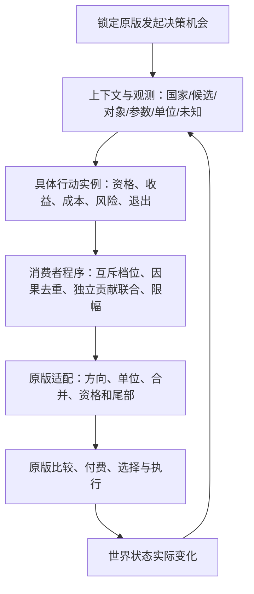

# Situated AI 架构主计划

> 架构规划 A2，2026-11-03。状态：**已授权实施；实际状态见当前工作清单与阶段收据**。
> 本页只规定战略目标、架构边界、阶段结果和完成判据。方向拆解见[架构子计划](架构子计划.md)，实际状态和下一动作见[当前工作清单](当前工作清单.md)。
> 旧 31.4 与 A1.0 草案归入[历史参考](archive/README.md)，不再发出执行指令，也不继承完成结论。

## 目标与选择依据

**Situated AI 让每个国家基于自身处境和可观测信息，在原版机制内持续做出符合自身约束与利益的相对最优决策。**

最优秀的架构在此表示：在已证实的原版接口和性能约束内，以最少的重复业务逻辑表达尽可能广而细的真实权衡；
能说明每个结果为何产生，能发现缺失接线、方向错误和未知输入，能够持续扩展并交付。不是数学上的全知最优证明。
正确性第一、速度第二、内存第三；[工程原则](../principles/工程原则.md)、[Mod 开发原则](../principles/Mod开发原则.md)、
[贡献流程](../../CONTRIBUTING.md)和[工程基线](exec/工程基线-1.0.md)持续适用。

本轮审查了现有编译器、规则、适配器和锁定原版。三种方向的取舍：

| 方向 | 判断 |
|---|---|
| 按固定优先级选第一条规则 | 适合单行动内部互斥档位，不足以联合评估独立的需求、收益和成本；不能作为全国通用决策法 |
| 在游戏中实现全国多步搜索、资源原子预留 | 原版没有承诺完整候选集、结果反馈和资源调度控制权；不可假设接口，运行成本也高 |
| **局部行动净贡献＋可观察因果反馈＋原版决策消费者** | 在真实决策时机按当前上下文评估多个目标，原版继续比较和执行；采用此方向 |

旧代码作为资产审查。解析器、底本锁、精确 reader、AST 适配、包合同和独立生成脚本求值器优先复用；
旧业务优先链、重复选择器、仅作登记的行动包装，须按实际语义迁移后退役。不得用重命名证明迁移完成。

## 架构职责

Python 只在开发期分析、编译、检查和打包；游戏中运行有限 PDX。业务分成四项职责：

1. **上下文与观测**：区分 actor、目标、辅助对象、编译期定义和完整参数；记录单位、来源、时机、已知状态。不能用目标国家代替候选法律或州。
2. **具体行动**：最小单元是具体消费者中的一个真实选择，例如某科技、某建筑、某制度、某对国条款；阈值变体不是额外行动。资格与软偏好分开。
3. **消费者程序**：同一行动内部选互斥档位，独立目标与成本共同参与，相关证据按因果来源去重，在物理字段边界一次限制扰动。不同消费者可以同时产生调整。
4. **原版适配**：每种字段按其真实连续值、倍率、布尔门、枚举、策略选择或静态模板语义处理；保留原版资格、实际成本、概率、否决、终结零分和执行。

工具链另维护两项横切能力：**独立原版能力/适配合同**与**决策追踪/独立见证**。两者用于暴露遗漏和证明生产语义，不能另建业务决策旁路。
文件布局、类名、数学曲线、固定阈值、记忆数量和生成表达式均由实施时比较决定，不在战略计划拍定。
实际选择记录在阶段结果；改变实现方案必须重新核对依赖和见证，不能悄悄改变目标。

## 必须产生的决策行为

- 需求、机会、能力、风险和已发生承诺分别建模；低识字、低行政、小国或正常借款不禁止所有经济发展。
- 直接需求可以触发低成本基础行动；增加规模或不可逆承诺时才引入相关承载和机会成本，不设全域共同“全满足门”。
- 同一行动的收益、成本和风险同时参与；成本增加能降低净支持，适用时改变方向，不能被前面的奖励分支遮蔽。
- 单个行动核心未知只影响该行动；辅助未知只退出对应增量或降至已证档位，不把未知国家当作健康，也不连带封禁独立行动。
- 联动依赖世界实际事实：已研发科技、已生效法律、真实投入/产能/威胁等。候选获高权重不代表被选中或完成。
- 互补、替代、冲突、饱和、机会成本和退出必须有实际输出区别；跨消费者只能协调倾向，不能假装原子分配国家资源。
- 使用当前世界状态形成时间反馈；新增持久记忆仅在证明额外价值、合法生命周期、存档迁移和成本后采用。不得为满足概念而增加状态。
- 同名字段的跨策略合并按字段证据处理，不能一律认定覆盖、求和或相乘。
- 不按国家标签写死路线，不赠资源、不强制行动、不修改玩家路径或原版安装。

## 广度与深度

独立扫描锁定原版建立分母，再核对每个能力的对象、字段、作用域、操作、时机、适配和生产映射。
分类区分直接、间接、观察、未知与引擎未暴露；发现未实现接口不能改名为引擎不支持。
原版合法接口中当前生产遗漏的面继续进入方向清单，不能用当前规则数量定义完整覆盖。

所有方向共同覆盖：经济/财政/建设/投入/基础设施；人口/就业/生活/迁移/教育/科技；法律/政治/利益集团/制度/行政/身份；
市场/贸易/公司；外交/条约/宗属/殖民/地区；陆海军/军需/战争/恢复；地理/国家阶段/时间反馈。
每项深度以“相同主需求、不同成本或处境，产生不同且可解释的实际输出”衡量；卡数、表格数与测试数不是目标。

## 主阶段与出口

| 阶段 | 战略结果 | 出口 |
|---|---|---|
| S0 归档与基线 | 历史只作参考，工作树可接手，已知失败真实保留；能力分母独立 | 归档身份可复核、导航一致、卫生与基线检查有结果；失败输入和迁移责任明确 |
| S1 统一语义纵切 | 观测→行动→消费者→实际PDX形成一条生产语义 | 正负项共同生效、局部未知、单位方向、一次限幅、原版尾部与独立见证通过；先纠正教育/经济平衡错位 |
| S2 发展与治理 | 经济社会知识、财政行政政治、具体选择在约束下联动 | 各具体目标已接入；直接需求/成本/饱和/未知和反例闭合，不靠全满足门 |
| S3 外部与安全 | 贸易外交宗属海外、战争军需海军与恢复相互协调 | 完整对象身份、真实威胁与承诺、跨域反馈和机会成本有生产见证 |
| S4 全迁移与结构整合 | 其余合法可接入面覆盖，旧能力有逐项处置，重复业务退役 | 单消费者单作者、无旧语义旁路、独立分母与迁移映射闭合；未解决项不隐藏 |
| S5 全 Mod 终审 | 复核所有结构和内容，静态功能、工程、资源及包合同闭合 | 功能见证、底本集成、全量回归、类型/质量/卫生全部通过；不是只审查本轮差异 |
| S6 发布与部署 | 用户可安装的标准版本，Git/Release/游戏目录一致 | 中文PR与CI合并；标签指向合并提交；确定性ZIP/SHA发布；Workshop文案同步；部署字节可复核、残留清理 |

每阶段结束先复核实际出口，更新[工作清单](当前工作清单.md)及少量结果，再提交。允许并行独立方向，但不能跳过共享语义依赖。
S0 的归档提交不等于能力分母已闭合，S1 的纵切不等于全域迁移完成，发布动作也不能补签功能完成。

## 逐项验收和变更方式

每个实现切片在编码前明确：具体原版接口/对象、期望行为、边界输入、生产路径、独立见证及适用的成本/未知/玩家/关闭/尾部反例。
见证预期由设计与原版语义独立确定，不让待测实现生成预期；必要时使用差分、性质和失败注入。
如果无法读取或控制某项能力，记录证据与限制；实现困难、测试不足或时间不足不算引擎限制。

逐项证据至少能追到：战略要求→方向任务→生产源→生成字段/表达式→测试身份→结果。临时操作表放阶段记录，
不把所有函数、数值、文件预先冻结。变更时写明新证据、保留的目的、受影响项与重新验证方式。

完整完成必须同时满足：全范围分类闭合、所有承诺功能进入生产、参考与实际PDX一致、兼容回退不退化、
旧能力迁移无遗漏、全Mod复核与工程门通过、标准交付及部署完成。任何未实现、pending或失效证据保持公开未完成。
长期游戏行为、数值平衡、游戏内性能与玩家体验由用户验收；这些不作为本轮工程出口，也不能掩盖未完成生产功能。

## 执行效率

按消费者类别批量贯穿实现，优先修真实方向/语义错误，复用锁定原版只读解析；独立子任务可并行，Git、生成锁和部署由主代理统一处理。
开发期只跑改动域见证；冻结最终候选后集中完整回归一次，失败修复后再跑必要检查。不重复已停止且无新证据的失败窗口。
不通过删断言、改测试选择、放宽资源/覆盖门或伪造收据提高速度。生成脚本采用有界组合，避免把全部事实真值做笛卡尔展开。
