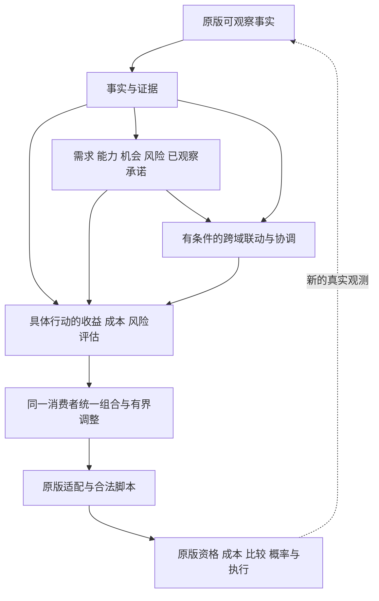

# Mod 开发原则

本页定义 Situated AI 的产品目标与持续设计约束，不是实现清单、阶段状态或行为验收报告；每条约束有稳定编号 `MP-nn`，
编号、引用和修订规则及各条的执行方式见[原则索引](README.md)。版本维护、证据分层和性能优先级的通用约束只在[工程原则](工程原则.md)写全，
本页以 `EP-nn` 引用，只写 Mod 特有部分。

## 核心目标

**Situated AI 让每个国家基于自身处境和可观测信息，在原版机制内持续做出符合自身约束与利益的相对最优决策。**

- **MP-01 未知如实标注**：未被可靠读取或实现的能力必须明确标为未知、未支持或未完成。
- **MP-02 相对最优的含义**：“相对最优”不是全知的全局最优，也不是把真实历史写死；它指国家在可观察事实、当前能力、政治阻力、财政成本、外部威胁和原版规则约束下，持续选择当前较合理且可执行的行动。
- **MP-03 不凭国名定路线**：历史合理性应来自条件与因果关系，而非国家名称专属路线；国家名称不能直接产生目标或路线，不得仅凭国家名称写死路线。

## 目标决策架构

职责分层、工程构建流水线与游戏求值分别说明；详细合同由[架构设计](../design/1.15架构设计.md)维护，生成与交付约束见
[工程交付基线](../design/exec/工程基线-1.0.md)。计划和工作清单维护目标、顺序与状态，本页不登记这些内容：

- **MP-04 行动中心、消费者收敛**：设计目标是以具体行动为中心、在原版消费者收敛的可解释决策网络。
- **MP-05 多路径并存**：独立依据、逐层派生与条件联动可同时支持同一行动；不要求每项判断穿越所有层。
- **MP-06 统一出口**：分层不代表每层都加分或各自写入PDX，各路径必须通过统一行动评价与消费者出口。
- **MP-07 工程模型不冒充运行状态**：工程中的模型、构建操作和依赖图不能冒充游戏中的调度器或运行状态。
- **MP-08 同次求值有向无环**：同次求值依赖保持有向无环，关系须有明确类型、对象和合法脚本依据；图中反馈仅跨原版执行后的新观测，不是同轮循环计算。

### 信息底座

- **MP-09 信息覆盖面**：工程研究尽可能读取、分类和解释锁定安装及相关资料，覆盖政治、人口、社会、财政、行政、生产、市场、贸易、科技、外交、宗属、军事、战争、殖民、地理、身份和时间等方面；读取范围、分母与分层证明按 EP-38、EP-40、EP-41 执行。
- **MP-10 只消费合法可观测信息**：国家运行期决策只消费对应主体、对象、作用域和时点可合法观测的信息；开发者资料不构成国家观测权（EP-42）。
- **MP-11 输入登记**：每类输入需明确原版来源、单位、可用时机、时效、未知值策略、性能成本和可连接的原版消费者。
- **MP-12 不可见状态保持未知**：无法可靠读取的引擎内部状态不得被假定为已知，也不得把未暴露的历史或引擎状态当作输入；读取与接线缺口按 EP-43 登记。
- **MP-13 国家全集**：国家覆盖必须先定义可作为 AI 行动主体的国家全集、排除条件和覆盖处置。
- **MP-14 逐主体处置**：每个主体都要有可追溯的事实、行动消费者、原版保留或明确的未知/不支持处置，不能用少量代表国家或领域开关代替“每个国家”。
- **MP-15 逐国观测登记**：逐国观测覆盖还需按主体、目标、消费者和评估时点登记来源、合法读取能力、时效、性能预算及缺失回退。
- **MP-16 缺失不当作健康**：无法证明某项观测在相应时点可用时，保留 `unknown`，不得假定国家处于健康或把缺失当作零；高档辅助事实缺失只能使用已证实的低档。
- **MP-17 行动卡是最小决策单元**：行动卡是最小决策单元；旧条件规则只能作为卡内部逻辑或适配基础设施，不能绕过内核直接写权重。
- **MP-18 判断可追到生成脚本**：每个声称参与判断的状态、目标、成本、关系和时间因素必须能追到实际生成脚本及正反见证；生成期模型或辅助合同存在不能替代生产实现。
- **MP-19 各决策面分别登记**：全领域不是把同一倍率复制到所有字段。各决策面都要分别登记事实、单位、作用域、未知策略、协调需求和实际原版消费者，形成从事实、行动评价到具体消费者的可追溯联系，按需加入处境派生与协调。
- **MP-20 无生产接线即未完成**：只有信息登记、注释或计划而没有生产接线时，仍视为未完成。
- **MP-21 广度与深度分别证明**：领域开关不证明其中各领域具有相同深度。广度从独立原版盘点建立分母，再与具体行动和绑定关联；每个细分域应能查到真实事实、协调关系、原版消费者、权衡和未知回退。

### 国家画像与综合权衡

- **MP-22 国家画像**：将信息归纳为有限而可解释的状态维度，例如财政承受力、行政能力、政治稳定与改革空间、社会发展、产业和市场能力、军事安全、外交压力、教育与科技阶段、海外投射、身份宗属和短期危机。画像只为原版行动评估提供依据，不创造原版不存在的资格、资源或强制行动。
- **MP-23 先资格后权衡**：先依据已证实的原版必要资格识别不可行行动，成本与国家能力作为相关行动的约束和权衡因素；在单位和作用域明确的因素间权衡生存稳定、经济财政、军事安全、外交收益、长期目标、政治可行性、机会、风险、行政负担和路线冲突。
- **MP-24 不设万能分数**：不同单位不可直接相加成缺乏含义的万能分数；结论应能追溯到输入、约束、权重和最终消费者。
- **MP-25 消费者内的相对最优**：“相对最优”只在每个原版消费者内定义为有界相对偏好和原生比较：先依据该消费者实际提供的候选集合和原版资格排除不可行项，再在可比较的收益、成本与风险项间形成有依据的排序或非支配选择。
- **MP-26 保守回退与随机语义**：未知事实、未知成本和不可见候选必须按该消费者声明的保守回退处理；并列、稳定顺序和原版随机语义必须保留可追溯的 `tie-break`/随机处理。
- **MP-27 不设全局规划器**：不得引入跨消费者的万能总分、全局规划器或未经原版支持的资源互斥，也不得把“有界偏好”写成已经保证实际行动选择最优。
- **MP-28 国家利益须声明**：国家利益必须有明确声明：每个国家的目标项要有可观察来源、适用主体和对象、期限、相对现状的比较基准，并声明目标之间的冲突、并存或取舍关系及其最终消费者。没有足够来源或消费者接线的利益项标为未知或未完成。
- **MP-29 承受能力与领域需求分开**：承受能力与领域需求分开：严重偿付问题优先恢复，战败后优先重建再考虑扩张，战时新增承诺仍受可负担约束；低识字率、行政欠缺、小国规模或正常低债借款不能成为所有发展的全局禁令。
- **MP-30 法律与发展阶段**：法律调整依据政治可行性，国家发展阶段不预设统一意识形态。
- **MP-31 处境时点与重评**：处境记录在合法原版消费者时机可用的事实、派生状态和证据时点，并声明何时重评、何时失效以及如何跨原版执行与新的观测传递。
- **MP-32 时效与幂等**：快照和重评必须有 TTL、失效、重复执行幂等及存档边界；无法保证时效、顺序或幂等时，必须标为 `unknown`，局部回退原版行为，不得继续声称持续决策已成立。
- **MP-33 持久记忆**：持久记忆仅在证明独立决策价值、合法生命周期、性能和存档边界后使用。记忆只影响有界偏好，不代表行动已完成，也不能禁止其他领域的合理基础行动。
- **MP-34 影子预算**：影子预算只表达倾向和机会成本，不分配真实资源。
- **MP-35 同一效应不重复计入**：共享证据与效应身份分开：同一事实可以支持对象、目标或因果后果不同的真实收益和成本；同一效应换名、换路径或换领域后仍不得重复计入。
- **MP-36 联动只表达残差**：联动项只表达独立项之外有依据的交互残差，或显式替代原有项；不能把整项收益再奖励一次。增加判断深度不得无故抹去已知独立项。
- **MP-37 收益成本完整性组**：若某项收益的成立必须同时掌握相关成本，两者属于同一完整性组；必需成本未知时，整组按声明局部退出或保守回退，不能仅删除成本而保留乐观收益，其他完整且独立的项仍可参与。
- **MP-38 原版成本不重复加罚**：原版已经计入的成本与约束须明确保留，不得无依据再加罚；保留原版执行也不等于模型已读懂或控制该成本。

### 冲击、惯性与公平

- **MP-39 冲击须有可观察依据**：战争失败、市场危机、改革机会等因素，只有在原版可观察信息和合法评估时机支持时才能改变行动倾向。
- **MP-40 路线惯性**：普通波动应平滑处理；路线切换需有合理惯性、冷却或成本，避免 AI 反复摇摆。

## 原版兼容与行为边界

- **MP-41 Mod 版本范围**：Mod 只适配最新正式稳定版游戏，并与工程共用唯一有效版本基线（EP-06、EP-07）；不维护旧版本 Mod 变体，也不承诺旧游戏版本或跨游戏版本存档兼容。
- **MP-42 Mod 旧版本清退**：升级后移除旧游戏版本专属政策副本、脚本、适配和兼容分支；当前版本仍有效的既有功能与国家决策语义须迁移、重新生成和验证，不能因其来自旧版而直接删除。清退顺序、历史材料与证据保留按 EP-10 至 EP-15 执行。
- **MP-43 新底本重新证明**：版本身份按 EP-08 核验，不能仅凭版本字符串、安装目录或旧收据声称适配完成；当前 Mod 的字段、作用域、原版资格/成本/尾部、未知回退及全部生产接线须在同一新底本上重新证明。
- **MP-44 兼容范围**：兼容范围以[工程交付基线](../design/exec/工程基线-1.0.md)锁定的原版为准，底本漂移按 EP-09 先重新分析、验证和生成；第三方 Mod 的兼容性不作承诺，除非被单独分析和验证。
- **MP-45 只用已核实的原版接口**：只使用已核实的原版字段、触发器、效果、作用域、钩子、策略消费者和合法路径。
- **MP-46 保留原版语义**：保留原版实际成本、资格、前置、政治支持、随机、限幅、拒绝、终结零分、执行及回退语义。
- **MP-47 条件化有界调整**：Mod 通过合法原版消费者对 AI 倾向作条件化、有界调整；不整体替换 AI、不强制执行行动、不赠送资源、不改变玩家决策路径。
- **MP-48 不靠削弱制造差异**：不以全局惩罚或削弱国家来制造表面上的 AI 差异。
- **MP-49 局部回退原版**：关闭、不可用或核心输入未知时应局部回退原版行为；让错误在生成或静态检查中显式可见。
- **MP-50 字段唯一作者**：同一生产字段只能有一个作者。
- **MP-51 一次有界调整**：适用的正负贡献联合评估后形成一次有界调整，不以奖励优先链屏蔽成本。
- **MP-52 活跃策略覆盖**：活跃原版策略定义的同名字段可能覆盖默认策略；脚本静态可见不能证明引擎如何合并或覆盖，不把默认策略接线等同于所有活跃策略均生效。

## 性能与稳定性

正确性与性能的优先级见 EP-01。

- **MP-53 复用原版求值**：优先使用原版已有消费者和求值时机，避免全世界扫描、常驻服务、冗余持久状态、重复求值和无界缓存。
- **MP-54 Mod 优化保持原版语义**：优化必须保持原版执行语义、未知值处理和回退行为（EP-02 的 Mod 侧），性能结论按 EP-44、EP-45 取得；静态复杂度预算不能替代引擎性能实测。

## 本地化与命名

- **MP-55 全语言覆盖**：生产本地化覆盖锁定游戏版本支持的全部语言。
- **MP-56 同键与校验**：各语言维护同一组自有键，并校验语言头、键集合、占位符、路径和交付编码。
- **MP-57 译文如实标注**：未完成的译文不得伪装成完整支持。
- **MP-58 稳定命名**：稳定展示名为 `Situated AI`，Mod ID 为 `situated-ai`，PDX 内部资源使用 `sitai_` 前缀；版本和包文件细节由生成源与交付基线维护。

## 验收

- **MP-59 两类验收**：静态工程检查证明工具、生成和交付合同；Mod功能验收证明声明的判断真实接入行动与消费者并保持语义。
- **MP-60 缺口不转交用户**：前两类缺口由实现与验证补齐，不能转交用户体验验收；也不能通过缩范围或伪标引擎不支持获得完成。
- **MP-61 逐项核对**：Mod 功能验收逐项核对事实到行动到消费者的接线、参考/PDX 等价，以及字段、作用域、方向、原版资格与成本、随机、回退、包结构和编码。
- **MP-62 运行时命题另证**：运行时命题另需对应的引擎加载、实际求值、执行时机或跨时点重评证据；未完成相应实测时明确标为未验证或未知。
- **MP-63 静态不代签运行时**：脚本合法、生成成功、加载成功、评分变化和根 hook 记录各自只证明其覆盖范围（EP-37）；模型、构建期快照和静态通过不能代签运行时或持续决策目标已完成。
- **MP-64 用户实机验收**：长期国家行为、数值平衡、游戏内性能和玩家体验由用户在固定版本与哈希的交付包上实机验收；不以这些尚未完成阻塞已具备充分证据的静态阶段出口。
- **MP-65 反馈材料只作辅助**：日志、存档、快照和观察工具是反馈辅助能力，不要求用户开启常驻探针或承担新的长期观测流程。用户提供版本、包哈希、启用 Mod 集、存档和日志后，可据可复核证据辅助分析与修复；这些材料不能替代实现、静态验收或声明的发布功能验证。

阶段顺序、出口和当前状态由计划与工作清单维护，不在本页登记。
